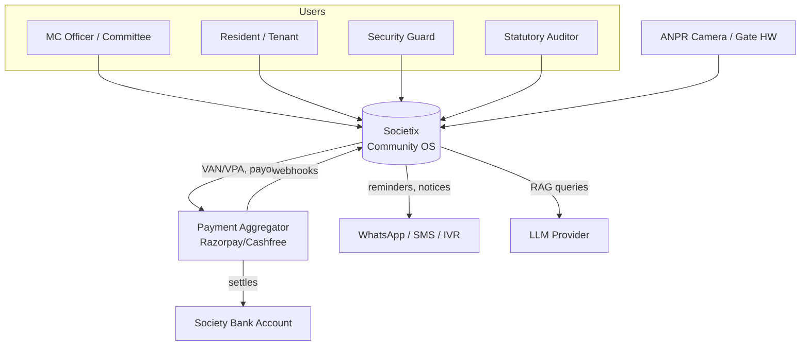
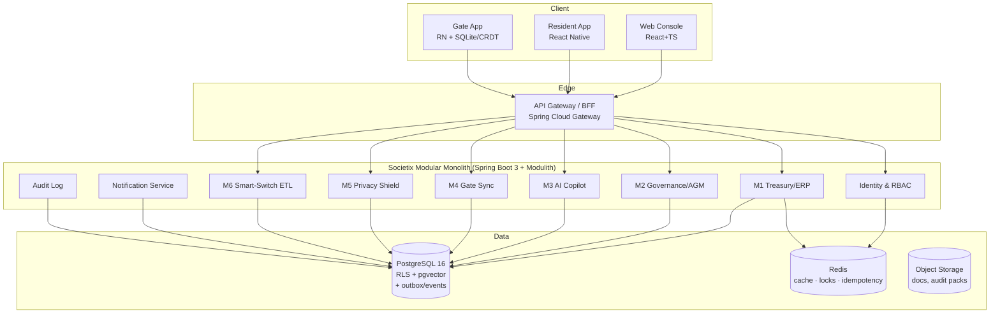
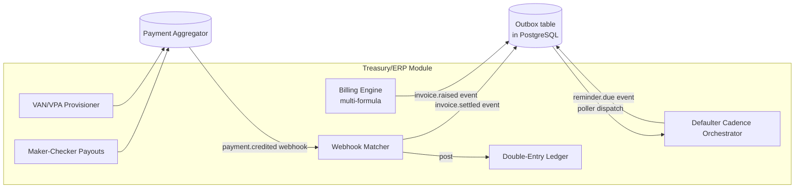
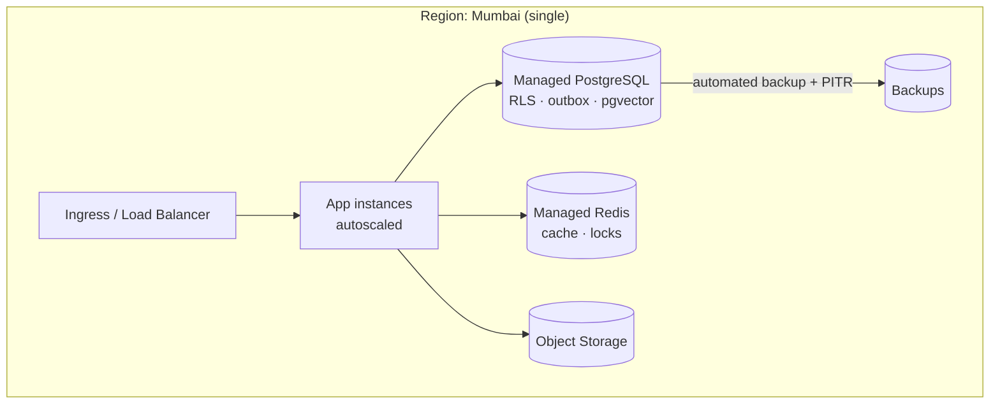

# 01 — Architecture

**Document:** `SOC-DOC-01` · **Status:** Anchor document — all other docs reference this one.

This document defines the system architecture: the C4 views, the event-driven topology, the
multi-tenancy model, and how the BRD non-functional requirements map to design decisions.

---

## 1. Architectural principles

1. **Modular monolith first.** One deployable Spring Boot application partitioned into
   well-bounded modules via **Spring Modulith**; extract to services only when scale demands it.
   Rationale in [ADR-0001](adr/0001-modular-monolith-spring-modulith.md).
2. **Event-driven core (broker-free v1).** Treasury allocation, defaulter cadence, and
   notifications are driven by domain events written to a **Postgres transactional outbox** and
   handled by in-process Spring listeners + scheduled pollers — the "autonomous" behavior is
   asynchronous reactions to events, with **no message broker** to run early on. The event contract
   is transport-agnostic so a broker (Kafka) can be slotted in at scale.
3. **Privacy & tenancy by construction.** Every row is tenant-scoped; PostgreSQL **RLS** enforces
   isolation at the database, not just the application. No third-party tracking SDKs anywhere.
4. **No float.** Money never flows through Societix; the Payment Aggregator settles to the society
   account and notifies us via webhook.
5. **Offline-tolerant edge.** The gate app is authoritative offline (local SQLite) and reconciles
   via CRDTs on reconnect.
6. **Auditable & deterministic.** Ledger postings and votes are append-only and tamper-evident.

## 2. C4 — Level 1: System Context



## 3. C4 — Level 2: Containers



> **Economical-first note.** There is **no message broker** in the first version. Asynchronous,
> "autonomous" behaviour is implemented with a **Postgres transactional outbox** plus in-process
> Spring events (`@TransactionalEventListener`) and scheduled pollers (`@Scheduled` + ShedLock for
> single-firing across pods). The domain-event contract below is broker-agnostic, so introducing
> Kafka later (at scale) is a drop-in swap of the transport — see
> [ADR-0004](adr/0004-kafka-event-driven-cadence.md). This removes a whole piece of
> infrastructure (and its cost/ops) while keeping the event-driven design intact.

## 4. C4 — Level 3: Component (illustrative — M1 Treasury)



## 5. Event-driven topology

The BRD's "autonomous ERP engine" is realized as domain events written to a **transactional
outbox** table in PostgreSQL (same transaction as the state change), then dispatched by in-process
listeners and scheduled pollers. The event **contract** is broker-agnostic — each event below is a
logical message type (an outbox event), not a broker topic. Events are keyed by `tenantId`.

| Event | Produced by | Consumed by | Purpose |
|---|---|---|---|
| `billing.invoice.raised` | M1 Billing | M1 Ledger, Notification | New invoice generated |
| `payment.settled` | M1 Matcher (from PA webhook) | M1 Ledger, M1 Cadence | Zero-touch allocation |
| `payment.unmatched` | M1 Matcher | Ops queue | Needs manual allocation |
| `defaulter.stage.advanced` | M1 Cadence | Notification | Day +1/+10/+15/+30 escalation |
| `agm.vote.cast` | M2 Voting | M2 Tally, Audit | Cryptographic ballot event |
| `gate.visit.logged` | M4 Sync | M5 Purge scheduler, Notification | Visitor event (30-day TTL) |
| `privacy.purge.due` | M5 Scheduler | M5 Purge worker | 30-day auto-delete of visitor PII |
| `audit.action.recorded` | all | Audit log (append-only) | Tamper-evident trail |

**Mechanism (v1, economical):**
- **Write:** producers insert the event row into the `outbox` table inside the same DB transaction
  as the business change (no dual-write, no lost events).
- **Dispatch:** a `@Scheduled` poller (guarded by **ShedLock** so only one pod fires) reads
  unprocessed outbox rows and invokes the relevant in-process handlers; time-based events
  (defaulter cadence Day +1/+10/+15/+30, 30-day purge) are driven by scheduled jobs that query due rows.
- **Delivery semantics:** at-least-once; consumers are **idempotent** (Redis idempotency keys +
  unique constraints). Ledger postings rely on the outbox for consistency.

**Upgrade path:** when per-tenant volume warrants it, the same outbox rows can be relayed to **Kafka**
(or Redis Streams) by swapping the dispatcher — handlers and event contracts stay unchanged. Tracked
in [ADR-0004](adr/0004-kafka-event-driven-cadence.md).

## 6. Multi-tenancy model

- **Isolation:** shared schema, **row-level** tenancy. Every tenant-owned table has a non-null
  `tenant_id`; PostgreSQL **RLS** policies filter by a session GUC (`app.tenant_id`) set per request.
- **Context propagation:** the API gateway resolves `tenantId` from the authenticated principal and
  passes it downstream; a Spring `OncePerRequestFilter` opens a connection and executes
  `SET LOCAL app.tenant_id = :tid` inside the request transaction.
- **Keys:** per-tenant data-encryption keys (envelope encryption) for sensitive columns (visitor PII,
  bank identifiers). See [ADR-0002](adr/0002-postgres-rls-multitenancy.md) and
  [`03-data-model.md`](03-data-model.md).
- **Noisy-neighbor:** per-tenant rate limits (Redis) at the gateway; the outbox poller processes in
  tenant-fair batches. *(At scale, a broker with per-tenant partitions is the upgrade path — [ADR-0004](adr/0004-kafka-event-driven-cadence.md).)*

```mermaid
sequenceDiagram
    participant C as Client
    participant GW as API Gateway
    participant APP as Spring App (RLS filter)
    participant DB as PostgreSQL (RLS)
    C->>GW: request + JWT (tenant, roles)
    GW->>APP: forward + X-Tenant-Id
    APP->>DB: BEGIN; SET LOCAL app.tenant_id = tid
    APP->>DB: query (RLS auto-filters by tenant_id)
    DB-->>APP: tenant-scoped rows only
    APP-->>C: response
```

## 7. NFR → design mapping (BRD §10)

| NFR | Design response |
|---|---|
| Gate check-in < 1.5 s | Edge-local decision (SQLite); async push via FCM/APNs high-priority; gate reads never hit cloud on the hot path |
| Zero loss over 6-hr blackout | SQLite WAL + CRDT merge on reconnect; see [dd-02](deep-dives/dd-02-offline-gate-crdt.md) |
| 99.95% availability | Stateless app pods (managed container host, autoscaled), managed-Postgres automated failover + PITR backups. *(Single-region v1; multi-region active-passive is a documented later step.)* |
| AI query < 2.5 s | Pre-computed pgvector embeddings of bylaws & ledger; retrieval-augmented prompt; result cache in Redis *(M3 is a Phase-2 feature)* |
| Data isolation | PostgreSQL RLS + per-tenant keys; tested by tenancy integration tests |
| Immutable audit | Append-only, hash-chained audit table; writes via DB trigger, no UPDATE/DELETE grant |

## 8. Cross-cutting concerns

Detailed in [`02-system-design.md`](02-system-design.md): authN/authZ (OIDC + RBAC), the uniform
error model, idempotency, pagination, i18n (8 languages), the notification fan-out (in-app →
WhatsApp → SMS → IVR), and observability.

## 9. Deployment topology

**v1 (economical): single region, managed services.** Run on a managed container host with
**managed PostgreSQL** (automated backups + point-in-time recovery) and **managed Redis**. No
message broker, no second region — this minimizes both monthly spend and the ops burden on a small
team.



**Scale-up path (documented, not built yet):** add a passive standby region with streaming
replication, promote autoscaling, and introduce a message broker — see
[`delivery/cicd-devops.md`](delivery/cicd-devops.md) and [ADR-0004](adr/0004-kafka-event-driven-cadence.md).

Infra details (manifests/PaaS config, IaC, secrets, rollback) in [`delivery/cicd-devops.md`](delivery/cicd-devops.md).

## 10. Key architecture decisions (ADRs)

| ADR | Decision |
|---|---|
| [0001](adr/0001-modular-monolith-spring-modulith.md) | Modular monolith with Spring Modulith |
| [0002](adr/0002-postgres-rls-multitenancy.md) | PostgreSQL RLS for multi-tenancy |
| [0003](adr/0003-payment-aggregator-no-float.md) | Payment Aggregator, no float held |
| [0004](adr/0004-kafka-event-driven-cadence.md) | Event-driven via Postgres outbox now; Kafka deferred to scale |
| [0005](adr/0005-offline-gate-sqlite-crdt.md) | Offline gate: SQLite + CRDT |
| [0006](adr/0006-crypto-evoting-scheme.md) | Cryptographic e-voting scheme |
