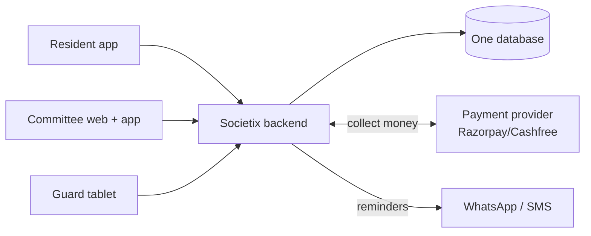

# 01 — Start Here

**What this is:** the first thing to read. By the end you'll know what Societix is, who uses it, and
how to run it on your own machine.
**Who should read it:** everyone on the team, day one.

---

## What are we building?

Indian apartment complexes ("housing societies") are run by a small group of **unpaid resident
volunteers** — usually a Secretary and a Treasurer, together called the **Managing Committee**. They
collect monthly maintenance fees, chase people who don't pay, keep the accounts, run the annual
meeting where owners vote on things, and manage the security guard at the gate. Today they do most of
this with spreadsheets, WhatsApp groups, and a lot of weekend effort.

**Societix replaces all that manual work with software.** Our one-line pitch: *"minimise the
secretary"* — turn hours of volunteer admin into a few taps.

We're also deliberately **privacy-first**: unlike competitors (MyGate, NoBrokerHood), we show **no
ads** and never sell resident data. That's both an ethical stance and a legal one (India's data-
protection law, the **DPDP Act** — think India's version of Europe's GDPR — carries huge fines for
mishandling personal data).

## Who uses it? (the main people)

- **Committee (Secretary / Treasurer):** runs the society. Uses a web dashboard + mobile app.
  Approves payments, chases defaulters, runs meetings. *This is our most important user.*
- **Resident (owner or tenant):** lives there. Uses a mobile app to pay maintenance, invite visitors,
  and vote in meetings.
- **Security guard:** sits at the gate. Uses a tablet app to log visitors — and it has to work even
  when the building's internet is down.

(There are a few more — auditor, platform admin — but these three drive almost everything.)

## The product in one picture



One backend (the server program we write), one database, a few front-end apps, and a couple of
outside services (a payment provider to collect money, WhatsApp/SMS to send reminders).

## What it's built with (the 30-second version)

- **Backend:** **Java** with **Spring Boot** (the most popular framework for building Java web
  servers). One program, split cleanly into 6 parts ("modules").
- **Database:** **PostgreSQL** (a reliable, free, open-source database).
- **Apps:** **React** for the web dashboard, **React Native** for the phone apps (lets us write one
  codebase for both iPhone and Android).
- **Hosting:** managed cloud services (someone else runs the servers/database for us, so 3 people
  aren't stuck doing server babysitting).

Full reasoning for each choice is in [03 — Tech Choices](03-tech-choices.md). Every unfamiliar word
is in the [Glossary](06-glossary.md).

## Run it on your laptop (the short version)

> This is the target workflow for once the project skeleton exists (the first tasks in the
> [backlog](jira/backlog.md) set this up). Keeping it here so we all aim for the same thing.

You need: **Java 25 (LTS)**, **Docker Desktop** (runs the database/cache in containers so you don't
install them by hand), and **Node.js 26 (LTS)** (for the web/app front-ends).

```bash
# 1. start the database + cache locally (Docker reads a file called docker-compose.yml)
docker compose up -d

# 2. run the backend (Maven Wrapper compiles + starts the server)
(cd backend && ./mvnw spring-boot:run)

# 3. run the web app in another terminal
cd web && npm install && npm run dev
```

Then open the web app in your browser and log in as the demo Secretary account (the setup tasks seed
one). If something fails, the troubleshooting notes live in the backlog's setup tasks.

## Where things live (once we start)

```
societix/
├── backend/      # the Java/Spring Boot server (the 6 modules live here)
├── web/          # the React web dashboard (for the committee)
├── mobile/       # the React Native app (residents) + the gate app (guards)
├── docs/         # you are here
└── docker-compose.yml   # local database + cache
```

## Next

Read [02 — How It Works](02-how-it-works.md) to see how the pieces fit together.
