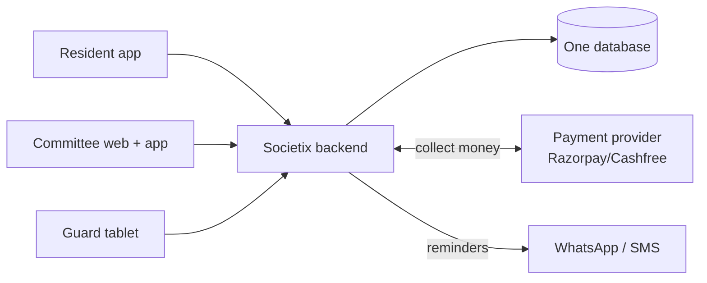

# 01 — Start Here

**What this is:** the first thing to read. By the end you'll know what Societix is, who uses it, and
how to run it on your own machine.
**Who should read it:** everyone on the team, day one.

---

## What are we building?

Indian apartment complexes ("housing societies") are run by a small group of **unpaid resident
volunteers** — usually a Secretary and a Treasurer, together called the **Managing Committee**. They
collect monthly maintenance fees, chase people who don't pay, keep the accounts, run the annual
meeting where owners vote on things, and manage the security guard at the gate. Today they do most of
this with spreadsheets, WhatsApp groups, and a lot of weekend effort.

**Societix replaces all that manual work with software.** Our one-line pitch: *"minimise the
secretary"* — turn hours of volunteer admin into a few taps.

We're also deliberately **privacy-first**: unlike competitors (MyGate, NoBrokerHood), we show **no
ads** and never sell resident data. That's both an ethical stance and a legal one (India's data-
protection law, the **DPDP Act** — think India's version of Europe's GDPR — carries huge fines for
mishandling personal data).

## Who uses it? (the main people)

- **Committee (Secretary / Treasurer):** runs the society. Uses a web dashboard + mobile app.
  Approves payments, chases defaulters, runs meetings. *This is our most important user.*
- **Resident (owner or tenant):** lives there. Uses a mobile app to pay maintenance, invite visitors,
  and vote in meetings.
- **Security guard:** sits at the gate. Uses a tablet app to log visitors — and it has to work even
  when the building's internet is down.

(There are a few more — auditor, platform admin — but these three drive almost everything.)

## The product in one picture



One backend (the server program we write), one database, a few front-end apps, and a couple of
outside services (a payment provider to collect money, WhatsApp/SMS to send reminders).

## What it's built with (the 30-second version)

- **Backend:** **Java** with **Spring Boot** (the most popular framework for building Java web
  servers). One program, split cleanly into 6 parts ("modules").
- **Database:** **PostgreSQL** (a reliable, free, open-source database).
- **Apps:** **React** for the web dashboard, **React Native** for the phone apps (lets us write one
  codebase for both iPhone and Android).
- **Hosting:** managed cloud services (someone else runs the servers/database for us, so 3 people
  aren't stuck doing server babysitting).

Full reasoning for each choice is in [03 — Tech Choices](03-tech-choices.md). Every unfamiliar word
is in the [Glossary](06-glossary.md).

## Run it on your laptop

You need: **Java 25 (LTS)**, **Docker** (Docker Desktop, or Docker Engine with the Compose plugin;
it runs the database, cache and payment mock in containers so you don't install them by hand), and
**Git**. **Node.js 26 (LTS)** is only needed once the web/mobile apps exist (later backlog tasks).

```bash
# 1. get the code (work happens on the master branch)
git clone --branch master https://github.com/ayushrai007/Societix.git societix
cd societix

# 2. create your local settings file (git-ignored; the defaults work as-is)
cp .env.example .env
set -a; source .env; set +a

# 3. start Postgres + Redis + the payment mock and wait until they are all healthy
docker compose up -d --wait
docker compose ps            # postgres, redis and pa-sandbox should all show (healthy)

# 4. run the backend (the Maven Wrapper downloads Maven, compiles and starts the server)
cd backend
./mvnw spring-boot:run
```

In another terminal, check the backend is up and connected to the database:

```bash
curl -s http://localhost:8080/actuator/health    # {"groups":["liveness","readiness"],"status":"UP"}
```

The health check includes the database, so it reports `DOWN` (HTTP 503) if the backend can't reach
Postgres. Stop the backend with `Ctrl+C`.

What `docker compose up` starts (defined in `docker-compose.yml`, settings in `.env`):

| Service | What it is | Local address |
|---|---|---|
| `postgres` | PostgreSQL 18 with pgvector 0.8.7 (`pgvector/pgvector:0.8.7-pg18`) | `localhost:5432`, database/user/password `societix` |
| `redis` | Redis 8.2 (`redis:8.2-alpine`) | `localhost:6379` |
| `pa-sandbox` | Payment-aggregator mock (MockServer) standing in for Razorpay/Cashfree; responses in `infra/pa-mock/pa-expectations.json` | `http://localhost:1080` (try `curl http://localhost:1080/pa/status`) |

There is no message broker: events go through a table in Postgres (the "outbox", see
[ADR-0008](adr/0008-postgres-outbox-no-broker.md)).

Everyday commands (run from the repository root):

```bash
docker compose ps              # what's running and whether it's healthy
docker compose logs -f postgres  # follow one service's logs
docker compose down            # stop everything (your data is kept)
docker compose down -v         # stop and delete the local database for a clean start
cd backend && ./mvnw test      # run the backend tests (needs Docker running; they start their own containers)
```

The database has two roles: `societix` owns the schema and runs migrations, and the backend
itself connects as `societix_app`, which row-level security applies to (see
[database-migrations.md](database-migrations.md)). If your local database was created before
`societix_app` existed, run `docker compose down -v` once so it is recreated with both roles.

If a port is already taken on your machine (say another Postgres on 5432), change `DB_PORT`,
`REDIS_PORT` or `PA_MOCK_PORT` in `.env`; both Docker Compose and the backend read it.

## Where things live (once we start)

```
societix/
├── backend/      # the Java/Spring Boot server (the 6 modules live here)
├── web/          # the React web dashboard (for the committee)
├── mobile/       # the React Native app (residents) + the gate app (guards)
├── docs/         # you are here
├── infra/        # local-only support files (e.g. the payment mock's responses)
└── docker-compose.yml   # local database + cache + payment mock
```

## Next

Read [02 — How It Works](02-how-it-works.md) to see how the pieces fit together.
