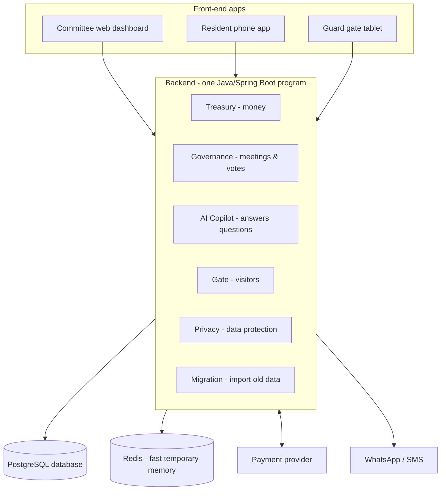

# 02 — How It Works

**What this is:** the big picture, in plain English — how the parts of Societix fit together.
**Who should read it:** everyone, before touching code.

---

## The whole system on one page

## The key idea: one program, one database

We are **not** building lots of separate mini-servers (that's called "microservices" and it's a lot
of extra work to run — overkill for 3 people and an early product). Instead we build **one program**
("a modular monolith" — *monolith* = one deployable program; *modular* = cleanly divided inside).
Each of the 6 modules is a separate folder with clear boundaries, so later — if we ever get huge — we
could split one out. Until then, one program is far simpler to build, test, and deploy.

Likewise **one database** (PostgreSQL) holds every society's data. We keep each society's data
private from every other society using a PostgreSQL feature called **Row-Level Security** (RLS) —
basically the database itself refuses to show society A's rows to a request acting for society B,
even if our code has a bug. ("Tenant" = one society; "multi-tenant" = many societies sharing one
system safely.)

## How "automatic" things happen (the outbox — our replacement for Kafka)

A lot of Societix is *automatic*: when a payment arrives, the ledger updates and a receipt goes out;
when a bill is 10 days overdue, a reminder fires on its own. These are **reactions to events**.

Big systems often use a dedicated "message broker" (a tool called **Kafka**) to pass these events
around. We deliberately **don't** — Kafka is expensive to run and total overkill at our size.

Instead we use a dead-simple trick called the **outbox pattern**: when something happens, we write a
little "to-do" row into an `outbox` table in the same database, in the same save. A **background job
that runs every few seconds** reads new rows and does the follow-up work (send the reminder, post the
receipt). That's it — no extra infrastructure, just a table and a timer.

Because the event is saved in the *same database save* as the change that caused it, we can never
"update the ledger but lose the reminder" — they succeed or fail together.

> We wrote this so that swapping in Kafka later (if we ever truly need it) is easy — the event names
> stay the same, only the delivery mechanism changes. See the decision record in
> [`archive/adr/0004-kafka-event-driven-cadence.md`](archive/adr/0004-kafka-event-driven-cadence.md).

## Money never touches us

When a resident pays maintenance, the money goes **straight to the society's own bank account**
through a licensed **payment provider** (Razorpay or Cashfree — "payment aggregators"). Societix is
only the software in between; **we never hold anyone's money.** This keeps us out of a whole category
of banking regulation (handling other people's funds requires special RBI licensing — we avoid it
entirely). The payment provider just pings our backend ("payment received for flat B-1204") and we
update the records.

## The gate works offline

The security gate often sits in a basement with flaky internet. So the guard's tablet app stores
everything **locally first** (in a small on-device database) and syncs up to the server when the
connection returns. A visitor check-in must work in under 1.5 seconds even with no internet. The
clever bit that merges offline changes without conflicts is explained in
[04 — The 6 Modules](04-the-6-modules.md#m4) and, in depth, in the archive.

## The 6 modules in two sentences each

1. **Treasury (M1)** — the money. Creates monthly bills, collects payments automatically, chases
   people who don't pay, and keeps proper double-entry accounts.
2. **Governance (M2)** — society meetings and voting. Sends the legally-required meeting notices,
   tracks who's attending, and runs secret, verifiable online votes.
3. **AI Copilot (M3)** — a helper that answers plain-English questions about the society's finances
   and rules, and drafts meeting minutes. (A "nice to have" we build later.)
4. **Gate (M4)** — the security gate. Logs visitors, scans pre-approved QR codes, reads vehicle
   number plates, and keeps working offline.
5. **Privacy (M5)** — data protection. Guarantees no ads/trackers, auto-deletes visitor data after
   30 days, and lets residents control who sees their details.
6. **Migration (M6)** — moving in. Imports a society's old data (from Tally, Excel, or MyGate) so
   they don't start from a blank slate.

More detail on each in [04 — The 6 Modules](04-the-6-modules.md).

## What we build first

We don't build all 6 at once. Rough order:
1. **Foundations** — the skeleton: log in, keep societies' data separate, the outbox, basic plumbing.
2. **Treasury (M1) + Gate (M4)** — the two things that deliver real value fastest. Privacy (M5) is
   built in from the start, not bolted on.
3. **Governance (M2), Copilot (M3), Migration (M6)** — once the core is solid.

The full who-does-what-when is in [05 — Building It](05-building-it.md).
