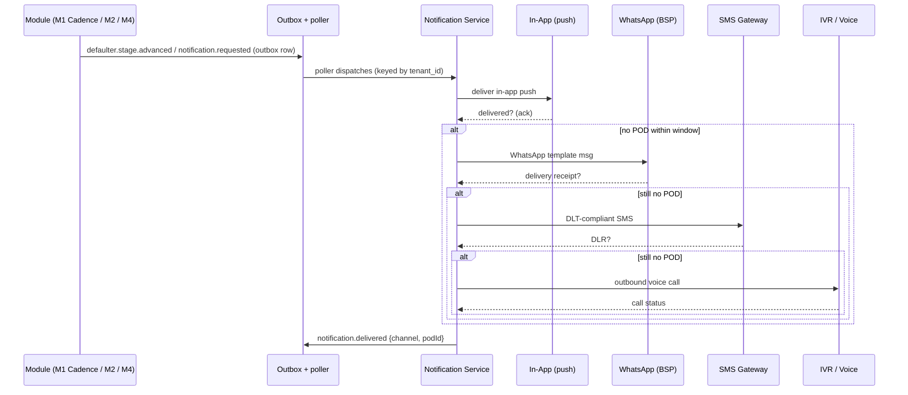

# 02 — System Design (Cross-Cutting Concerns)

**Document:** `SOC-DOC-02`

This document specifies the concerns that span every module: authentication/authorization,
the gateway/BFF, the uniform error model, idempotency, pagination, i18n, notification fan-out,
observability, and concurrency control. It builds on the C4 views, event (outbox) catalogue, and RLS
tenancy flow defined in [architecture](01-architecture.md); those are referenced, not repeated.
See the [glossary](glossary.md) for terms and the [data model](03-data-model.md) for schema.

---

## 1. Authentication & Authorization

### 1.1 Login (OIDC / JWT)

Societix uses OpenID Connect (Authorization Code + PKCE for web/mobile). The platform runs an
OIDC provider (Keycloak-compatible) issuing short-lived access tokens (JWT, 15 min) and
refresh tokens (rotating). Residents additionally support OTP-first onboarding (phone number),
after which an OIDC identity is bound.

```mermaid
sequenceDiagram
    participant U as User (Web/Mobile)
    participant GW as API Gateway / BFF
    participant IDP as OIDC Provider
    participant APP as Spring App (RLS filter)
    participant DB as PostgreSQL (RLS)

    U->>IDP: Auth Code + PKCE (login / OTP)
    IDP-->>U: id_token + access_token (JWT) + refresh_token
    U->>GW: GET /api/v1/invoices  (Authorization: Bearer <JWT>)
    GW->>GW: Validate JWT sig (JWKS), exp, aud, iss
    GW->>GW: Extract claims: sub, tenant_id, roles[]
    GW->>APP: forward + X-Tenant-Id + X-Roles (signed)
    APP->>DB: BEGIN; SET LOCAL app.tenant_id = :tenant_id
    APP->>DB: query (RLS auto-filters by tenant_id)
    DB-->>APP: tenant-scoped rows
    APP-->>U: 200 + body
```

### 1.2 Claims → tenancy

The JWT carries the tenancy and authorization context. The gateway validates the signature
against the IdP JWKS and forwards the resolved identity downstream:

| Claim | Example | Purpose |
|---|---|---|
| `sub` | `usr_8f2a…` | Stable user id |
| `tenant_id` | `soc_maple_01` | Society (tenant) — drives the RLS GUC `app.tenant_id` |
| `roles` | `["TREASURER","OWNER"]` | RBAC enforcement |
| `unit_ids` | `["B-1204"]` | Row scoping for resident-owned data |
| `scope` | `payments:write` | Fine-grained OAuth scopes for machine clients |

A user may hold multiple roles across one society (e.g. an Owner who is also Treasurer). The
gateway re-signs the forwarded `X-Tenant-Id`/`X-Roles` headers with an internal key so the
app trusts them only from the gateway. The app opens the request transaction and runs
`SET LOCAL app.tenant_id = :tenant_id` — see the RLS flow in [architecture](01-architecture.md) §6.

### 1.3 RBAC matrix (roles × key permissions)

| Permission | Platform Admin | Secretary | Treasurer | Committee Member | Owner | Tenant | Guard | Auditor |
|---|:--:|:--:|:--:|:--:|:--:|:--:|:--:|:--:|
| Manage societies / tenants | ✅ | — | — | — | — | — | — | — |
| Configure bylaws / charge formulas | — | ✅ | ✅ | — | — | — | — | — |
| Raise / edit invoices (M1) | — | ✅ | ✅ | — | — | — | — | — |
| View own dues / pay (M1) | — | ✅ | ✅ | ✅ | ✅ | ✅ | — | — |
| Approve payout (checker, M1) | — | ✅ | ✅ | — | — | — | — | — |
| Initiate payout (maker, M1) | — | — | ✅ | ✅ | — | — | — | — |
| View full ledger / statements (M1) | — | ✅ | ✅ | ✅ | ✅ (read) | — | — | ✅ (read) |
| Schedule AGM / publish resolutions (M2) | — | ✅ | ✅ | — | — | — | — | — |
| Cast vote (M2) | — | ✅ | ✅ | ✅ | ✅ | — | — | — |
| Run AI Copilot query (M3) | — | ✅ | ✅ | ✅ | ✅ (scoped) | — | — | ✅ (read) |
| Log visitor / scan pass (M4) | — | — | — | — | — | — | ✅ | — |
| Create visitor pre-invite (M4) | — | ✅ | ✅ | ✅ | ✅ | ✅ | — | — |
| Manage consents / purge (M5) | — | ✅ | — | — | own | own | — | — |
| View unmasked directory PII (M5) | — | ✅ | ✅ | — | — | — | — | — |
| Run migration job (M6) | ✅ | ✅ | — | — | — | — | — | — |
| Read immutable audit trail | ✅ | ✅ | — | — | — | — | — | ✅ |

Enforcement is layered: coarse at the gateway (role gate per route), fine in the service via
Spring Security `@PreAuthorize("hasRole('TREASURER') and #tenantId == authentication.tenantId")`,
and **row-level in PostgreSQL** (RLS) as the backstop — a bug in app code still cannot leak
cross-tenant rows. Per-module endpoint→role mappings are in [API spec](04-api-specification.md).

## 2. API Gateway / BFF

A single edge (Spring Cloud Gateway) terminates TLS and fronts the modular monolith. Responsibilities:

- **AuthN edge:** JWT validation (JWKS cache), token introspection for opaque machine tokens.
- **Tenant resolution:** extract `tenant_id`, inject signed `X-Tenant-Id` downstream.
- **Rate limiting / quotas:** per-tenant + per-user token buckets in Redis (noisy-neighbor control).
- **Request shaping (BFF):** aggregate/trim payloads per client surface (web console vs. mobile vs. gate).
- **Idempotency gate:** honor `Idempotency-Key` on unsafe methods (§4).
- **Cross-cutting headers:** correlation/trace id propagation (`traceparent`), CORS, HSTS.
- **Routing & versioning:** map `/api/v1/**` to module controllers; shed load / circuit-break.

## 3. Uniform Error Model (RFC 9457 problem+json)

All errors return `application/problem+json`. Rules live in
[standards/api-guidelines.md](standards/api-guidelines.md); the shape:

```json
{
  "type": "https://errors.societix.in/payment-already-settled",
  "title": "Payment already settled",
  "status": 409,
  "detail": "Invoice INV-2026-00231 is already fully paid.",
  "instance": "/api/v1/invoices/INV-2026-00231/payments",
  "code": "SOC-PAY-409-001",
  "traceId": "0af7651916cd43dd8448eb211c80319c",
  "errors": [
    { "field": "amount", "reason": "must be <= outstanding balance", "code": "SOC-VAL-amount-range" }
  ]
}
```

### 3.1 Error code catalogue (representative)

| Code | HTTP | Meaning |
|---|:--:|---|
| `SOC-AUTH-401-001` | 401 | Missing/invalid/expired token |
| `SOC-AUTH-403-001` | 403 | Role lacks permission for action |
| `SOC-TEN-403-002` | 403 | Cross-tenant access attempt (blocked by RLS) |
| `SOC-VAL-400-001` | 400 | Request validation failed (see `errors[]`) |
| `SOC-IDEM-409-001` | 409 | Idempotency-Key reused with different payload |
| `SOC-PAY-409-001` | 409 | Payment conflict (already settled / overpay) |
| `SOC-RES-404-001` | 404 | Resource not found (within tenant) |
| `SOC-RATE-429-001` | 429 | Rate limit exceeded (see `Retry-After`) |
| `SOC-LOCK-423-001` | 423 | Resource locked / optimistic conflict |
| `SOC-DEP-503-001` | 503 | Downstream (PA / LLM) unavailable |

Validation errors always use `status: 400`, `code: SOC-VAL-400-001`, and a populated `errors[]`
array (one entry per field). `traceId` is the OpenTelemetry trace id (§8) for support correlation.

## 4. Idempotency

Unsafe, side-effecting operations accept an `Idempotency-Key` header (client-generated UUID).

| Requirement | Detail |
|---|---|
| **Where required** | All `POST`/`PUT`/`PATCH` on payments, payouts, vote casting, visitor pre-invite, migration triggers; PA webhook ingest |
| **Store** | Redis key `idem:{tenant_id}:{route}:{key}` → `{requestHash, status, responseBody}`, TTL 24h |
| **First call** | Acquire key (SET NX); execute; persist response snapshot |
| **Replay (same hash)** | Return the stored response verbatim (same status/body) |
| **Replay (different hash)** | `409 SOC-IDEM-409-001` — key reused with a different payload |
| **In-flight** | Second concurrent call with same key gets `409` until the first completes |

Combined with at-least-once outbox delivery (consumers dedupe on idempotency keys + unique
constraints — see [architecture](01-architecture.md) §5), this makes retries safe end-to-end.

## 5. Pagination & Filtering

- **Cursor pagination (default):** `?limit=50&cursor=<opaque>`; response includes `nextCursor`
  (null at end). Preferred for large/append-only collections (ledger entries, gate logs).
- **Offset pagination:** `?page=1&size=50` offered for small admin lists only.
- **Filtering:** `?filter[status]=OVERDUE&filter[from]=2026-04-01`; repeated keys = OR, distinct keys = AND.
- **Sorting:** `?sort=-dueDate,unit` (`-` = descending).
- **Field selection:** `?fields=id,amount,status` to trim payloads (BFF-friendly).
- **Envelope:** `{ "data": [...], "page": { "nextCursor": "...", "total": 1234 } }`.

Defaults: `limit=25`, max `limit=200`. All list endpoints are tenant-scoped by RLS regardless of filters.

## 6. Internationalization (i18n)

Target languages (8): **English, Hindi, Marathi, Kannada, Tamil, Telugu, Bengali, Gujarati**.

| Aspect | Approach |
|---|---|
| Server messages | ICU MessageFormat catalogues `messages_<lang>.properties`; locale from `Accept-Language` or user pref |
| Error `title`/`detail` | Localized; stable `code` stays language-independent for machine handling |
| Client strings | `i18next` catalogues shared via a generated bundle; keys namespaced per module |
| Currency / number / date | `₹` INR, Indian digit grouping (lakh/crore), `Asia/Kolkata` default TZ |
| **Gate audio prompts** | Pre-recorded + TTS fallback per language ("Visitor approved", "Please wait") cached on-device for the offline [gate app](06-frontend-architecture.md); selected by society locale |
| Templates | Notification templates (WhatsApp/SMS/IVR) authored per language with variable interpolation |

## 7. Notification Fan-out (escalation ladder)

Notifications are event-driven (via the Postgres outbox — see
[ADR-0004](adr/0004-kafka-event-driven-cadence.md)): a domain event produces a
`notification.requested` record; the Notification service resolves the recipient's channel
preference and locale, then walks the ladder **in-app → WhatsApp → SMS → IVR**, stopping at the
first channel with proof-of-delivery (POD). Each attempt and its POD are recorded and are
audit-visible.



- **Proof-of-delivery:** in-app ack, WhatsApp receipt, SMS DLR (DLT template ids), IVR call status.
- **Idempotent:** one logical notification; retries keyed to avoid duplicate sends (§4).
- **Compliance:** SMS uses DLT-registered templates; WhatsApp uses approved HSM templates.
- **Audit:** every attempt → `audit.action.recorded` (see [data model](03-data-model.md) §5).

## 8. Observability

**v1 (economical):** **Spring Boot Actuator** (health, Micrometer metrics, info) + **structured JSON
logs** with correlation ids, shipped to the managed host's log aggregation. This is enough for health,
basic metrics, and incident triage without a standalone metrics/trace platform. The richer tracing
stack is a documented later step — see [`delivery/cicd-devops.md`](delivery/cicd-devops.md) §7.

| Signal | Tooling (v1 → later) | Notes |
|---|---|---|
| **Tracing** | `traceId` in logs → **OpenTelemetry** export later | `traceId` surfaced in every problem+json; spans across gateway → module → DB when OTel is added |
| **Metrics** | **Actuator + Micrometer** now → **Prometheus/Grafana** later | SLO signals for gate check-in < 1.5s, AI query < 2.5s (BRD §10); Micrometer is OTel/Prometheus-ready |
| **Logs** | Structured JSON (SLF4J + logstash encoder) | Correlation: `traceId`, `tenantId`, `userId`, `module` |
| **Audit log** | Dedicated append-only, hash-chained DB table | **Distinct from app logs**: business-meaningful, tamper-evident, retained for statutory auditors |

**App logs vs. audit log:** app/observability logs are operational, sampled, and short-retention.
The **audit log** is a legal/compliance artifact — append-only, hash-chained, never updated or
deleted, and exposed read-only to Auditors (schema in [data model](03-data-model.md) §5, retention
in [security & compliance](05-security-compliance.md)). PII is redacted from operational logs.

## 9. Concurrency & Locking

| Mechanism | Used for |
|---|---|
| **Optimistic locking** | Default for aggregates — JPA `@Version` column; conflict → `423 SOC-LOCK-423-001` with latest ETag |
| **Redis distributed locks** | Cross-instance critical sections (payout batch run, cadence sweep, migration job, VAN provisioning) via Redlock; fenced tokens + TTL |
| **DB advisory / unique constraints** | Serialize ledger posting per invoice; unique `(tenant_id, idempotency_key)` to dedupe webhook replays |
| **CRDT (edge)** | Gate app merges offline writes on reconnect — no server lock needed (see [dd-02](deep-dives/dd-02-offline-gate-crdt.md)) |

ETags (`If-Match`) are supported on mutable resources so clients can do conditional updates and
detect optimistic conflicts. Ledger postings are serialized via the transactional outbox
(see [architecture](01-architecture.md) §5) so events and DB state never diverge.

---

**Related:** [architecture](01-architecture.md) · [data model](03-data-model.md) ·
[API spec](04-api-specification.md) · [security & compliance](05-security-compliance.md) ·
[frontend](06-frontend-architecture.md) · [glossary](glossary.md)
