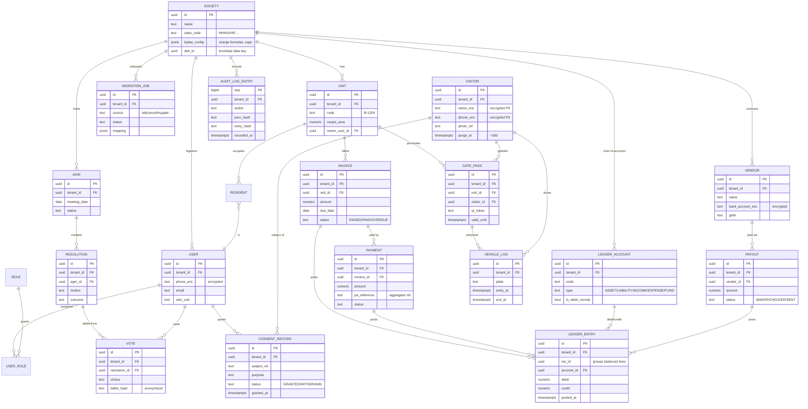

# 03 — Data Model

**Document:** `SOC-DOC-03`

The persistence model: the core entity-relationship diagram, the double-entry ledger schema,
the Row-Level Security (RLS) tenancy strategy, sensitive-column encryption, the append-only
hash-chained audit log, and the Flyway migration approach. Entities map to the six modules.
Tenancy context and the RLS request flow are defined in [architecture](01-architecture.md) §6
and the cross-cutting authZ in [system design](02-system-design.md). Terms: [glossary](glossary.md).

---

## 1. Entity-Relationship Diagram (core)



Entity → module map: M1 Treasury (Invoice, Payment, LedgerAccount, LedgerEntry, Vendor, Payout);
M2 Governance (AGM, Resolution, Vote); M3 Copilot (embeddings, §7); M4 Gate (Visitor, GatePass,
VehicleLog); M5 Privacy (ConsentRecord, purge metadata); M6 Smart-Switch (MigrationJob). Society,
Unit, User, Role, AuditLogEntry are shared. Module detail: [modules/module-1-treasury-erp.md](modules/module-1-treasury-erp.md).

## 2. Double-entry ledger schema

Every financial transaction is a **balanced set of entries** sharing a `txn_id`: the sum of
debits equals the sum of credits. Balances and the trial balance are **derived** from entries,
never stored mutably. Deep dive: [dd-01](deep-dives/dd-01-double-entry-ledger.md).

```sql
CREATE TABLE ledger_account (
    id              uuid PRIMARY KEY DEFAULT gen_random_uuid(),
    tenant_id       uuid NOT NULL,
    code            text NOT NULL,
    name            text NOT NULL,
    type            text NOT NULL CHECK (type IN
                      ('ASSET','LIABILITY','INCOME','EXPENSE','FUND')),
    is_debit_normal boolean NOT NULL,          -- assets/expenses debit-normal
    UNIQUE (tenant_id, code)
);

CREATE TABLE ledger_entry (
    id         uuid PRIMARY KEY DEFAULT gen_random_uuid(),
    tenant_id  uuid NOT NULL,
    txn_id     uuid NOT NULL,                  -- groups the balanced lines
    account_id uuid NOT NULL REFERENCES ledger_account(id),
    debit      numeric(14,2) NOT NULL DEFAULT 0 CHECK (debit  >= 0),
    credit     numeric(14,2) NOT NULL DEFAULT 0 CHECK (credit >= 0),
    memo       text,
    posted_at  timestamptz NOT NULL DEFAULT now(),
    CHECK ( (debit = 0) <> (credit = 0) )      -- exactly one side non-zero
);
CREATE INDEX ON ledger_entry (tenant_id, account_id, posted_at);

-- Balance must hold per txn (enforced in-service in the posting transaction):
--   SELECT txn_id FROM ledger_entry GROUP BY txn_id
--   HAVING SUM(debit) <> SUM(credit);  -- must return zero rows
```

**Trial balance** derivation:

```sql
SELECT a.code, a.name, a.type,
       SUM(e.debit)  AS total_debit,
       SUM(e.credit) AS total_credit,
       SUM(e.debit) - SUM(e.credit) AS net
FROM ledger_account a
JOIN ledger_entry e ON e.account_id = a.id
WHERE a.tenant_id = current_setting('app.tenant_id')::uuid
GROUP BY a.id ORDER BY a.code;
```

Postings are written via the transactional outbox (see [architecture](01-architecture.md) §5) so
the `payment.settled` event and the ledger rows commit atomically.

## 3. RLS tenancy strategy

Every tenant-owned table carries a non-null `tenant_id`. RLS enforces isolation at the database;
the request transaction sets the session GUC `app.tenant_id` (flow in [architecture](01-architecture.md) §6).

```sql
-- 1. Enable + force RLS (force so even the table owner is filtered)
ALTER TABLE invoice ENABLE ROW LEVEL SECURITY;
ALTER TABLE invoice FORCE ROW LEVEL SECURITY;

-- 2. Policy: a row is visible/writable only for the current tenant GUC
CREATE POLICY tenant_isolation ON invoice
    USING      (tenant_id = current_setting('app.tenant_id')::uuid)
    WITH CHECK (tenant_id = current_setting('app.tenant_id')::uuid);

-- 3. Per request (inside the request transaction):
--    BEGIN; SET LOCAL app.tenant_id = 'soc_maple_01'; ... COMMIT;
```

The application DB role is **not** `BYPASSRLS`. A missing/blank GUC makes
`current_setting('app.tenant_id')` throw, so an un-scoped query fails closed rather than leaking.
This policy template is applied to every tenant table via a Flyway migration (§6).

## 4. Encryption of sensitive columns (envelope keys)

Visitor PII (name, phone, photo) and bank identifiers (vendor/payout account numbers, VPA) are
encrypted at the column level with **envelope encryption**: a per-society Data Encryption Key
(DEK) encrypts the columns; the DEK is itself wrapped by a KMS master key (see
[security & compliance](05-security-compliance.md) for rotation and sovereignty).

| Column | Table | Protection |
|---|---|---|
| `name_enc`, `phone_enc`, `photo_ref` | `visitor` | AES-256-GCM via society DEK; auto-purged at `purge_at` (M5) |
| `phone_enc` | `user` | AES-256-GCM via society DEK |
| `bank_account_enc` | `vendor`, `payout` | AES-256-GCM via society DEK |

```sql
ALTER TABLE visitor
    ADD COLUMN name_enc  bytea NOT NULL,   -- AES-256-GCM ciphertext
    ADD COLUMN phone_enc bytea NOT NULL,
    ADD COLUMN dek_id    uuid  NOT NULL,   -- which society DEK wrapped this
    ADD COLUMN purge_at  timestamptz NOT NULL;  -- now() + interval '30 days'
```

Encryption/decryption happens in a service-layer converter; keys are never written to the DB in
plaintext. DEK rotation re-wraps without re-encrypting payloads where GCM key-id tagging allows.

## 5. Audit log — append-only, hash-chained

A tamper-evident table: each row's `entry_hash = SHA-256(prev_hash || canonical(payload))`,
forming a chain per tenant. No `UPDATE`/`DELETE` grant is issued; inserts go through a trigger
that computes the chain. Exposed read-only to Auditors (see [system design](02-system-design.md) §8).

```sql
CREATE TABLE audit_log_entry (
    seq         bigint GENERATED ALWAYS AS IDENTITY PRIMARY KEY,
    tenant_id   uuid NOT NULL,
    actor_id    uuid,
    action      text NOT NULL,              -- e.g. PAYOUT_APPROVED
    target_ref  text,
    payload     jsonb NOT NULL,             -- redacted of raw PII
    prev_hash   text NOT NULL,
    entry_hash  text NOT NULL,
    recorded_at timestamptz NOT NULL DEFAULT now()
);

CREATE OR REPLACE FUNCTION audit_chain() RETURNS trigger AS $$
DECLARE last_hash text;
BEGIN
    SELECT entry_hash INTO last_hash FROM audit_log_entry
      WHERE tenant_id = NEW.tenant_id ORDER BY seq DESC LIMIT 1;
    NEW.prev_hash  := COALESCE(last_hash, 'GENESIS');
    NEW.entry_hash := encode(digest(NEW.prev_hash ||
                       NEW.tenant_id::text || NEW.action ||
                       NEW.payload::text || NEW.recorded_at::text, 'sha256'), 'hex');
    RETURN NEW;
END $$ LANGUAGE plpgsql;

CREATE TRIGGER trg_audit_chain BEFORE INSERT ON audit_log_entry
    FOR EACH ROW EXECUTE FUNCTION audit_chain();

REVOKE UPDATE, DELETE ON audit_log_entry FROM app_role;  -- append-only
```

Verification: walk the chain per tenant and recompute hashes; any break reveals tampering.
Fed by the `audit.action.recorded` topic (see [architecture](01-architecture.md) §5).

## 6. Migrations (Flyway)

- **Naming:** `V<version>__<description>.sql` for versioned, `R__<name>.sql` for repeatable
  (views, trial-balance helpers). Example: `V012__add_rls_policies.sql`.
- **RLS setup migration** applies `ENABLE/FORCE RLS` + the `tenant_isolation` policy to every new
  tenant table — a repeatable migration loops the catalog so no table ships without a policy.
- **Tenant-aware seed:** reference/config data (chart-of-accounts template, state bylaw caps,
  default roles, i18n message keys) is seeded per society when a `MIGRATION_JOB` onboards it; seeds
  run with `SET LOCAL app.tenant_id` so RLS applies. Global reference tables (state codes) are
  non-tenant and seeded once.
- **pgvector:** `CREATE EXTENSION IF NOT EXISTS vector;` plus an `embedding vector(1536)` column on
  the RAG store (bylaws, ledger summaries) feeding M3 Copilot — see [modules/module-3-ai-copilot.md](modules/module-3-ai-copilot.md).
- **Migration jobs (M6):** `MIGRATION_JOB` drives Smart-Switch ETL from Tally/Excel/incumbent apps;
  mapping is stored as JSONB and replayed idempotently. See [modules/module-6-smart-switch.md](modules/module-6-smart-switch.md).

---

**Related:** [architecture](01-architecture.md) · [system design](02-system-design.md) ·
[API spec](04-api-specification.md) · [security & compliance](05-security-compliance.md) ·
[dd-01 double-entry ledger](deep-dives/dd-01-double-entry-ledger.md) · [glossary](glossary.md)
