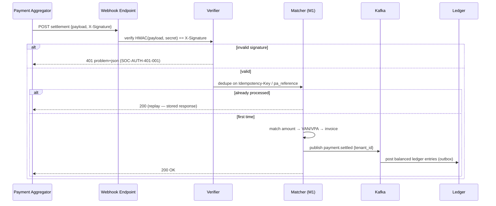

# 04 — API Specification

**Document:** `SOC-DOC-04`

The external REST API: conventions, an endpoint catalogue grouped by module (M1–M6), the Payment
Aggregator settlement webhook, and the error contract. Normative rules live in
[standards/api-guidelines.md](standards/api-guidelines.md); cross-cutting mechanics
(authN/authZ, idempotency, pagination, errors) are defined in [system design](02-system-design.md)
and the tenancy flow in [architecture](01-architecture.md). Resources map to the
[data model](03-data-model.md).

> **Source of truth:** the machine-readable **OpenAPI 3.1** document is generated from the Spring
> controllers (springdoc) at build time and published at `/api/v1/openapi.json`. This doc is the
> human-oriented companion — where they differ, OpenAPI wins.

---

## 1. Conventions

| Topic | Rule |
|---|---|
| Base path | `/api/v1` (major version in path) |
| Resource naming | Plural nouns, kebab-case: `/invoices`, `/gate-passes`, `/migration-jobs` |
| Verbs | `GET` (read), `POST` (create/action), `PUT` (replace), `PATCH` (partial), `DELETE` |
| Status codes | `200/201/202/204`; `400/401/403/404/409/422/423/429`; `500/503` |
| Auth header | `Authorization: Bearer <JWT>` (OIDC) — see [system design](02-system-design.md) §1 |
| Tenant resolution | From JWT `tenant_id` claim → gateway `X-Tenant-Id` → RLS GUC `app.tenant_id`; never a client body field |
| Idempotency | `Idempotency-Key` required on unsafe payment/vote/invite/migration calls ([sys-design §4](02-system-design.md)) |
| Pagination | Cursor default `?limit&cursor`; envelope `{data, page}` ([sys-design §5](02-system-design.md)) |
| Concurrency | `ETag` + `If-Match` on mutable resources; `423` on conflict |
| Errors | RFC 9457 `application/problem+json` ([sys-design §3](02-system-design.md)) |
| Versioning | Breaking changes → `/api/v2`; additive changes are non-breaking within `v1` |

Roles referenced below: Platform Admin, Secretary, Treasurer, Committee Member, Owner, Tenant,
Guard, Auditor — matrix in [system design](02-system-design.md) §1.3.

## 2. Endpoint catalogue

### M1 — Treasury / ERP ([module](modules/module-1-treasury-erp.md))

| Method | Path | Purpose | Roles |
|---|---|---|---|
| GET | `/api/v1/invoices` | List invoices (filter by unit/status/period) | Secretary, Treasurer, Committee, Owner, Tenant (own) |
| POST | `/api/v1/invoices` | Raise invoice(s) from a charge formula | Secretary, Treasurer |
| GET | `/api/v1/invoices/{id}` | Invoice detail | owner/occupant + MC |
| POST | `/api/v1/invoices/{id}/payments` | Record/initiate a payment (idempotent) | Owner, Tenant, Treasurer |
| GET | `/api/v1/payments` | List payments / reconciliation status | Treasurer, Secretary, Auditor |
| GET | `/api/v1/ledger/accounts` | Chart of accounts | Treasurer, Secretary, Auditor |
| GET | `/api/v1/ledger/entries` | Ledger entries (cursor) | Treasurer, Secretary, Auditor |
| GET | `/api/v1/ledger/trial-balance` | Derived trial balance / P&L / BS | Treasurer, Secretary, Auditor |
| GET | `/api/v1/vendors` | List vendors | Treasurer, Secretary |
| POST | `/api/v1/vendors` | Create vendor | Treasurer, Secretary |
| POST | `/api/v1/payouts` | Initiate payout (maker, idempotent) | Treasurer, Committee |
| POST | `/api/v1/payouts/{id}/approve` | Approve payout (checker) | Treasurer, Secretary |

### M2 — Governance / e-AGM ([module](modules/module-2-governance-agm.md))

| Method | Path | Purpose | Roles |
|---|---|---|---|
| GET | `/api/v1/agms` | List AGMs/EGMs | all members |
| POST | `/api/v1/agms` | Schedule an AGM | Secretary, Treasurer |
| GET | `/api/v1/agms/{id}/resolutions` | Resolutions for a meeting | all members |
| POST | `/api/v1/agms/{id}/resolutions` | Publish a resolution | Secretary, Treasurer |
| POST | `/api/v1/resolutions/{id}/votes` | Cast anonymized vote (idempotent) | Owner, Committee, Secretary, Treasurer |
| GET | `/api/v1/resolutions/{id}/tally` | Weighted tally / outcome | MC, Auditor |
| GET | `/api/v1/agms/{id}/mom` | Minutes of Meeting (M3-assisted) | all members, Auditor |
| GET | `/api/v1/notices` | Circulars / notices | all members |
| POST | `/api/v1/notices` | Publish a notice | Secretary, Treasurer, Committee |

### M3 — AI Copilot ([module](modules/module-3-ai-copilot.md))

| Method | Path | Purpose | Roles |
|---|---|---|---|
| POST | `/api/v1/copilot/queries` | RAG query over bylaws/ledger (< 2.5s target) | MC, Owner (scoped), Auditor (read) |
| GET | `/api/v1/copilot/queries/{id}` | Fetch async answer + citations | requester |
| POST | `/api/v1/copilot/mom/draft` | Draft Minutes of Meeting from AGM record | Secretary, Treasurer |
| POST | `/api/v1/copilot/tender-compare` | Compare vendor tenders/quotes | Treasurer, Committee |

### M4 — Gate Infrastructure ([module](modules/module-4-gate-infra.md))

| Method | Path | Purpose | Roles |
|---|---|---|---|
| POST | `/api/v1/gate/visits` | Log a visitor entry/exit | Guard |
| POST | `/api/v1/gate/passes` | Create a visitor pre-invite (QR, idempotent) | Owner, Tenant, Committee, Secretary |
| GET | `/api/v1/gate/passes/{token}` | Validate a QR pass at the gate | Guard |
| POST | `/api/v1/gate/vehicles` | Record ANPR vehicle entry/exit | Guard |
| POST | `/api/v1/gate/sync` | Batch CRDT sync from offline gate device | Guard (device) |

### M5 — Privacy Shield ([module](modules/module-5-privacy-shield.md))

| Method | Path | Purpose | Roles |
|---|---|---|---|
| GET | `/api/v1/consents` | List consent records (self or society) | Owner/Tenant (own), Secretary |
| POST | `/api/v1/consents` | Grant/withdraw consent | Owner, Tenant |
| GET | `/api/v1/privacy/purge-status` | 30-day visitor-PII purge status | Secretary, Auditor |
| GET | `/api/v1/directory` | Member directory with PII masking | all members (masked), Secretary (unmasked) |
| POST | `/api/v1/privacy/data-requests` | DPDP data-subject request (access/erasure) | Owner, Tenant |

### M6 — Smart-Switch Migration ([module](modules/module-6-smart-switch.md))

| Method | Path | Purpose | Roles |
|---|---|---|---|
| POST | `/api/v1/migration-jobs` | Start an onboarding/ETL job (idempotent) | Platform Admin, Secretary |
| GET | `/api/v1/migration-jobs` | List migration jobs | Platform Admin, Secretary |
| GET | `/api/v1/migration-jobs/{id}` | Job status / mapping / errors | Platform Admin, Secretary |
| POST | `/api/v1/migration-jobs/{id}/mapping` | Set/adjust field mapping | Platform Admin, Secretary |

## 3. Webhooks — Payment Aggregator settlement

The PA (Razorpay/Cashfree) settles funds **directly to the society bank account** — Societix holds
no float (see [ADR-0003](adr/0003-payment-aggregator-no-float.md)). The PA notifies us via webhook;
we verify, dedupe, allocate, and post to the ledger.

`POST /api/v1/webhooks/pa/settlement`

- **Signature:** HMAC-SHA256 over the raw body with the per-society webhook secret; constant-time compare.
- **Idempotency:** keyed on the PA reference / `Idempotency-Key`; replays return the stored response
  (see [system design](02-system-design.md) §4). `payment.settled` consumers are idempotent.
- **Unmatched:** credits that don't map to an invoice emit `payment.unmatched` → ops queue (see
  [architecture](01-architecture.md) §5), never auto-posted.
- **Fast ack:** respond `200` quickly after verify+dedupe; heavy allocation/posting is async via Kafka.

## 4. Error responses

All non-2xx responses are RFC 9457 `application/problem+json` with a stable `code` and the
OpenTelemetry `traceId`. The full model, catalogue, and validation-error shape are in
[system design](02-system-design.md) §3. Rate-limited responses include `Retry-After`; optimistic
conflicts return `423` with the current `ETag`.

---

**Related:** [architecture](01-architecture.md) · [system design](02-system-design.md) ·
[data model](03-data-model.md) · [security & compliance](05-security-compliance.md) ·
[API guidelines](standards/api-guidelines.md) · [glossary](glossary.md)
