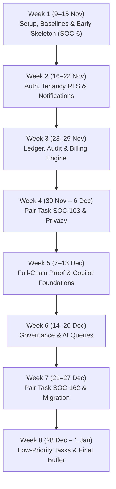

# 05 — Building It

**What this is:** The execution plan for the three of us — who owns what, what order we build in,
the day-by-day time plan, and how we work day to day.  
**Who should read it:** Everyone, before and during the build.

This document contains the authoritative time plan and weekly schedule. The task-by-task backlog
lives in Jira and the readable backlog mirror ([`jira/backlog.md`](jira/backlog.md) /
[`jira/societix-backlog.csv`](jira/societix-backlog.csv)).

---

## The team (3 developers)

We are building Societix as a three-developer team. While we all contribute across the stack,
each engineer owns an explicit primary area for delivery and review depth.

| Engineer | Primary Ownership | Also Reviews / Helps With |
|---|---|---|
| **Aditya** (`Adityarajkishan`, Dev A) | Project setup, Flyway migrations, Docker Compose dev environment, CI pipeline, Tenancy RLS (SOC-13), Chart of accounts & Ledger (SOC-100), Financial Statements (SOC-105), Maker-Checker payouts (SOC-106), Smart-Switch Migration (SOC-200, SOC-202, SOC-203), and Pair tasks. | Security, database migrations & privacy checks |
| **Shree** (`ssharan100`, Dev B) | Modular monolith backend scaffold (SOC-2), Walking skeleton (SOC-6), Auth & Login (SOC-11, SOC-12), Flat & Member master records (SOC-14), Health/metrics (SOC-41), Tracker CI gate (SOC-140), Billing engine & VANs (SOC-101, SOC-102), Defaulter cadence (SOC-104), AGM notices & Quorum engine (SOC-160, SOC-161), Handover pack (SOC-164), and Pair tasks. | API consistency & financial logic |
| **Ayush** (`ayushrai007`, Dev C, Repo Owner) | Tenant onboarding entity (SOC-10), Outbox table & background poller (SOC-20, SOC-21, SOC-22), Notifications (SOC-30, SOC-31), Audit log (SOC-40), Gate visitor backend (SOC-122 backend half), Privacy auto-delete & consent (SOC-141, SOC-142), pgvector & AI copilot (SOC-180, SOC-181, SOC-182, SOC-183), Capex voting (SOC-163), and MyGate import (SOC-201). | Edge sync & front-end architecture |

### Starting assignments
- **Shree:** SOC-2 (Scaffold backend — counted as Done), SOC-6 (Walking skeleton end-to-end check).
- **Aditya:** SOC-1 (Repository setup — counted as Done, taken over from Ayush), SOC-3 (Docker Compose dev environment), SOC-4 (CI pipeline), SOC-5 (Database migrations with Flyway).
- **Ayush:** SOC-10 (Society tenant entity and onboarding).

### Two Pair Tasks
Two tasks are designated as **PAIR TASKS** because they carry the highest algorithmic and financial risk:
1. **SOC-103 Zero-touch payment matching:** Aditya + Shree.
2. **SOC-162 Secret verifiable e-voting:** Aditya + Shree.

Both pair tasks carry an explicit **5-day dedicated buffer** immediately following implementation.

---

## Effort Re-Check & Scope Reality

The active backlog defines **46 tasks across 11 epics, totaling 127 story points** (1 point ≈ 1 developer-day).
By contrast, the historical archived plan ([`archive/delivery/execution-plan-3-devs.md`](archive/delivery/execution-plan-3-devs.md) §2)
estimated **55–65 story-weeks (~275–325 dev-days)** across 12–14 two-week sprints (~6–7 months) to deliver full scope.

The 127-point backlog is an aggressive, tightly scoped estimate based on strict vertical slices and
modular monolith boundaries. When re-checking effort against production reality, the following tasks
are most likely to be underestimated:

- **SOC-103 Zero-touch payment matching (5 pts):** Bank statement parsing, aggregator webhook race
  conditions, suspense accounts, partial payment allocation, and idempotency guarantees under load.
- **SOC-162 Secret verifiable e-voting (5 pts):** Cryptographic commit-reveal scheme, receipt hashing,
  ballot audit trails, voter privacy preservation, and quorum edge cases.
- **SOC-121 Offline sync with CRDT (5 pts):** Multi-device conflict resolution, SQLite-to-PostgreSQL
  clock drift, and schema convergence across intermittent Wi-Fi drops.
- **SOC-181 / SOC-182 AI Copilot RAG & Natural Language Queries (5 pts + 3 pts):** Document embedding
  chunking, prompt injection guardrails, SQL schema grounding, and strict tenant isolation within vector search.

### Explicit buffer strategy
To absorb these risks without breaking the delivery commitment, we carry **explicit named buffer**:
- **SOC-103:** +5 days carried buffer (Aditya + Shree)
- **SOC-162:** +5 days carried buffer (Aditya + Shree)
- **SOC-181:** +3 days carried buffer (Ayush)
- **SOC-182:** +2 days carried buffer (Ayush)
- **SOC-121:** +5 days carried buffer allocated in the post-1-Jan mobile track.
- **Week 8 (Final week):** Contains only Low-priority tasks (SOC-183, SOC-164, SOC-203), leaving
  **3–4 free buffer days** per engineer before 1 Jan 2027.

---

## Time Plan: 9 Nov 2026 – 1 Jan 2027 (Backend First)

### Schedule constraints
- **Start:** Monday, 9 November 2026
- **End:** Friday, 1 January 2027
- **Calendar duration:** 54 consecutive days, working **seven days a week** (no weekends off).
- **BACKEND FIRST:** All backend modules, database migrations, outbox pollers, security policies,
  and APIs must be completed and proven before any client application work begins.
- **Client surfaces:** Mobile tablet apps (SOC-120, SOC-121, SOC-123, SOC-124, tablet check-in half of SOC-122)
  and web console screens move after 1 January 2027.

---

## Day-by-Day Schedule & Weekly Assignments

### Week 1: 9 Nov – 15 Nov 2026 (Setup & Baselines)
*Goal: Working development environment, migrations baseline, early walking skeleton.*

| Day | Aditya (Dev A) | Shree (Dev B) | Ayush (Dev C) | Notes |
|---|---|---|---|---|
| **Mon 9 Nov** | **SOC-5** Flyway migrations (1 pt) | *SOC-2 landed (Done)* | *Onboarding prep* | SOC-5 unblocks schema & entities |
| **Tue 10 Nov** | **SOC-3** Docker Compose (2 pts) | **SOC-6** Walking skeleton (3 pts) | **SOC-10** Tenant entity (2 pts) | SOC-6 starts once Flyway lands |
| **Wed 11 Nov** | **SOC-3** Docker Compose (cont.) | **SOC-6** Walking skeleton (cont.) | **SOC-10** Tenant entity (cont.) | SOC-3 & SOC-10 merge |
| **Thu 12 Nov** | **SOC-4** CI pipeline (2 pts) | **SOC-6** Walking skeleton (cont.) | **SOC-20** Outbox table (2 pts) | SOC-6 merges after SOC-3 |
| **Fri 13 Nov** | **SOC-4** CI pipeline (cont.) | **SOC-11** Auth OTP/JWT (3 pts) | **SOC-20** Outbox table (cont.) | SOC-4 & SOC-20 merge |
| **Sat 14 Nov** | *Buffer / Code review* | **SOC-11** Auth OTP/JWT (cont.) | **SOC-21** Outbox poller (3 pts) | Outbox drain poller started |
| **Sun 15 Nov** | *Buffer / Code review* | **SOC-11** Auth OTP/JWT (cont.) | **SOC-21** Outbox poller (cont.) | **Milestone 1 Complete** |

### Week 2: 16 Nov – 22 Nov 2026 (Auth, Tenancy RLS & Notifications)
*Goal: Fail-closed tenant isolation, roles, scheduled jobs, notification engine.*

| Day | Aditya (Dev A) | Shree (Dev B) | Ayush (Dev C) | Notes |
|---|---|---|---|---|
| **Mon 16 Nov** | **SOC-13** Tenancy RLS (5 pts) | **SOC-12** RBAC roles (2 pts) | **SOC-21** Outbox poller (cont.) | SOC-13 RLS begins; SOC-21 merges |
| **Tue 17 Nov** | **SOC-13** Tenancy RLS (cont.) | **SOC-12** RBAC roles (cont.) | **SOC-22** Scheduled jobs (2 pts) | SOC-12 merges |
| **Wed 18 Nov** | **SOC-13** Tenancy RLS (cont.) | **SOC-41** Health & metrics (2 pts) | **SOC-22** Scheduled jobs (cont.) | SOC-22 merges |
| **Thu 19 Nov** | **SOC-13** Tenancy RLS (cont.) | **SOC-41** Health & metrics (cont.) | **SOC-30** Notifications (3 pts) | SOC-41 merges |
| **Fri 20 Nov** | **SOC-13** Tenancy RLS (cont.) | **SOC-140** Tracker check (2 pts) | **SOC-30** Notifications (cont.) | SOC-13 RLS merges |
| **Sat 21 Nov** | **SOC-100** Ledger CoA (3 pts) | **SOC-140** Tracker check (cont.) | **SOC-30** Notifications (cont.) | SOC-140 & SOC-30 merge |
| **Sun 22 Nov** | **SOC-100** Ledger CoA (cont.) | **SOC-14** Flat & Member master (2 pts) | **SOC-31** Channel fallback (2 pts) | Notification fallback started; SOC-14 begins |

### Week 3: 23 Nov – 29 Nov 2026 (Foundations Complete & Core Billing)
*Goal: Complete foundations milestone, double-entry ledger, billing engine, audit log.*

| Day | Aditya (Dev A) | Shree (Dev B) | Ayush (Dev C) | Notes |
|---|---|---|---|---|
| **Mon 23 Nov** | **SOC-100** Ledger CoA (cont.) | **SOC-14** Flat & Member master (cont.) | **SOC-31** Channel fallback (cont.) | SOC-100, SOC-31 & SOC-14 merge (before SOC-101) |
| **Tue 24 Nov** | **SOC-105** Financial stmts (3 pts) | **SOC-101** Billing engine (3 pts) | **SOC-40** Audit log (3 pts) | Parallel financial & audit track |
| **Wed 25 Nov** | **SOC-105** Financial stmts (cont.) | **SOC-101** Billing engine (cont.) | **SOC-40** Audit log (cont.) | |
| **Thu 26 Nov** | **SOC-105** Financial stmts (cont.) | **SOC-101** Billing engine (cont.) | **SOC-40** Audit log (cont.) | **Milestone 2 Complete** |
| **Fri 27 Nov** | **SOC-106** Maker-checker (3 pts) | **SOC-102** VAN / UPI VPA (3 pts) | **SOC-122** Visitor backend (3 pts)| Core Treasury & Gate backend |
| **Sat 28 Nov** | **SOC-106** Maker-checker (cont.) | **SOC-102** VAN / UPI VPA (cont.) | **SOC-122** Visitor backend (cont.)| |
| **Sun 29 Nov** | **SOC-106** Maker-checker (cont.) | **SOC-102** VAN / UPI VPA (cont.) | **SOC-122** Visitor backend (cont.)| All three merge |

### Week 4: 30 Nov – 6 Dec 2026 (Pair Task SOC-103 & Privacy Handover)
*Goal: Zero-touch payment matching pair implementation, visitor data retention & consent.*

| Day | Aditya (Dev A) | Shree (Dev B) | Ayush (Dev C) | Notes |
|---|---|---|---|---|
| **Mon 30 Nov** | **SOC-103** Payment matching (5 pts) | **SOC-103** Payment matching (5 pts) | **SOC-141** 30d auto-delete (3 pts) | **PAIR TASK SOC-103** begins |
| **Tue 1 Dec** | **SOC-103** Payment matching (cont.) | **SOC-103** Payment matching (cont.) | **SOC-141** 30d auto-delete (cont.) | |
| **Wed 2 Dec** | **SOC-103** Payment matching (cont.) | **SOC-103** Payment matching (cont.) | **SOC-141** 30d auto-delete (cont.) | SOC-141 merges |
| **Thu 3 Dec** | **SOC-103** Payment matching (cont.) | **SOC-103** Payment matching (cont.) | **SOC-142** Resident consent (3 pts) | |
| **Fri 4 Dec** | **SOC-103** Payment matching (cont.) | **SOC-103** Payment matching (cont.) | **SOC-142** Resident consent (cont.) | SOC-103 core code complete |
| **Sat 5 Dec** | *SOC-103 buffer day 1* | *SOC-103 buffer day 1* | **SOC-142** Resident consent (cont.) | SOC-142 merges |
| **Sun 6 Dec** | *SOC-103 buffer day 2* | *SOC-103 buffer day 2* | **SOC-180** pgvector index (3 pts) | AI Copilot track begins |

### Week 5: 7 Dec – 13 Dec 2026 (Full Chain Proof, Defaulter Chasing & Financial AI)
*Goal: Full chain proven end-to-end, defaulter cadence, Tally import, financial RAG.*

| Day | Aditya (Dev A) | Shree (Dev B) | Ayush (Dev C) | Notes |
|---|---|---|---|---|
| **Mon 7 Dec** | *SOC-103 buffer day 3* | *SOC-103 buffer day 3* | **SOC-180** pgvector index (cont.) | |
| **Tue 8 Dec** | *SOC-103 buffer day 4* | *SOC-103 buffer day 4* | **SOC-180** pgvector index (cont.) | SOC-180 merges |
| **Wed 9 Dec** | *SOC-103 buffer day 5* | *SOC-103 buffer day 5* | **SOC-181** Financial RAG (5 pts) | **Milestone 3: Full Chain Proven** |
| **Thu 10 Dec** | **SOC-200** Tally import (3 pts) | **SOC-104** Defaulter cadence (3 pts)| **SOC-181** Financial RAG (cont.) | Billing & migration processing |
| **Fri 11 Dec** | **SOC-200** Tally import (cont.) | **SOC-104** Defaulter cadence (cont.)| **SOC-181** Financial RAG (cont.) | |
| **Sat 12 Dec** | **SOC-200** Tally import (cont.) | **SOC-104** Defaulter cadence (cont.)| **SOC-181** Financial RAG (cont.) | **Milestone 4 Complete** |
| **Sun 13 Dec** | **SOC-202** Balance verify (3 pts)| **SOC-160** AGM notices (2 pts) | **SOC-181** Financial RAG (cont.) | SOC-181 core complete |

### Week 6: 14 Dec – 20 Dec 2026 (Governance, Safe NL Queries & Pair Task SOC-162)
*Goal: AGM meeting notices, live quorum engine, natural language data queries, e-voting pair.*

| Day | Aditya (Dev A) | Shree (Dev B) | Ayush (Dev C) | Notes |
|---|---|---|---|---|
| **Mon 14 Dec** | **SOC-202** Balance verify (cont.)| **SOC-160** AGM notices (cont.) | *SOC-181 buffer day 1* | SOC-160 merges |
| **Tue 15 Dec** | **SOC-202** Balance verify (cont.)| **SOC-161** Quorum engine (3 pts) | *SOC-181 buffer day 2* | SOC-202 merges |
| **Wed 16 Dec** | *Buffer / Prep for SOC-162* | **SOC-161** Quorum engine (cont.) | *SOC-181 buffer day 3* | SOC-181 buffer concludes |
| **Thu 17 Dec** | *Buffer / Prep for SOC-162* | **SOC-161** Quorum engine (cont.) | **SOC-182** NL queries (3 pts) | SOC-161 merges |
| **Fri 18 Dec** | **SOC-162** Secret e-voting (5 pts)| **SOC-162** Secret e-voting (5 pts)| **SOC-182** NL queries (cont.) | **PAIR TASK SOC-162** begins |
| **Sat 19 Dec** | **SOC-162** Secret e-voting (cont.)| **SOC-162** Secret e-voting (cont.)| **SOC-182** NL queries (cont.) | SOC-182 core complete |
| **Sun 20 Dec** | **SOC-162** Secret e-voting (cont.)| **SOC-162** Secret e-voting (cont.)| *SOC-182 buffer day 1* | |

### Week 7: 21 Dec – 27 Dec 2026 (Voting Buffer, Capex & MyGate Import)
*Goal: Commit-reveal crypto buffer, fund-linked capex voting, MyGate migration.*

| Day | Aditya (Dev A) | Shree (Dev B) | Ayush (Dev C) | Notes |
|---|---|---|---|---|
| **Mon 21 Dec** | **SOC-162** Secret e-voting (cont.)| **SOC-162** Secret e-voting (cont.)| *SOC-182 buffer day 2* | SOC-182 buffer concludes |
| **Tue 22 Dec** | **SOC-162** Secret e-voting (cont.)| **SOC-162** Secret e-voting (cont.)| **SOC-163** Capex voting (2 pts) | SOC-162 core complete |
| **Wed 23 Dec** | *SOC-162 buffer day 1* | *SOC-162 buffer day 1* | **SOC-163** Capex voting (cont.) | SOC-163 merges |
| **Thu 24 Dec** | *SOC-162 buffer day 2* | *SOC-162 buffer day 2* | **SOC-201** MyGate import (2 pts) | |
| **Fri 25 Dec** | *SOC-162 buffer day 3* | *SOC-162 buffer day 3* | **SOC-201** MyGate import (cont.) | SOC-201 merges |
| **Sat 26 Dec** | *SOC-162 buffer day 4* | *SOC-162 buffer day 4* | **SOC-183** Auto-minutes (3 pts) | Low-priority copilot tasks |
| **Sun 27 Dec** | *SOC-162 buffer day 5* | *SOC-162 buffer day 5* | **SOC-183** Auto-minutes (cont.) | **Milestone 5 Complete** |

### Week 8: 28 Dec 2026 – 1 Jan 2027 (Low-Priority Tasks, Hardening & Buffer)
*Goal: Complete low-priority tasks, parallel-run testing, end-to-end integration polish.*

| Day | Aditya (Dev A) | Shree (Dev B) | Ayush (Dev C) | Notes |
|---|---|---|---|---|
| **Mon 28 Dec** | **SOC-203** Parallel run (2 pts) | **SOC-164** Handover pack (2 pts) | **SOC-183** Auto-minutes (cont.) | SOC-183 merges |
| **Tue 29 Dec** | **SOC-203** Parallel run (cont.) | **SOC-164** Handover pack (cont.) | *Free Buffer Day 1* | SOC-203 & SOC-164 merge |
| **Wed 30 Dec** | *Free Buffer Day 1* | *Free Buffer Day 1* | *Free Buffer Day 2* | All backend scope delivered |
| **Thu 31 Dec** | *Free Buffer Day 2* | *Free Buffer Day 2* | *Free Buffer Day 3* | Smoke tests & security review |
| **Fri 1 Jan** | *Free Buffer Day 3* | *Free Buffer Day 3* | *Free Buffer Day 4* | **Milestone 6 Complete (v1 Backend Done)** |

---

## The Six Key Milestones

1. **Milestone 1 — Setup & Dev Baseline (Sun 15 Nov, End of W1):**  
   Repository rules, Spring Boot modular monolith scaffold, Flyway migrations baseline, Docker Compose
   local stack, CI pipeline, tenant onboarding entity, and the **SOC-6 walking skeleton** end-to-end
   slice proven against local infrastructure.
2. **Milestone 2 — Foundations Complete (Thu 26 Nov, W3):**  
   Row-Level Security (SOC-13) verified fail-closed, RBAC roles (SOC-12), flat & member master records (SOC-14), transactional outbox table &
   poller (SOC-20/21), scheduled automation (SOC-22), structured audit log (SOC-40), health checks (SOC-41),
   notification engine with fallback (SOC-30/31), and no-tracker CI gate (SOC-140).
3. **Milestone 3 — Full Chain Proven End-to-End (Wed 9 Dec, W5):**  
   The critical architectural loop is proven end-to-end:
   **Tenancy RLS (SOC-13) → Transactional Outbox (SOC-20/21) → Payment Webhook Matching (SOC-103) → Double-Entry Ledger Posting (SOC-100/104)**.
4. **Milestone 4 — Treasury & Gate/Privacy Backend Complete (Sat 12 Dec, W5):**  
   Flat billing engine (SOC-101), virtual accounts & UPI VPAs (SOC-102), defaulter reminder cadence (SOC-104),
   maker-checker payouts (SOC-106), visitor check-in API (SOC-122 backend), 30-day auto-purge (SOC-141),
   and resident directory consent (SOC-142).
5. **Milestone 5 — Governance, Copilot & Migration Backend Complete (Sun 27 Dec, W7):**  
   AGM meeting notices (SOC-160), live quorum calculation (SOC-161), secret verifiable e-voting (SOC-162),
   fund-linked capex voting (SOC-163), pgvector knowledge index (SOC-180), grounded financial Q&A (SOC-181),
   safe NL queries (SOC-182), Tally/Excel import (SOC-200), MyGate import (SOC-201), and balance verification (SOC-202).
6. **Milestone 6 — v1 Backend Hardening & Handover Complete (Fri 1 Jan 2027, End of W8):**  
   Meeting auto-minutes (SOC-183), committee handover pack (SOC-164), parallel-run comparison (SOC-203),
   and 3–4 days free buffer per engineer used for regression verification and zero-warning build packaging.

---

## What "Done" Means

A task is not complete when code is written on a local machine — it is done only when:
- **One approving review** from a teammate (two approving reviews for money, RLS, auth, or DB migrations).
- **No self-merge to master.**
- **Automated test suite passes** in CI (`cd backend && ./mvnw verify`).
- **Data isolation test passes:** Every new tenant table must include an integration test asserting that
  tenant A cannot read or modify tenant B rows.
- **Privacy check passes:** No plaintext PII in logs; retention rules verified.
- The full checklist is preserved in [`archive/delivery/definition-of-done.md`](archive/delivery/definition-of-done.md).

---

## How We Work Day to Day

- **One master branch.** All feature branches are short-lived (`feat/SOC-n-slug`), cut directly from
  `master`, and merged back via Pull Request with squash merge.
- **Commit messages** follow Conventional Commits (`feat: ...`, `fix: ...`, `docs: ...`).
- **Tests with every change:** Small unit tests for business calculations; Testcontainers (`*IT.java`)
  for database, RLS, and outbox interactions.
- **Branch protection on master:** Direct pushes disabled; requires 1 approval and passing CI checks.

---

## Known Backlog Gaps

- **Flat and Member Master CRUD — resolved:** This gap is now covered by
  **SOC-14 Flat/Unit and Member master records** (2 pts, Shree, Foundations: Auth & Tenancy). It is
  scheduled on Shree's former buffer days, Sun 22 Nov (W2) and Mon 23 Nov (W3), so it merges before
  SOC-101 starts on Tue 24 Nov. SOC-14 is now a precondition of billing (SOC-101), VAN assignment
  (SOC-102), and the Tally/Excel import (SOC-200). No other task moves and the 1 Jan 2027 end date is
  unchanged.

---

## Where to Go Next

- **To pick up tasks:** Open [`jira/backlog.md`](jira/backlog.md) or import [`jira/societix-backlog.csv`](jira/societix-backlog.csv).
- **For AI code generation:** See [`codegen/README.md`](codegen/README.md) for prompts and conventions.
- **For deep technical specifications:** See the detailed specs in [`archive/`](archive/README.md).
