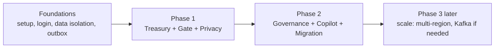

# 05 — Building It

**What this is:** the plan for the three of us — who owns what, what order we build in, what "done"
means, and how we work day to day.
**Who should read it:** everyone, before and during the build.

This is the readable summary. The task-by-task breakdown lives in the Jira backlog
([`jira/backlog.md`](jira/backlog.md)); import it and start pulling tasks.

---

## The team (3 developers)

We're all full-stack, but each of us *owns* an area — meaning we're the go-to person and the main
reviewer for it. We still help on and review each other's work.

| Dev | Owns | Also helps with |
|---|---|---|
| **Dev A** | Foundations (project setup, login, data isolation, the outbox), and the Treasury accounts/ledger | Security & privacy checks |
| **Dev B** | Payments, defaulter chasing, and later the Governance/voting module | Migration (importing old data) |
| **Dev C** | The front-ends (web dashboard + phone apps) and the offline Gate app | The AI Copilot's screens |

**Two things we build as a pair** because they're the trickiest and most important to get right:
the automatic payment-to-ledger matching (in Treasury), and the secret online voting (in Governance).

---

## The order we build in

We do **not** build all 6 modules at once. We build a thin, working slice first, then grow it.

### Phase 0 — Foundations (first ~3 sprints)
The skeleton everything else sits on. Nothing user-facing is "done" yet, but this is what makes the
rest possible:
- Project setup: the code repository, the build, running the database locally with Docker.
- **Login** and **roles** (Secretary, Treasurer, Resident, Guard) — using standard secure login
  (OIDC/JWT; see glossary).
- **Data isolation**: making the database keep each society's data private (Row-Level Security). We
  test this hard — a bug here is a privacy breach.
- The **outbox** (our simple events mechanism) and the background job that drains it.
- A **walking skeleton**: one feature working end-to-end (create a bill → pay it on the payment
  provider's test system → see it recorded). This proves the whole chain works.

### Phase 1 — The valuable core (next ~5 sprints)
The smallest product a real society would pay for:
- **M1 Treasury** — billing, automatic payment collection, defaulter chasing, the ledger.
- **M4 Gate** — the offline visitor app.
- **M5 Privacy** — built in alongside, not after (the no-ads check, 30-day auto-delete, consent).

At the end of Phase 1 we can run a **real pilot** with ~20 societies. This is the point to stop and
breathe if we're short on time — everything after this is "grow the product."

### Phase 2 — Rounding it out (next ~6 sprints)
- **M2 Governance** — meetings and secret voting.
- **M3 AI Copilot** — the question-answering assistant.
- **M6 Migration** — importing societies' old data (unlocks easier sign-ups).

### Phase 3 — Later, only if we grow
Multi-region hosting, swapping the outbox for Kafka, etc. **We do not build these now** — they're
documented so we know the upgrade path exists, and we only take them on when real load demands it.

> Rough total: ~12–14 two-week sprints (~6–7 months) for all of it with 3 people. Phase 1 (the
> pilot-ready product) is ~8 sprints in.

---

## What "done" means

A task isn't done when the code runs — it's done when:
- The code is reviewed by one other person (no one merges their own work to the main branch).
- It has **tests**, and they pass in the automated pipeline.
- It respects **data isolation** (a society can never see another's data) and **privacy** (no PII in
  logs, nothing that should auto-delete is kept).
- The API docs are updated if endpoints changed.
- Anything touching personal data got a quick privacy check.

(The full checklist is in [`archive/delivery/definition-of-done.md`](archive/delivery/definition-of-done.md).)

---

## How we work day to day

- **One main branch.** Each task gets a short-lived branch; open a Pull Request; one teammate reviews;
  the automated checks must pass; then merge. Keep PRs small.
- **Commit messages** follow a simple convention (`feat: ...`, `fix: ...`, `docs: ...`).
- **Tests:** we write them as we go — small unit tests for logic, and a few "does the whole feature
  work" tests using throwaway real databases in containers. Two kinds we never skip: the
  **data-isolation test** (prove one society can't read another's rows) and the **privacy tests**
  (prove the 30-day delete actually deletes, and no ad/tracker code is present).
- **Sprints:** 2 weeks. Pull tasks from the Jira backlog in roughly the order above. The hardest
  tasks (payment matching, voting) are scheduled early in their phase, never crammed into the last
  sprint.
- **Buffer:** treat the last sprint of each phase as hardening/catch-up — don't plan new features
  into it.

---

## Where to go next

- **To start coding:** open [`jira/backlog.md`](jira/backlog.md) (or import
  [`jira/societix-backlog.csv`](jira/societix-backlog.csv) into Jira) and pick up the first
  Foundations tasks.
- **For deep technical detail on any module:** follow the links in
  [04 — The 6 Modules](04-the-6-modules.md) into the archive.
