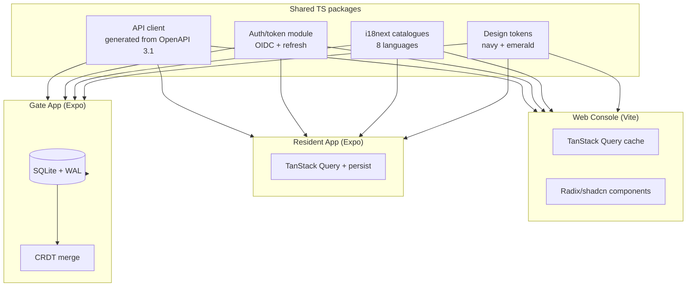
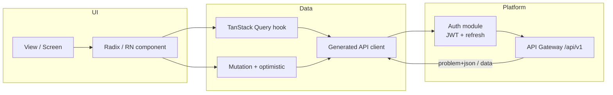

# 06 — Frontend Architecture

**Document:** `SOC-DOC-06`

The three client surfaces — the **Web console**, the **Resident mobile app**, and the
**Gate app** — plus shared concerns (auth, generated API client, state, i18n, accessibility,
offline/optimistic UI, errors). Backend contracts come from the [API spec](04-api-specification.md)
(OpenAPI 3.1 source of truth); cross-cutting mechanics are in [system design](02-system-design.md).
The design tokens are lifted from the existing prototype at `/Users/I570995/Project/societix/styles.css`
(the mockup already demonstrates the **Resident** and **Committee** personas). Terms: [glossary](glossary.md).

---

## 1. Surfaces at a glance

| Surface | Stack | Primary users | Key traits |
|---|---|---|---|
| Web console | React 18 + TS + Vite, TanStack Query, Radix/shadcn, React Router | Secretary, Treasurer, Committee, Auditor | Rich admin/finance/governance workflows |
| Resident app | React Native (Expo) | Owner, Tenant | Dues/pay, visitor QR, e-vote, tickets |
| Gate app | React Native (Expo), SQLite + CRDT | Guard | Offline-first, multilingual audio, QR + ANPR |



## 2. Web console (React 18 + TS + Vite)

- **Server state:** TanStack Query — queries keyed `['invoices', tenantId, filters]`; mutations with
  optimistic updates + `onError` rollback; cache invalidation on mutation success.
- **Routing:** React Router with role-guarded routes (role claims from the JWT — [system design](02-system-design.md) §1).
- **Components:** Radix primitives + shadcn, themed with the tokens below.
- **Feature-folder structure** (vertical slices aligned to modules):

```
src/
  app/            # router, providers (Query, Auth, i18n, theme)
  shared/         # ui kit, hooks, api client (generated), tokens
  features/
    treasury/     # M1: invoices, payments, ledger, payouts
    governance/   # M2: agms, resolutions, votes, notices
    copilot/      # M3: query, MoM, tender-compare
    gate-admin/   # M4: passes, logs (admin view)
    privacy/      # M5: consents, directory masking, purge status
    migration/    # M6: migration jobs
```

### 2.1 Design tokens (from the prototype `styles.css`)

The navy + emerald system (plus gold accent) reused verbatim from the prototype:

| Token | Value | Use |
|---|---|---|
| `--navy` | `#0f1c3f` | Primary brand / headers |
| `--navy-deep` | `#0a1430` | Deep backgrounds |
| `--navy-ink` | `#15224a` | Ink / dark surfaces |
| `--emerald` | `#0f9d6b` | Primary action / success |
| `--emerald-deep` | `#0b7d54` | Hover/active emerald |
| `--emerald-soft` | `#e6f6ef` | Emerald tint surfaces |
| `--gold` / `--gold-soft` | `#c7a763` / `#f6efdd` | Accent / highlight |
| `--paper` / `--mist` / `--mist-2` | `#ffffff` / `#f5f7fb` / `#eef2f9` | Surfaces |
| `--line` / `--line-strong` | `#e4e8f0` / `#d4dae6` | Borders |
| `--muted` / `--muted-2` | `#5b6678` / `#8591a5` | Secondary text |
| `--danger` / `--danger-soft` | `#c0392b` / `#fcecea` | Errors |
| `--radius` / `--radius-lg` | `18px` / `26px` | Corner radii |
| `--maxw` | `1180px` | Content max width |
| `--sans` | `'Inter', system-ui, …` | Body font |
| `--display` | `'Sora', 'Inter', …` | Display/headings |

Shadows `--shadow-sm` / `--shadow` / `--shadow-lg` are carried over as-is. These are published as a
shared tokens package consumed by all three surfaces so brand stays consistent.

## 3. Resident mobile app (React Native / Expo)

Core screens for Owners/Tenants:

| Screen | Does | API (see [API spec](04-api-specification.md)) |
|---|---|---|
| Dues & Pay | View outstanding invoices, pay via UPI/VAN | `GET /invoices`, `POST /invoices/{id}/payments` |
| Visitor QR invite | Pre-invite a guest, share QR | `POST /gate/passes` |
| AGM e-vote | View resolutions, cast anonymized vote | `GET /agms`, `POST /resolutions/{id}/votes` |
| Tickets / notices | Raise/track issues, read notices | `GET /notices`, tickets endpoints |

- TanStack Query cache persisted for quick cold-start; optimistic UI on pay/vote with rollback.
- Push (FCM/APNs) receives the in-app rung of the notification ladder ([system design](02-system-design.md) §7).

## 4. Gate app (React Native, offline-first)

The gate app is **authoritative offline** (NFR: gate check-in < 1.5s, zero loss over a 6-hr
blackout — [architecture](01-architecture.md) §7). Deep dive: [dd-02](deep-dives/dd-02-offline-gate-crdt.md).

- **Local store:** SQLite (WAL) holds passes, visitor records, and a pending-ops log.
- **CRDT sync:** offline writes merge conflict-free on reconnect via `POST /api/v1/gate/sync`
  (batch) — no server lock needed.
- **Multilingual audio UI:** pre-cached prompts in all **8 languages** ("Visitor approved",
  "Please wait") selected by society locale ([system design](02-system-design.md) §6).
- **Capture modes:** QR scan (resident pre-invite), ANPR vehicle entry, and a **delivery
  fast-track** lane for couriers.
- Decisions are made on-device (never blocking on the cloud on the hot path); results push async.

## 5. Shared concerns

| Concern | Approach |
|---|---|
| **Auth / tokens** | OIDC (Auth Code + PKCE); access token in memory, refresh in secure storage (Keychain/Keystore; web: httpOnly where possible); silent refresh; `tenant_id`/roles read from JWT |
| **API client** | Generated from OpenAPI 3.1 ([API spec](04-api-specification.md)) → typed client; no hand-written DTOs |
| **State** | Server state = TanStack Query; local UI state = React state/Zustand; no global store for server data |
| **i18n** | `i18next` shared catalogues, 8 languages; locale from user pref / device; RTL not required |
| **Accessibility** | Radix a11y primitives on web; RN accessibility props; WCAG AA contrast (tokens chosen to pass); audio prompts aid low-literacy gate use |
| **Offline / optimistic UI** | Query persistence + optimistic mutations (web/mobile); full offline authority + CRDT (gate) |
| **Error handling** | Parse RFC 9457 `problem+json` ([system design](02-system-design.md) §3); map `code` → localized toast; surface `traceId` in support/debug view |
| **Idempotency** | Client generates `Idempotency-Key` for pay/vote/invite/migration ([system design](02-system-design.md) §4) |

## 6. Component / state diagram



---

**Related:** [architecture](01-architecture.md) · [system design](02-system-design.md) ·
[API spec](04-api-specification.md) · [security & compliance](05-security-compliance.md) ·
[dd-02 offline gate CRDT](deep-dives/dd-02-offline-gate-crdt.md) · [glossary](glossary.md)
