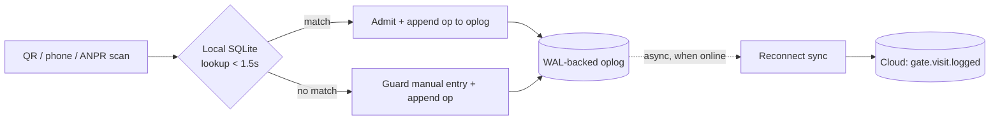
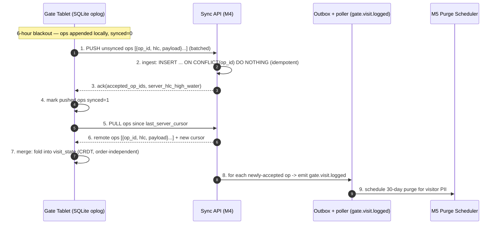
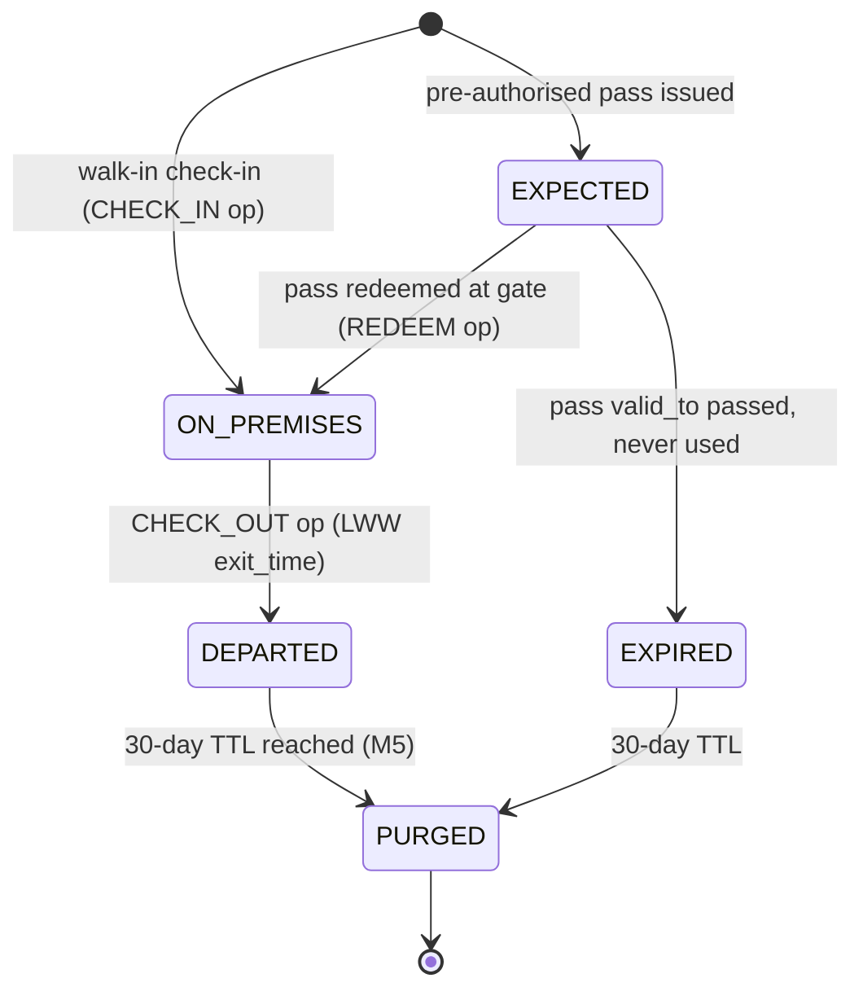

# Deep Dive — Offline-First Gate Sync (SQLite + CRDT)

**Document:** SOC-DOC-DD-02 · **Status:** Engineering deep dive · **Supports:** M4 Gate Infrastructure, BRD FR-4.1

> Prerequisite reading: [Architecture anchor](../01-architecture.md) (NFR mapping, `gate.visit.logged`
> topic), [Data model](../03-data-model.md), [Glossary](../glossary.md), and the module spec
> [M4 — Gate Infra](../modules/module-4-gate-infra.md). Scheme decision:
> [ADR-0005 (Offline gate: SQLite + CRDT)](../adr/0005-offline-gate-sqlite-crdt.md).

The gate tablet must keep working when the cloud is unreachable, and it must never lose an event.
This document specifies how: a local **SQLite + WAL** store that is authoritative on the hot path, gate
events modelled as **CRDTs** so independently-recorded edits merge without a central coordinator, and a
**reconnect sync protocol** that produces idempotent `gate.visit.logged` events on the server.

Two hard NFRs drive the whole design ([Architecture §7](../01-architecture.md)):

- **Zero loss over a 6-hour blackout.** Gate wifi/4G at Indian complexes drops for hours.
- **Check-in < 1.5 s.** The guard cannot wait on a round-trip to Mumbai.

The consequence is **offline-authoritative**: the decision to admit a visitor is made entirely on the
tablet from local data; the cloud push is **asynchronous** and happens later. The hot path never
touches the network.

---

## 1. Why offline-authoritative (not offline-cache)

A read-through cache that falls back to cloud still blocks on the network when the cache misses.
Instead the tablet holds a full working set — the resident directory, active pre-authorised passes,
the vehicle allow-list — refreshed opportunistically when online. Writes (check-ins) are recorded
**locally first, unconditionally**, then replicated. The gate is a *replica*, not a terminal.



---

## 2. Local store — SQLite + WAL

SQLite runs in **WAL (Write-Ahead Logging)** mode so a commit is a sequential append to the WAL
(`-wal`) file — fast and crash-safe. A power loss mid-check-in loses at most the uncommitted
transaction; everything acked to the guard is durable.

```sql
PRAGMA journal_mode = WAL;      -- durability + concurrent readers
PRAGMA synchronous  = NORMAL;   -- fsync WAL on checkpoint; fast + safe with WAL

-- Working set (pulled from cloud; read-only on the edge).
CREATE TABLE unit_directory (
    unit_id TEXT PRIMARY KEY, block TEXT, flat TEXT,
    resident_name TEXT, phone_masked TEXT, server_version INTEGER
);
CREATE TABLE visitor_pass (                 -- pre-authorised passes
    pass_id TEXT PRIMARY KEY, unit_id TEXT, code TEXT,
    valid_from INTEGER, valid_to INTEGER, max_uses INTEGER
);

-- The CRDT operation log: the authoritative local record of gate activity.
CREATE TABLE gate_oplog (
    op_id        TEXT PRIMARY KEY,   -- globally-unique, deterministic: deviceId:counter
    entity_type  TEXT NOT NULL,      -- VISIT | VEHICLE | PASS_REDEMPTION
    entity_id    TEXT NOT NULL,      -- the visit/vehicle id this op concerns
    op_type      TEXT NOT NULL,      -- CHECK_IN | CHECK_OUT | VEHICLE_LOG | REDEEM | FIELD_SET
    field        TEXT,               -- for LWW field sets (e.g. 'exit_time')
    value        TEXT,               -- JSON payload
    device_id    TEXT NOT NULL,
    hlc          TEXT NOT NULL,      -- hybrid logical clock stamp (see §4), sortable string
    synced       INTEGER NOT NULL DEFAULT 0   -- 0 = not yet pushed to cloud
);
CREATE INDEX ix_oplog_unsynced ON gate_oplog (synced, hlc);

-- Materialised current state (a local projection of the oplog for fast reads).
CREATE TABLE visit_state (
    visit_id TEXT PRIMARY KEY, unit_id TEXT, visitor_name TEXT,
    photo_ref TEXT, entry_hlc TEXT, exit_hlc TEXT,
    status TEXT,                     -- EXPECTED|ON_PREMISES|DEPARTED
    purge_after INTEGER              -- epoch; 30-day TTL (M5), see §8
);
```

The **oplog is the source of truth**; `visit_state` is a cache rebuilt by folding ops. This is what
lets two replicas converge: they exchange ops, not states.

---

## 3. CRDT design — choosing the right type per event

Different gate events have different merge semantics. We use three CRDT patterns, all built on the
same append-only oplog:

| Gate event | CRDT type | Why |
|---|---|---|
| **Visit check-in / check-out** | **LWW-Register per field** on a visit entity | Entry and exit are single-writer-ish facts; last-writer-wins by HLC resolves the rare double-record. A visit is created once; `entry_time`/`exit_time` are LWW fields. |
| **Vehicle logs (ANPR + manual)** | **OR-Set** (observed-remove set) of sightings | Many independent sightings accumulate; adds commute, and removal (false-positive plate) must not resurrect on merge. OR-Set tags each add with a unique id so concurrent add/remove is unambiguous. |
| **Pass redemptions** | **Grow-only counter (G-Counter) / add-only set** with a cap check | Redemptions only ever increase; the cap (`max_uses`) is validated at fold time. Append-only means no lost redemption. |

Key property across all three: **operations are commutative, associative, and idempotent** when keyed
by `op_id`. Applying the same op twice, or in any order, yields the same state — which is exactly what
makes merge coordinator-free and safe under at-least-once delivery.

### LWW visit resolution

```
foldVisit(ops for visit V):
    state = {}
    for op in ops sorted by hlc:            # total order via HLC (§4)
        if op.op_type == CHECK_IN:  state.entry = max_hlc(state.entry, op)   # LWW
        if op.op_type == CHECK_OUT: state.exit  = max_hlc(state.exit,  op)   # LWW
    return state
```

`max_hlc` keeps the value with the greater HLC; ties break on `device_id` (deterministic, so all
replicas pick the same winner).

### OR-Set for vehicle sightings

```
add(plate, tag=op_id):   observed.add((plate, tag))
remove(plate):           tombstones.add(all tags currently observed for plate)
members():               { plate : (plate,tag) in observed and tag not in tombstones }
```

A concurrent add on another device carries a *new* tag the remover never observed, so a legitimate
re-entry after a false-positive removal is preserved — no resurrection bug.

---

## 4. Ordering — Hybrid Logical Clocks

Pure wall-clock time is unreliable (tablet clocks drift, especially after a long offline stretch).
Pure Lamport clocks lose human-meaningful ordering. We use **Hybrid Logical Clocks (HLC)**: a pair
`(physical_time, logical_counter)` encoded as a lexicographically-sortable string. HLC stays close to
wall-clock but guarantees monotonicity and a total order even across devices.

```
# On local event:
l' = max(l, physicalClock())
if l' == l: c = c + 1 else c = 0
hlc = (l', c)

# On receiving a remote op with hlc_r = (l_r, c_r):
l' = max(l, l_r, physicalClock())
if   l' == l and l' == l_r: c = max(c, c_r) + 1
elif l' == l:               c = c + 1
elif l' == l_r:             c = c_r + 1
else:                       c = 0
hlc = (l', c)
```

Why this matters at the gate: during a 6-hour blackout the tablet keeps minting strictly increasing
HLCs. On reconnect, the server's and other tablets' ops interleave by HLC into a deterministic total
order, so **every replica folds to the identical visit state** regardless of arrival order.

---

## 5. The reconnect sync protocol

When connectivity returns, the tablet runs a bounded push/pull/merge cycle. It is **idempotent and
resumable** — a mid-sync disconnect just reruns.



### Conflict resolution rules (summary)

- **Same visit, two check-outs:** LWW by HLC — later exit wins; earlier retained in oplog for audit.
- **Duplicate scan (same person, two taps within seconds):** deduplicated by a content hash in the
  payload *plus* a short dedupe window; the second op is accepted but folds to the same visit (no
  double visit). See §7.
- **Vehicle false-positive then real entry:** OR-Set tags keep them distinct (§3).
- **Pass over-redemption across offline replicas:** each redemption is its own op; at fold time, if
  observed redemptions exceed `max_uses`, the surplus is flagged for MC review — **not silently
  dropped** (append-only is preserved; the business rule is applied at read time).

---

## 6. Idempotent server ingest

The server ingest is keyed on the globally-unique, deterministic `op_id` (`deviceId:counter`). The
device assigns it; the server never rewrites it. This makes the whole pipeline safe under retries:

```sql
INSERT INTO gate_op (op_id, tenant_id, entity_type, entity_id, op_type,
                     payload, hlc, device_id)
VALUES (:op_id, :tid, :etype, :eid, :otype, :payload, :hlc, :dev)
ON CONFLICT (op_id) DO NOTHING;         -- redelivery / retry -> no-op
```

Only rows actually inserted (not conflict-skipped) emit a `gate.visit.logged` event — so a resent
batch never double-fires downstream notifications or double-schedules a purge. The event carries the
`op_id` so M5 and Notification are themselves idempotent on it.

---

## 7. Clock skew & duplicate scans

- **Clock skew:** HLC bounds divergence — on merge, a tablet whose physical clock ran slow catches up
  to the max observed physical component, so its subsequent ops sort correctly. No op is ever
  discarded for being "in the past"; it simply folds by HLC.
- **Duplicate scans:** the guard double-taps, or ANPR fires twice. The op payload includes a
  `dedupe_key = hash(entity_id, op_type, truncate(entry_time, 5s))`. Ops sharing a `dedupe_key` fold
  to one visit record; the extra ops remain in the oplog (audit) but do not create a second visit.
  Because this is applied at *fold* time, it works identically on the tablet and the server.

---

## 8. Visit lifecycle



### Retention interplay with M5 (30-day purge)

Each accepted visit op schedules an M5 purge via `gate.visit.logged`
([Architecture §5](../01-architecture.md)). Important edge: the purge must also run **on the tablet's
local copy** — `visit_state.purge_after` drives a local SQLite sweep so visitor PII (name, photo,
phone) is deleted from the edge after 30 days too, not just from the cloud. The oplog retains a
**redacted** op (ids and HLC only) so convergence math still holds after PII is purged. M5's
guarantees are specified in [M5 — Privacy Shield](../modules/module-5-privacy-shield.md); DPDP roles
are in the [Glossary](../glossary.md).

---

## 9. Hot-path budget (< 1.5 s)

The check-in decision is a single indexed SQLite lookup + one WAL-append insert, both local:

| Step | Typical | Notes |
|---|---|---|
| Scan decode (QR/plate) | ~200 ms | on-device |
| `unit_directory` / `visitor_pass` lookup | < 5 ms | PK index, in-memory page cache |
| Append op to `gate_oplog` (WAL) | < 10 ms | sequential append |
| UI confirm (admit/deny) | ~100 ms | render |
| **Cloud push** | **off the hot path** | async, batched on reconnect |

The entire admit decision is local and well under budget; synchronisation latency is decoupled from
the guard's experience. This is the concrete realisation of the "offline-tolerant edge" principle in
[Architecture §1](../01-architecture.md).

---

## 10. Where this connects

- `gate.visit.logged` topic and the < 1.5 s / zero-loss NFRs: [Architecture §5, §7](../01-architecture.md).
- CRDT, WAL, ANPR term definitions: [Glossary](../glossary.md).
- Edge schema and tenancy: [Data model](../03-data-model.md).
- Multilingual UI, smart access, pass issuance: [M4 — Gate Infra](../modules/module-4-gate-infra.md).
- 30-day purge mechanics and consent: [M5 — Privacy Shield](../modules/module-5-privacy-shield.md).
