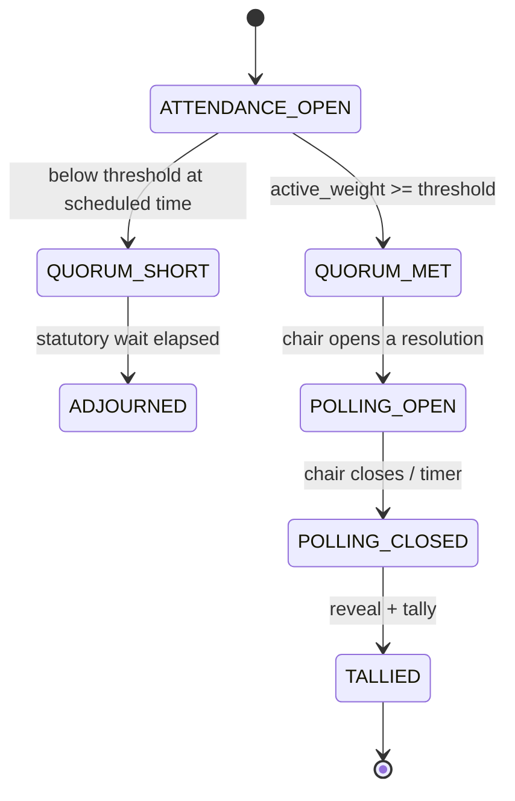

# Deep Dive — Cryptographic Secret Balloting & Quorum

**Document:** SOC-DOC-DD-03 · **Status:** Engineering deep dive · **Supports:** M2 Governance/e-AGM, BRD FR-2.2 / FR-2.3

> Prerequisite reading: [Architecture anchor](../01-architecture.md) (`agm.vote.cast`, append-only
> audit), [Data model](../03-data-model.md), [Glossary](../glossary.md), and the module spec
> [M2 — Governance/e-AGM](../modules/module-2-governance-agm.md). Scheme decision:
> [ADR-0006 (Cryptographic e-voting scheme)](../adr/0006-crypto-evoting-scheme.md).

A society's AGM must run secret ballots that are nonetheless *verifiable* and *tamper-evident*, with a
live quorum computation that honours statutory voting weights and validated proxies. This document
specifies a **pragmatic engineering scheme** — commit-reveal + encrypted ballots + an append-only
hash-chained audit log. It is deliberately **not a blockchain**: it realises the BRD's "immutable
cryptographic audit trail" with standard cryptography an auditor can reason about and re-verify from
an exported log.

---

## 1. Requirements

| Requirement | Meaning |
|---|---|
| **Secrecy** | No one — including MC and Societix admins — can link a cast ballot's *content* to the voter. |
| **Verifiability** | A voter can confirm their ballot was counted; anyone can recompute the tally from the published log. |
| **Tamper-evidence** | Any insertion, deletion, or edit of a recorded ballot is detectable. |
| **One-owner-one-(weighted)-vote** | Each eligible owner votes once; weight per statute. No double-voting. |
| **Validated proxies** | An absent owner may delegate; proxies are validated and bounded before polls open. |
| **Coercion/stuffing resistance** | Resistant (within a pragmatic model) to ballot stuffing, admin tampering, and casual coercion. |

The central tension — **secrecy vs. verifiability** — is resolved by *separating identity from
content*: eligibility is checked against the identity, but the thing recorded is a ballot that is
cryptographically unlinkable to that identity.

---

## 2. The quorum engine (dynamic active voting weight)

Quorum is not a headcount; it is a **weighted** threshold. Under e.g. **Karnataka KAOA 1972** voting
weightages, each unit carries a weight (often one vote per unit, or share-proportional per bylaws).
The engine tracks *active voting weight* live as members join/leave the sitting and as proxies are
exercised.

```
active_weight(resolution) =
      Σ weight(owner)                for owners present and voting
    + Σ weight(represented_owner)    for each VALID proxy exercised
quorum_met = active_weight >= statutory_threshold(resolution.type)
```

Rules enforced:

- **Weight source of truth** is the member/unit master (seeded by M6 migration; see
  [modules index](../modules/README.md)).
- **Proxy bounds:** a proxy must be validated (document uploaded, MC-approved) *before* polls open;
  one holder may carry at most the statutory cap of proxies; a proxy cannot vote if the represented
  owner also votes directly (direct vote supersedes, proxy is voided).
- **Threshold by resolution type:** ordinary vs. special resolutions (e.g. fund hike, capex) have
  different statutory thresholds; the engine selects per resolution.
- **Live recompute:** `agm.vote.cast` and attendance events drive a recompute; the quorum bar is shown
  live in the e-AGM console.



Separately from quorum: a voter **eligibility check** (owner in good standing, not disqualified,
weight > 0) gates issuance of a voting credential. This check touches identity — and is kept strictly
apart from the ballot box (§3).

---

## 3. The secret-ballot scheme (commit–reveal + encrypted ballots)

The scheme has two logical stores that are **never joined**:

- **Eligibility roll** — identity-linked: who is allowed to vote, their weight, and a one-time
  **voting token** (random, single-use). Marks *whether* a token has voted, never *how*.
- **Ballot box** — identity-stripped: encrypted ballots plus commitments, keyed only by the ballot's
  own id. No column links a ballot to a voter.

### Phase A — Credential issuance (identity side)

On eligibility pass, the server issues the voter a single-use **voting token** `t` (high-entropy
random) and records `hash(t)` in the eligibility roll with `has_voted = false`. The token is the
bearer credential; the server stores only its hash, so possession proves eligibility without the
server being able to forge or replay it.

### Phase B — Commit (cast)

The client forms a ballot `b = {resolutionId, choice, weight, nonce}`, then:

1. **Commitment:** `commitment = H(b || r)` with a random blinding factor `r`. This binds the voter to
   their choice without revealing it (hiding + binding — a standard commitment).
2. **Encrypted ballot:** `C = Enc(pk_election, b || r)` under the **election public key** `pk_election`
   (threshold key, see §7). The content is now readable only after the key is reconstructed at tally.
3. The client submits `{token t, commitment, C}`. The server:
   - verifies `hash(t)` is in the roll and `has_voted = false`;
   - atomically sets `has_voted = true` (the double-vote guard — §5);
   - **discards `t`** and inserts `{ballot_id, commitment, C}` into the ballot box with **no voter
     reference**;
   - appends an entry to the hash-chained audit log (§4).

The token is seen only at the boundary and is not stored alongside the ballot, so the link between
voter and ballot content is severed at write time.

### Phase C — Close & reveal

When the chair closes polling, the **election private key** `sk_election` is reconstructed from its
threshold shares (§7). Each `C` is decrypted to recover `b || r`; the tally engine re-derives
`H(b || r)` and checks it equals the stored `commitment`. A mismatch means tampering — the ballot is
flagged, not silently counted.

### Phase D — Tally

Weighted sum per choice over all ballots whose commitment verified:

```
for each resolution:
    tally[choice] += ballot.weight     for every verified ballot
result = argmax / threshold rule per resolution type
```

```mermaid
sequenceDiagram
    autonumber
    participant V as Voter (client)
    participant E as Eligibility Roll (identity)
    participant B as Ballot Box (anonymous)
    participant L as Hash-chain Audit Log
    participant T as Tally Engine

    Note over V,E: Phase A — issuance
    V->>E: authenticate (OIDC) + eligibility check
    E-->>V: single-use voting token t  (server stores H(t), has_voted=false)

    Note over V,B: Phase B — commit/cast
    V->>V: b={res,choice,weight,nonce}; commitment=H(b||r); C=Enc(pk,b||r)
    V->>B: submit {t, commitment, C}
    B->>E: verify H(t), CAS has_voted false->true   (double-vote guard)
    B->>B: store {ballot_id, commitment, C}  (NO voter link; t discarded)
    B->>L: append(hash(prev) -> this)  (tamper-evident)
    B-->>V: receipt = {ballot_id, commitment, chain_index}

    Note over B,T: Phase C/D — close, reveal, tally
    T->>T: reconstruct sk from threshold shares
    T->>B: read all {commitment, C}
    T->>T: b||r = Dec(sk,C); assert H(b||r)==commitment
    T->>T: weighted sum per choice
    T->>L: append TALLY_PUBLISHED (final chain head)
```

---

## 4. Append-only hash-chained audit log

Every ballot-affecting action (ballot stored, polling opened/closed, key reconstructed, tally
published) is an entry whose hash includes the **previous** entry's hash. Any mutation anywhere breaks
the chain for all subsequent entries — tamper-evident without a blockchain.

```sql
CREATE TABLE evote_audit_chain (
    seq          BIGINT GENERATED ALWAYS AS IDENTITY PRIMARY KEY,
    tenant_id    UUID        NOT NULL,
    election_id  UUID        NOT NULL,
    entry_type   TEXT        NOT NULL,   -- BALLOT_CAST | POLL_OPEN | POLL_CLOSE | KEY_RECONSTRUCT | TALLY_PUBLISHED
    -- Payload is anonymous: for BALLOT_CAST it carries {ballot_id, commitment}, never a voter id.
    payload      JSONB       NOT NULL,
    prev_hash    BYTEA       NOT NULL,   -- SHA-256 of the previous row's row_hash (genesis = 0x00..)
    row_hash     BYTEA       NOT NULL,   -- H(prev_hash || canonical(payload) || entry_type || ts)
    created_at   TIMESTAMPTZ NOT NULL DEFAULT now(),
    UNIQUE (tenant_id, election_id, seq)
);

-- Append-only: no UPDATE/DELETE grant; a trigger recomputes and verifies row_hash on INSERT.
CREATE OR REPLACE FUNCTION evote_chain_link() RETURNS trigger AS $$
DECLARE prev BYTEA;
BEGIN
    SELECT row_hash INTO prev FROM evote_audit_chain
      WHERE tenant_id = NEW.tenant_id AND election_id = NEW.election_id
      ORDER BY seq DESC LIMIT 1;
    NEW.prev_hash := COALESCE(prev, '\x0000000000000000000000000000000000000000000000000000000000000000');
    NEW.row_hash  := digest(NEW.prev_hash
                         || convert_to(NEW.entry_type, 'UTF8')
                         || convert_to(NEW.payload::text, 'UTF8'), 'sha256');
    RETURN NEW;
END $$ LANGUAGE plpgsql;

CREATE TRIGGER trg_evote_chain BEFORE INSERT ON evote_audit_chain
    FOR EACH ROW EXECUTE FUNCTION evote_chain_link();
```

**Verification** (any auditor, from an export): walk the chain, recompute each `row_hash` from
`prev_hash + payload`, and confirm it matches and that each `prev_hash` equals the prior row's
`row_hash`. A single altered or removed ballot invalidates every hash downstream. The final
`TALLY_PUBLISHED` head can be published (e.g. read into the society notice board) so the result is
pinned to a specific chain state. This log is the M2-specific instance of the system-wide append-only
audit principle in [Architecture §7](../01-architecture.md).

---

## 5. Preventing double-voting while preserving secrecy

The double-vote guard lives entirely on the **identity side** and never sees ballot content:

```sql
-- Atomic compare-and-set: only the first cast with this token flips the flag.
UPDATE eligibility_roll
   SET has_voted = TRUE, voted_at = now()
 WHERE tenant_id = :tid AND token_hash = :h AND has_voted = FALSE
RETURNING 1;          -- 0 rows -> already voted / invalid -> reject the cast
```

Because this `UPDATE ... WHERE has_voted = FALSE` is atomic, two concurrent submissions with the same
token serialize — exactly one wins. The ballot box, meanwhile, stores no token and no voter id, so the
fact *that* a voter voted (identity side) is provably disjoint from *what* was voted (ballot side).
The receipt returned to the voter (`ballot_id`, `commitment`, `chain_index`) lets them later confirm
their ballot is present in the published chain — verifiability without de-anonymisation.

---

## 6. Threat model & mitigations

| Threat | Vector | Mitigation |
|---|---|---|
| **Ballot stuffing** | Forge extra ballots | Single-use tokens bound to the eligibility roll; a ballot without a consumed token can't be created. Chain length is reconcilable against tokens consumed. |
| **Admin tampering** | MC/Societix edits or deletes ballots | Append-only table (no UPDATE/DELETE grant) + hash chain makes any edit detectable; tally recomputable by third party from the export. |
| **De-anonymisation** | Join voter to choice | No column links them; token discarded at cast; audit payload is anonymous. Even full DB read cannot reconstruct the link. |
| **Result forgery** | Publish a tally that doesn't match ballots | Anyone can re-decrypt (post-close) and recompute; commitments pin each choice so a swapped ballot fails `H(b||r)` check. |
| **Coercion / vote-buying** | Pressure a voter, demand proof | Receipt proves *presence*, not *content* (commitment is hiding), so a coercer can't verify how the voter chose. Within the pragmatic model; strong receipt-freeness is out of scope. |
| **Early decryption** | Admin peeks before close | Election key is threshold-split (§7); no single party can decrypt before shares are combined at close. |
| **Replay** | Resubmit a captured cast | `agm.vote.cast` ingest is idempotent on `ballot_id`; token already consumed. |

---

## 7. Key management

- **Election keypair per resolution set.** `pk_election` is published before polls open; `sk_election`
  is **threshold-split** (Shamir `t`-of-`n`) across independent trustees — e.g. the chair, an
  independent scrutineer, and a Societix escrow share. No single party can decrypt ballots; `t` shares
  must combine at close. This is what prevents early decryption and admin tampering.
- **Reconstruction is an audited event** (`KEY_RECONSTRUCT` entry on the chain), performed only after
  `POLL_CLOSE`.
- **Transport & rest:** TLS 1.3 in transit; shares and the ballot box encrypted at rest (AES-256),
  consistent with the canonical stack. Per-tenant envelope keys isolate one society's election from
  another ([Architecture §6](../01-architecture.md)).
- **Commitment blinding factors** `r` live only inside the encrypted ballot `C`, so they surface only
  at reveal — the commitment alone leaks nothing before close.

---

## 8. Why not blockchain

A permissioned ledger would add consensus, token economics, and operational weight the problem does
not need. The requirement is an **immutable, verifiable audit trail for one society's vote** — a
hash-chained append-only table plus threshold-encrypted ballots delivers tamper-evidence and
independent recomputation with cryptography an auditor already trusts, inside the existing PostgreSQL
tenancy and audit model. The scheme decision and this trade-off are recorded in
[ADR-0006](../adr/0006-crypto-evoting-scheme.md).

---

## 9. Where this connects

- `agm.vote.cast` event and append-only audit principle: [Architecture §5, §7](../01-architecture.md).
- Quorum, Proxy, Resolution, KAOA weightage definitions: [Glossary](../glossary.md).
- Member/unit master and election tables: [Data model](../03-data-model.md).
- Notice generation, live quorum console, committee handover: [M2 — Governance/e-AGM](../modules/module-2-governance-agm.md).
- Minutes produced from a tallied resolution feed M3's auto-MoM — see [dd-04](dd-04-ai-copilot-rag.md).
