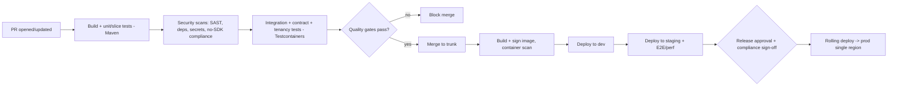

# CI/CD & DevOps

**Document:** `SOC-DOC-DEL-05` · **Status:** Draft for engineering

The delivery pipeline, environments, infrastructure-as-code, secrets, database migration strategy,
release/rollback, and observability for Societix. Realises the deployment topology in
[`../01-architecture.md`](../01-architecture.md) §9 (**single-region, managed services v1**) and the
testing lanes in [`testing-strategy.md`](testing-strategy.md). Quality gates are enforced per
[`definition-of-done.md`](definition-of-done.md).

> **Economical-first.** v1 runs in a **single region on managed services** (managed PostgreSQL,
> managed Redis, a managed container host) with **no message broker** (the event backbone is a
> Postgres transactional outbox — [ADR-0004](../adr/0004-kafka-event-driven-cadence.md)) and a
> **simple rolling deploy**. The heavier options below (multi-region, canary/blue-green, full
> OpenTelemetry/Prometheus/Grafana, self-managed Kubernetes) are documented as **later scale steps**,
> not day-1 infra — keeping monthly spend and ops load low for a 3-developer team.

---

## 1. Pipeline (GitHub Actions)

| Stage | Trigger | Actions |
|---|---|---|
| Build + test | every PR | Maven verify, unit/slice/Modulith tests, patch coverage gate |
| Security scans | every PR | **SAST** (CodeQL), **dependency** scan (Dependabot/OWASP), **secret** scan (gitleaks), **no-third-party-SDK** compliance check |
| Integration | PR (required) | Testcontainers integration, contract verify, tenancy isolation |
| Image | merge to trunk | Build OCI image, generate SBOM, **sign** (cosign), **container scan** (Trivy/Grype) |
| Deploy dev→staging | merge | Deploy to managed host; E2E (Playwright/Detox) + performance on staging |
| Deploy prod | manual approval + compliance sign-off | **Rolling deploy** to the single prod region |

---

## 2. Environments

| Env | Purpose | Topology |
|---|---|---|
| **dev** | integration & feature validation | single region, managed services (shared) |
| **staging** | production-like; E2E/perf/pre-release | mirrors prod at reduced scale |
| **prod** | live | **single region (Mumbai)** on managed services (managed PostgreSQL + Redis + container host), automated backups + PITR |

Data residency: all environments stay within Indian regions (DPDP/sovereignty requirement).

> **Later (scale step):** add a **Hyderabad passive region** with streaming PostgreSQL replication for
> regional failover once the 99.95% multi-region target is prioritised. Not part of v1.

---

## 3. Infrastructure as Code

- **Terraform** provisions cloud infra: network, a **managed container host**, **managed PostgreSQL 18**
  (automated backups + PITR), **managed Redis 8.2**, object storage, DNS/ingress. State in a locked
  remote backend. *No broker and no self-managed Kubernetes control plane in v1.*
- **Deployment manifests / PaaS config** deploy the modular monolith, gateway/BFF, and the scheduled
  outbox/worker process; autoscaling on the stateless app.
- Environments are diff-only promotions of the same modules (dev/staging/prod as Terraform
  workspaces / value overlays) — no snowflakes.

> **Later (scale step):** migrate to self-managed **Kubernetes** (Helm + manifests, HPA,
> `PodDisruptionBudget`, anti-affinity) if managed-host limits or cost at scale justify the added ops.

---

## 4. Config & secrets management

- **Non-secret config** via per-environment config (managed-host config / `ConfigMap`).
- **Secrets** in a managed secrets store (cloud secrets manager, or HashiCorp **Vault** when
  warranted); injected at runtime, never in images or git.
- **Per-tenant data-encryption keys** (envelope encryption) managed via a KMS/transit engine —
  tenant PII and bank identifiers are encrypted with per-tenant DEKs (see
  [`../01-architecture.md`](../01-architecture.md) §6).
- Secret scanning (gitleaks) blocks any credential from entering the repo.

---

## 5. Database migrations (zero-downtime)

- **Flyway** migrations run as a pre-deploy pipeline step, versioned with the app.
- **Expand-contract** pattern for zero-downtime, DB-compatible rollbacks:
  1. **Expand** — additive change (new nullable column/table), deployed first; old + new code both work.
  2. **Migrate** — backfill + dual-write while both app versions run.
  3. **Contract** — remove the old shape only after the old app version is fully retired.
- No destructive migration ships in the same release as the code that stops using the old shape — this
  keeps **every release rollback-safe at the DB layer**.
- RLS policies are versioned Flyway migrations and covered by the tenancy isolation suite.
- The **outbox** and **shedlock** tables are ordinary Flyway-managed tables — no extra infra to migrate.

---

## 6. Release & rollback

- **Rolling deploy** (v1): replace instances incrementally behind the load balancer, with health
  checks gating each step. Simple, cheap, and adequate at pilot scale.
- **Feature flags** decouple deploy from release — merged code can ship dark and enable per-tenant.
- **Rollback** = redeploy the previous signed image; safe because migrations are expand-contract
  (previous app version remains DB-compatible). No forward-only destructive migration is allowed in a
  single step.

> **Later (scale step):** adopt **canary** (route a small traffic slice, watch SLOs/error budget, then
> promote) and **blue/green** for high-risk cutovers once traffic and a second region warrant it.

---

## 7. Observability & SLOs

**v1 (economical):** **Spring Boot Actuator** (health, metrics, info) + **structured JSON logging**
with a `traceId`/`tenantId` on every line, shipped to the managed host's log aggregation. This covers
health checks, basic metrics, and incident triage without standing up a metrics/trace platform.

> **Later (scale step):** add **OpenTelemetry** export → **Prometheus** + **Grafana** for distributed
> tracing (gateway→module→DB) and rich dashboards. The Actuator/Micrometer metrics are already
> OTel-compatible, so this is additive.

- **SLOs tied to the 99.95% availability target**, plus NFR-specific SLIs (tracked from Actuator
  metrics in v1; dashboarded later):

| SLI | SLO | Alert |
|---|---|---|
| Availability | 99.95% | Error-budget burn-rate (fast + slow) |
| Gate check-in latency | p95 < 1.5 s | p95 breach sustained 5 min |
| AI query latency | p95 < 2.5 s | p95 breach sustained 5 min |
| Payment match lag | < 60 s | unmatched queue growth |
| Outbox dispatch lag | < 30 s | unprocessed outbox backlog growth |
| Purge SLA | PII deleted ≤ 30 days + grace | overdue purge job |

- **Alerting** routes to on-call (PagerDuty/Opsgenie or a lightweight equivalent for a small team).
  Runbooks live with each alert; incident-response RACI in
  [`estimation-and-team.md`](estimation-and-team.md).
- v1 dashboards (from Actuator/Micrometer): golden signals per module, per-tenant rate-limit health,
  **outbox dispatch lag**, and managed-PostgreSQL health.
