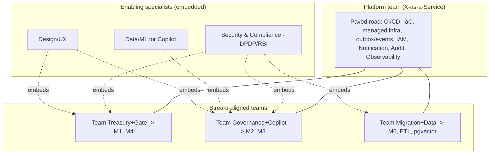

# Estimation & Team Topology

**Document:** `SOC-DOC-DEL-03` · **Status:** Draft for engineering

How we structure teams and estimate work across the BRD phases. Team sizing is anchored to the
BRD scale targets (Yr1: 120 societies / 24k units; Yr2: 650 / 130k; Yr3: 2200 / 440k; blended
ARPU ₹28–36/unit/mo; churn <2.5%) and the phased plan in
[`development-plan.md`](development-plan.md). Backlog in
[`epics-and-stories.md`](epics-and-stories.md).

---

## 1. Team topology

We apply **Team Topologies**: small stream-aligned teams own module clusters end-to-end, a
platform team owns the paved road, and enabling specialists are embedded as needed. Stream teams
interact with the platform team via **X-as-a-Service**; the security/compliance function is an
embedded **enabling** capability, not an afterthought.

| Team | Owns | Modules |
|---|---|---|
| **Platform** | Paved road, tenancy/RLS plumbing, outbox/event backbone, IAM, Notification, Audit, Observability, CI/CD, IaC | Foundations |
| **Stream: Treasury + Gate** | Collections spine + daily-touch gate | M1, M4 |
| **Stream: Governance + Copilot** | Statutory governance + AI analytics | M2, M3 |
| **Stream: Migration + Data** | ETL onboarding + data/embedding pipelines | M6 |
| **Enabling: Security & Compliance** | DPDP/RBI posture, M5 guardrails, threat modelling, audits | M5 (cross-cutting) |
| **Enabling: Data/ML** | RAG quality, eval harness, grounding | M3 |
| **Enabling: Design/UX** | Multilingual gate UI, resident/console UX, accessibility | all client |

> M5 (Privacy Shield) is owned by the Security & Compliance enabling team but **implemented inside
> every stream** — guardrails live in the modules that touch PII, reviewed by the enabling team.

---

## 2. Roles & headcount by phase

Indicative FTE; pairs/squads grow with scale, not linearly with society count (multi-tenant SaaS).

| Role | Phase 0 | Phase 1 | Phase 2 | Phase 3 |
|---|---|---|---|---|
| Backend (Java/Spring) | 3 | 5 | 8 | 9 |
| Frontend (React/TS) | 1 | 2 | 3 | 4 |
| Mobile (React Native/Expo) | 1 | 2 | 3 | 3 |
| Data/ML (Copilot) | 0 | 1 | 2 | 2 |
| DevOps/SRE | 1 | 2 | 3 | 4 |
| QA / SDET | 1 | 2 | 3 | 4 |
| **Security & Compliance** | **1** | **1** | **2** | **2** |
| Product | 1 | 1 | 2 | 2 |
| Design | 1 | 1 | 2 | 2 |
| Eng lead / architect | 1 | 1 | 2 | 2 |
| **Total (approx.)** | **11** | **18** | **30** | **34** |

> **The Security & Compliance role is non-negotiable from Phase 0.** DPDP Act exposure (resident
> PII, 30-day purge, consent) and RBI/PA exposure (no-float payments, maker-checker) make it a
> standing function, not a phase-gate review.

---

## 3. Estimation approach

- **Relative sizing with story points** (modified Fibonacci: 1, 2, 3, 5, 8, 13). Shirt sizes in the
  backlog map to points: S≈3, M≈5, L≈8–13, XL≈20+ (split before committing).
- **Velocity assumption:** a stabilised 2-person stream pair delivers ~15–20 points/2-week sprint.
  New teams are assumed to ramp (ignore velocity for the first 2–3 sprints — Sprint 0 is explicitly
  discovery/scaffold).
- **No false precision:** points are capacity signals, not hour commitments. We forecast with
  rolling 3-sprint velocity, not up-front Gantt-to-the-day estimates.
- **Risk buffers:** cryptographic voting (M2.3), CRDT offline merge (M4.1), and ETL reconciliation
  (M6) carry explicit spike stories before commitment.

### Indicative relative effort per module

Relative T-shirt effort (not a schedule) — reflects novelty/risk, not just surface area.

| Module | Relative effort | Why |
|---|---|---|
| Foundations | L–XL | Tenancy/RLS, eventing, IAM — the hard cross-cutting bedrock |
| M1 Treasury/ERP | XL | Double-entry ledger + zero-touch allocation + cadence; correctness-critical |
| M2 Governance/e-AGM | XL | Cryptographic balloting + statutory correctness |
| M3 AI Copilot | L | RAG grounding + eval harness; bounded by read-only scope |
| M4 Gate Infra | XL | Offline-authoritative CRDT + edge + multilingual; latency-critical |
| M5 Privacy Shield | M (×ongoing) | Smaller surface but cross-cutting and continuously enforced |
| M6 Smart-Switch | L | ETL mapping + reconciliation; messy source data is the risk |

---

## 4. RACI — key activities

R = Responsible, A = Accountable, C = Consulted, I = Informed.

| Activity | Eng Lead/Architect | Stream Team | Platform | Sec & Compliance | Product | SRE |
|---|---|---|---|---|---|---|
| Architecture decisions (ADRs) | A/R | C | C | C | I | C |
| Module feature delivery | C | A/R | C | C | A | I |
| Release to prod | C | R | R | C | I | A |
| **Compliance sign-off (DPDP/RBI)** | C | C | I | **A/R** | C | I |
| Incident response | C | C | C | C (if data) | I | A/R |
| Data model / RLS changes | A | R | C | C | I | I |
| Payment/ledger correctness | A | R | I | C | C | I |
| Threat modelling / pen-test | C | C | C | A/R | I | C |

> **Release and compliance are deliberately split:** SRE is accountable for the *mechanics* of
> release; Security & Compliance holds an independent **A** on DPDP/RBI sign-off that can block a
> release gate (see [`definition-of-done.md`](definition-of-done.md)).

---

## 5. Scaling the org with the business

| Year | Societies / units | Org implication |
|---|---|---|
| Yr1 | 120 / 24k | Single pod of 3 stream teams + platform; ~30 FTE by end of Phase 2 |
| Yr2 | 650 / 130k | Add SRE depth + a second migration squad for B2B onboarding; ~34+ |
| Yr3 | 2200 / 440k | Consider extracting hottest modules to services; grow platform & SRE, not per-society headcount |

Low churn (<2.5%) and multi-tenant architecture mean headcount scales **sub-linearly** with society
count — investment shifts toward reliability (SRE), compliance depth, and B2B/white-label features.
