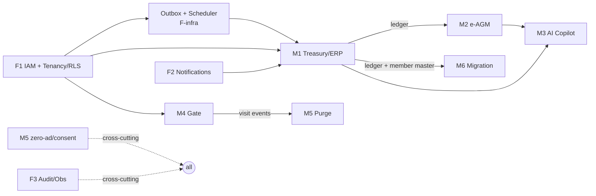
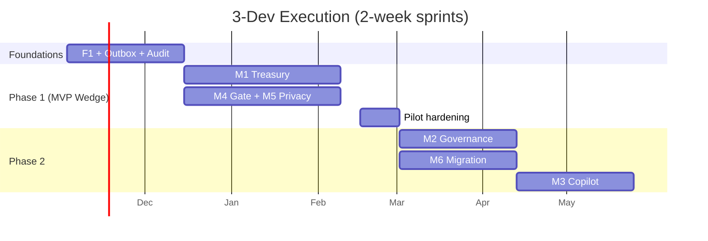

# Execution Plan — 3-Developer Team

**Document:** `SOC-DOC-DEL-07` · **Status:** Draft for engineering · **Team size:** 3 developers

This plan sequences the [epics & user stories](epics-and-stories.md) into a concrete execution order
for a **small team of three developers**, aligned to the [development plan](development-plan.md)
phases and the economical, broker-free v1 architecture (Postgres transactional outbox — no Kafka —
see [ADR-0004](../adr/0004-kafka-event-driven-cadence.md)). It assumes **2-week sprints**.

> Story IDs (F1.x, M1.x, …), sizes (S/M/L/XL), and acceptance criteria are defined in
> [`epics-and-stories.md`](epics-and-stories.md). Sizing basis: **S ≈ ½ sprint, M ≈ 1 sprint,
> L ≈ 2 sprints, XL ≈ 3 sprints** for *one developer*.

---

## 1. The team

Three full-stack-leaning engineers. We assign a **primary domain** to each for ownership and review
depth, but everyone works across the stack and reviews each other.

| Dev | Primary domain | Secondary |
|---|---|---|
| **Dev A — Platform/Backend lead** | Foundations (IAM, tenancy/RLS, outbox, CI/CD), Treasury ledger (M1 core) | Security/compliance sign-off |
| **Dev B — Payments & Governance** | M1 billing/VAN/payments/cadence, M2 e-AGM | Migration (M6) |
| **Dev C — Edge & Frontend** | M4 gate app (offline/CRDT), web + mobile UIs, M5 privacy | M3 copilot UI |

**Working agreement**
- Every story needs a second reviewer (see [`definition-of-done.md`](definition-of-done.md)); no self-merge to `main`.
- **Pair on the two hardest items** (M1.3 zero-touch allocation, M2.3 e-voting) — they are the
  highest-risk; a pair beats two solo tracks here.
- M5 (privacy) and F3.2 (audit) are **cross-cutting and continuous** — checked in every PR, not a
  one-off story.

## 2. Capacity & scope reality for 3 devs

At ~2.5 effective dev-weeks of throughput per 2-week sprint (meetings/support overhead), full scope
(all 6 modules + foundations ≈ 55–65 story-weeks) lands around **12–14 sprints (~6–7 months)** to a
production pilot. The sequencing below front-loads the **MVP wedge (M1 + M4)** so there is a
demoable, revenue-relevant product by ~Sprint 6, with governance/AI/migration following.

## 3. Execution order (dependency-driven)

The hard ordering constraints:

**Non-negotiable prerequisites:** F1 (tenancy/RLS) and the **outbox + scheduler** must exist before
any module emits events or persists tenant data. M1's ledger must exist before M2 capex voting and
M6 reconciliation. M4 must exist before M5's purge has anything to purge.

## 4. Sprint-by-sprint

Legend: **[A]/[B]/[C]** = owning dev; **(pair)** = two devs together.

### Phase 0 — Foundations (Sprints 0–2)

| Sprint | Dev A | Dev B | Dev C |
|---|---|---|---|
| **S0 — Walking skeleton** | Repo, Gradle multi-module (Modulith), CI skeleton, docker-compose (PG+Redis+PA mock) | **F1.1** tenant onboarding + **F1.4** RLS fail-closed *(pair with A)* | Web app shell (Vite), auth screens, design tokens wired |
| **S1 — Identity & outbox** | **F1.4** finish RLS + **outbox table + ShedLock poller** (the event backbone) | **F1.2** OTP+OIDC login, **F1.3** RBAC roles | **F3.2** audit log (append-only, hash-chain) + Actuator/health |
| **S2 — Notifications & vertical slice** | **F2.1** notification fan-out core + channel adapters | **F2.2** escalation + **F2.3** outbox-driven dispatch (idempotent) | Vertical slice UI: raise invoice → see it; seed demo tenant |

**Exit:** a logged-in Secretary in an isolated tenant; one event flows end-to-end through the outbox;
audit log verified; CI green. Compliance guardrail **M5.1** (no third-party SDK scan) added to CI now.

### Phase 1 — MVP Wedge: Treasury + Gate (Sprints 3–7)

| Sprint | Dev A | Dev B | Dev C |
|---|---|---|---|
| **S3** | **M1.6** double-entry ledger (schema, posting, invariant) | **M1.1** multi-formula billing engine | **M4.1** gate offline check-in + SQLite (start, L) |
| **S4** | **M1.3** zero-touch allocation **(pair with B)** | **M1.2** VAN/VPA provisioning + **M1.3 (pair)** | **M4.1** finish CRDT reconnect/merge |
| **S5** | **M1.6** statements (trial balance/P&L/BS) from ledger | **M1.4** defaulter cadence (Day +1→+30 scheduled) | **M4.3** visitor QR pre-approval + **M4.2** multilingual UI |
| **S6** | **M1.5** maker-checker payouts (TDS/GST ITC) | Treasury hardening, PA sandbox→real integration | **M4.4** ANPR + gate UI polish |
| **S7 — Pilot hardening** | Perf: gate < 1.5 s, payment idempotency tests | **M5.2** 30-day purge (consumes gate visit events) | **M5.3** consent + directory masking; resident mobile app for pay/visitor |

**Exit (≈ BRD Phase 1):** 20-society pilot can run — autopilot invoicing + payments + ledger +
offline gate + privacy purge live. This is the demoable, revenue-relevant wedge.

### Phase 2 — Governance, Copilot, Migration (Sprints 8–13)

| Sprint | Dev A | Dev B | Dev C |
|---|---|---|---|
| **S8** | Scale/backup review; support M2 ledger reads | **M2.1** AGM notices + **M2.2** quorum engine | **M2** web UI (notices, quorum board) |
| **S9** | **M2.3** e-voting crypto **(pair with B)** | **M2.3** e-voting **(pair)** — commit-reveal + hash chain | Voting UI (resident app + web tally) |
| **S10** | **M6.1** Tally ETL ingest | **M2.4** capex voting vs live ledger + **M2.5** handover pack | **M6.2** MyGate import + migration UI |
| **S11** | **M6.3** balance verification + **M6.4** parallel run | pgvector setup + **M3.3** bylaw advisor | **M3.1** copilot NL query UI (RAG) |
| **S12** | **M3.1** NL→SQL safety layer **(pair with C)** | **M3.4** tender comparison | **M3.2** auto-MoM + copilot UI polish |
| **S13 — Phase-2 hardening** | AI < 2.5 s caching, eval harness | Governance/migration edge cases | Accessibility, i18n sweep, UX polish |

**Exit (≈ BRD Phase 2):** e-AGM, AI Copilot, and Smart-Switch migration live; ready to scale to ~120
societies.

> **Phase 3 (scale & B2B)** — multi-region, broker upgrade (Kafka per
> [ADR-0004](../adr/0004-kafka-event-driven-cadence.md)), white-label — is out of scope for this
> plan and begins only when the [upgrade triggers](../adr/0004-kafka-event-driven-cadence.md) are hit.

## 5. Milestones

| Milestone | ~Sprint | Definition |
|---|---|---|
| **MS0 — Walking skeleton** | S0 end | Auth + tenant isolation + one event through the outbox + CI green |
| **MS1 — Treasury alpha** | S5 end | Invoice → pay → zero-touch ledger posting works on PA sandbox |
| **MS2 — Pilot ready (Phase 1)** | S7 end | 20-society pilot: billing + payments + gate + purge |
| **MS3 — Governance + Copilot** | S13 end | e-AGM voting, AI copilot, migration — Phase 2 scope |

## 6. Risk & sequencing notes

- **Highest-risk stories are paired and scheduled early in their phase:** M1.3 (zero-touch
  allocation, S4) and M2.3 (cryptographic e-voting, S9). Don't let these slip to a phase's last sprint.
- **M4.1 (offline CRDT) is a 2-sprint L** owned by Dev C across S3–S4 in parallel with treasury — the
  two tracks are independent until M5 purge needs gate events (S7).
- **M5 is continuous:** the no-SDK CI gate (M5.1) lands in Phase 0; purge (M5.2) and consent (M5.3)
  land in Phase 1 once gate data exists. Never defer privacy to "later".
- **Buffer:** treat every phase's final sprint (S2, S7, S13) as hardening/contingency — do not plan
  new feature work into it.
- **If the team is time-boxed**, ship **MS2 (Phase 1 wedge)** and pause: it is the smallest
  revenue-relevant, compliant product. M2/M3/M6 can follow in a later funding/staffing round.

---

**Related:** [`development-plan.md`](development-plan.md) · [`epics-and-stories.md`](epics-and-stories.md) ·
[`estimation-and-team.md`](estimation-and-team.md) · [`definition-of-done.md`](definition-of-done.md) ·
[ADR-0004](../adr/0004-kafka-event-driven-cadence.md)
