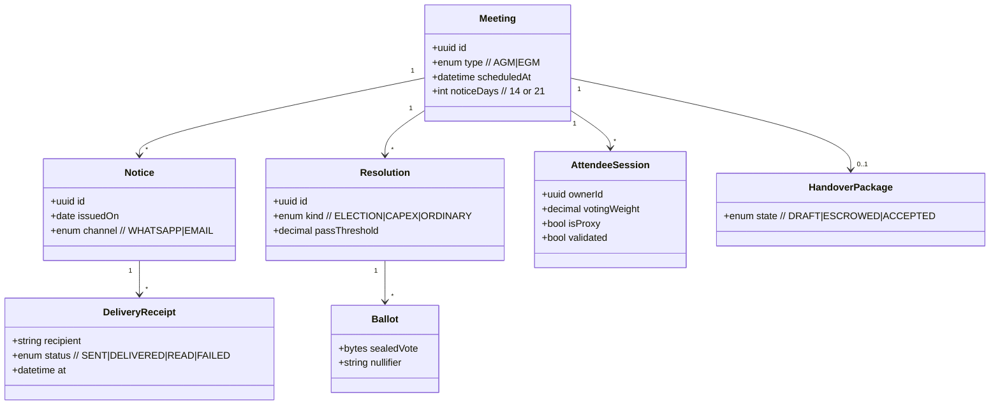
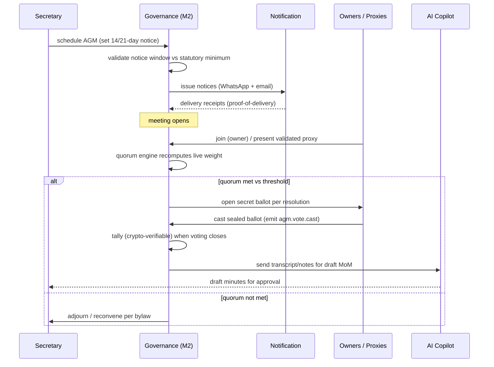

# M2 — Statutory Governance & e-AGMs

**Document:** SOC-DOC-M2 · **BRD FRs:** FR-2.1 … FR-2.4

> Anchors: [Architecture](../01-architecture.md) · [Glossary](../glossary.md) ·
> [Data model](../03-data-model.md) · [API spec](../04-api-specification.md) ·
> Deep dive: [dd-03 Cryptographic e-Voting](../deep-dives/dd-03-crypto-evoting.md).

## 1. Purpose & scope

M2 makes a society's statutory governance defensible in court. It issues legally compliant AGM/EGM
notices with verifiable **proof-of-delivery**, runs a **real-time quorum engine** that weighs live
attendees against statutory thresholds, conducts **cryptographic secret ballots** with an immutable
audit trail (elections and capex resolutions), and manages the **committee handover escrow** that
transfers contracts, bank signatory resolutions, and open tickets between outgoing and incoming
committees.

**Out of scope:** drafting bylaws (M3 advises on conflicts), legal filing of returns, and dispute
adjudication. M2 produces evidence; it does not render legal judgement.

## 2. Functional requirements (traceability)

| FR-id | Requirement | Notes |
|---|---|---|
| FR-2.1 | Digital Notice Registry | statutory AGM notices; verifiable proof-of-delivery via WhatsApp + email; **14/21-day** notice periods enforced |
| FR-2.2 | Real-time Quorum Engine | dynamic active-attendee voting weight; owners vs validated proxies; vs statutory thresholds |
| FR-2.3 | Cryptographic Secret Balloting | tamper-proof, immutable crypto audit trail — elections & capex — see [dd-03](../deep-dives/dd-03-crypto-evoting.md) |
| FR-2.4 | Committee Handover Escrow | transfer vendor contracts, bank signatory resolutions, pending tickets between committees |

## 3. Domain model

Key aggregates: **Meeting** (AGM/EGM with its notice window), **Notice** + **DeliveryReceipt**
(proof-of-delivery), **Resolution** (motion, with type election/capex/ordinary), **Ballot** (sealed
cryptographic vote), **AttendeeSession** (live quorum weight), and **HandoverPackage**.



Full schema in [`../03-data-model.md`](../03-data-model.md); the ballot sealing/tally scheme is in
[dd-03](../deep-dives/dd-03-crypto-evoting.md).

## 4. Key workflows

### 4.1 AGM lifecycle — notice → quorum → ballot → tally → MoM



### 4.2 Quorum / voting-weight logic (FR-2.2)

```mermaid
stateDiagram-v2
    [*] --> Collecting
    Collecting --> QuorumMet: Σ(validated attendee weight) ≥ statutory threshold
    Collecting --> QuorumShort: below threshold at scheduled time
    QuorumMet --> Collecting: attendee leaves → weight drops below
    QuorumShort --> Adjourned: grace window elapses
    QuorumMet --> VotingOpen: Secretary opens resolution
    VotingOpen --> Tallying: voting window closes
    Tallying --> [*]
    note right of Collecting: weight = owner share;\nproxies counted only if validated\nand within per-proxy cap
```

Voting weight follows the state act (e.g. Karnataka KAOA weightages); proxies count only when
validated and within statutory per-proxy caps; quorum is recomputed on every join/leave event.

## 5. APIs

Full conventions in [`../04-api-specification.md`](../04-api-specification.md).

| Method | Path | Purpose | Roles |
|---|---|---|---|
| POST | `/api/v1/meetings` | Schedule an AGM/EGM | Secretary |
| POST | `/api/v1/meetings/{id}/notices` | Issue statutory notices | Secretary |
| GET | `/api/v1/meetings/{id}/notices/proof` | Proof-of-delivery report | Secretary, Auditor |
| GET | `/api/v1/meetings/{id}/quorum` | Live quorum/weight snapshot | Secretary, Committee |
| POST | `/api/v1/meetings/{id}/attendance` | Join / register validated proxy | Owner, Proxy |
| POST | `/api/v1/resolutions/{id}/ballots` | Cast a sealed secret ballot | Owner (eligible) |
| GET | `/api/v1/resolutions/{id}/result` | Verifiable tally after close | All members |
| POST | `/api/v1/handover/{meetingId}` | Create committee handover escrow | Secretary (outgoing) |
| POST | `/api/v1/handover/{id}/accept` | Accept handover | Secretary (incoming) |

## 6. Events

From the [topic catalogue](../01-architecture.md#5-event-driven-topology):

**Produces:** `agm.vote.cast` (→ Tally + Audit), `audit.action.recorded` (notices, quorum changes,
handover transitions).
**Consumes:** notification delivery receipts (proof-of-delivery); reads M1 fund balances for capex
resolutions.

## 7. Acceptance criteria

- **FR-2.1 / 14-21 day notice** — *Given* an AGM scheduled with fewer than the statutory minimum
  (14 or 21 days per resolution type), *When* the Secretary tries to issue notices, *Then* the system
  blocks it; *and* for a valid notice, every recipient yields a stored proof-of-delivery record.
- **FR-2.2** — *Given* a live meeting, *When* an owner/validated proxy joins or leaves, *Then* quorum
  weight recomputes within the same session and the pass/short status flips deterministically against
  the statutory threshold; unvalidated proxies contribute zero weight.
- **FR-2.3** — *Given* a closed election, *When* the tally is produced, *Then* it is reproducible from
  the immutable ballot log, no ballot links to a voter identity, and double-voting is prevented via
  per-voter nullifiers (see [dd-03](../deep-dives/dd-03-crypto-evoting.md)).
- **FR-2.4** — *Given* an accepted handover, *When* complete, *Then* all vendor contracts, bank
  signatory resolutions, and open tickets transfer atomically to the incoming committee with an audit
  record; a partial accept is impossible.

## 8. Edge cases & failure modes

- **Quorum lost mid-vote:** voting on open resolutions is suspended if weight drops below threshold;
  bylaw-driven adjournment rules apply.
- **Proxy cap breach:** a proxy exceeding the statutory per-holder cap is rejected at validation.
- **Duplicate ballot / double vote:** nullifier uniqueness rejects the second attempt; `agm.vote.cast`
  consumers are idempotent.
- **Notice delivery failure:** failed WhatsApp/email falls back per the notification cascade; the
  failure itself is recorded (absence of delivery is evidence too).
- **Clock skew on voting windows:** server-authoritative open/close timestamps, not client clocks.
- **Handover disputes:** escrow stays in `ESCROWED` until incoming committee accepts; nothing is
  silently dropped.

## 9. Dependencies

- **Internal:** M1 (fund balances for capex resolutions), M3 (draft MoM from meeting notes),
  Notification (notice fan-out + receipts), Audit (immutable governance trail), IAM (eligibility:
  owner vs tenant vs proxy).
- **External:** WhatsApp + email providers (proof-of-delivery); state cooperative act parameters
  (notice periods, quorum, proxy caps).

## 10. Open questions

- Which states' quorum/weight/notice tables are in v1, and config vs code for updates?
- Proxy validation: digital signature, OTP, or committee manual approval — what is legally sufficient?
- e-voting key custody and the verifiability guarantees — finalized in [dd-03](../deep-dives/dd-03-crypto-evoting.md)?
- Hybrid (in-person + online) meetings: how is physical attendance folded into the live quorum weight?
