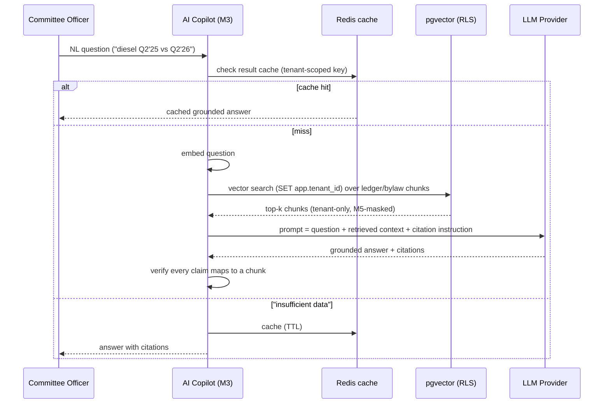
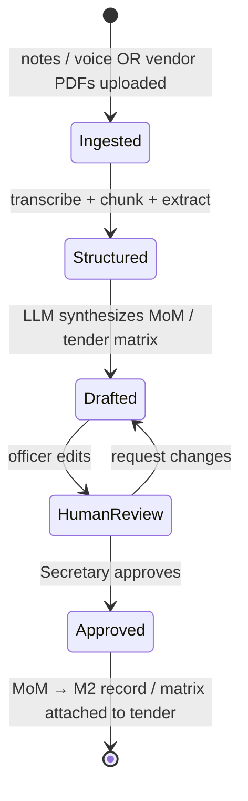

# M3 — AI Committee Copilot

**Document:** SOC-DOC-M3 · **BRD FRs:** FR-3.1 … FR-3.4

> Anchors: [Architecture](../01-architecture.md) · [Glossary](../glossary.md) ·
> [Data model](../03-data-model.md) · [API spec](../04-api-specification.md) ·
> Deep dive: [dd-04 AI Copilot / RAG](../deep-dives/dd-04-ai-copilot-rag.md).

## 1. Purpose & scope

M3 is a **grounded** retrieval-augmented assistant for committee officers. It answers
natural-language questions over the society's own financials and documents, synthesizes draft
**Minutes of Meeting** from notes, flags **state-bylaw conflicts**, and turns a pile of vendor quote
PDFs into a comparable **tender matrix**. Every answer is grounded in retrieved context
(ledger rows, bylaws, notices, MoM, quotes) via **pgvector** — M3 does not free-associate.

**Guardrails.** M3 is **read-mostly**: it produces *drafts and analyses for human approval*, never
posts to the ledger or finalizes a resolution. Retrieval is strictly tenant-scoped (RLS) and respects
M5 masking — the copilot cannot surface PII a resident has masked. The LLM provider is abstracted
(`claude-sonnet-5-5` default per the canonical stack); no resident data is used to train models.

**Out of scope:** autonomous financial actions, legal advice (it *advises on conflicts*, flags for
human review), and anything requiring data outside the tenant's own corpus.

## 2. Functional requirements (traceability)

| FR-id | Requirement | Notes |
|---|---|---|
| FR-3.1 | Natural-Language Analytics | e.g. "compare generator diesel expenses Q2 2025 vs Q2 2026", "list units over 60 days overdue" — grounded in the M1 ledger |
| FR-3.2 | Automated MoM | synthesize voice/bulleted notes → legally compliant AGM/EGM draft minutes (feeds M2) |
| FR-3.3 | State Bylaw Conflict Advisor | pet policies, EV charger rights, tenant move-in caps vs state act |
| FR-3.4 | Tender Comparison Matrix | ingest unstructured vendor PDF quotes → comparative cost/scope/SLA table |

## 3. Domain model

M3 owns little durable state of its own — mainly **embeddings** and **query/draft artifacts**. Its
source-of-truth corpora live in M1/M2 and the bylaw library. See
[dd-04](../deep-dives/dd-04-ai-copilot-rag.md) for the chunking/embedding pipeline and
[`../03-data-model.md`](../03-data-model.md) for the pgvector schema.

```mermaid
classDiagram
    class DocumentChunk {
      +uuid id
      +enum source // LEDGER|BYLAW|NOTICE|MOM|QUOTE
      +text content
      +vector embedding  // pgvector
    }
    class CopilotQuery {
      +uuid id
      +text question
      +enum kind // ANALYTICS|MOM|BYLAW|TENDER
    }
    class GroundedAnswer {
      +text answer
      +uuid[] citations // chunk ids
      +float confidence
    }
    class MoMDraft {
      +uuid meetingId
      +enum status // DRAFT|APPROVED
    }
    class TenderMatrix {
      +uuid tenderId
      +json rows // vendor x {cost,scope,sla}
    }
    CopilotQuery "1" --> "1" GroundedAnswer
    GroundedAnswer "*" --> "*" DocumentChunk : cites
    CopilotQuery ..> MoMDraft : kind=MOM
    CopilotQuery ..> TenderMatrix : kind=TENDER
```

## 4. Key workflows

### 4.1 RAG query flow (FR-3.1 / FR-3.3)



Target end-to-end latency **< 2.5 s** (BRD NFR) via pre-computed embeddings + Redis result cache; see
[Architecture §7](../01-architecture.md#7-nfr--design-mapping-brd-10) and
[dd-04](../deep-dives/dd-04-ai-copilot-rag.md).

### 4.2 Draft MoM / tender matrix (FR-3.2 / FR-3.4)



## 5. APIs

Full conventions in [`../04-api-specification.md`](../04-api-specification.md).

| Method | Path | Purpose | Roles |
|---|---|---|---|
| POST | `/api/v1/copilot/query` | Ask an NL analytics/bylaw question | Committee, Treasurer |
| POST | `/api/v1/copilot/mom` | Synthesize draft MoM from notes/voice | Secretary |
| POST | `/api/v1/copilot/tenders/{id}/matrix` | Build tender comparison matrix from quote PDFs | Committee |
| GET | `/api/v1/copilot/queries/{id}` | Retrieve a grounded answer + citations | requester |
| POST | `/api/v1/copilot/reindex` | Rebuild embeddings for a corpus | Platform admin |

## 6. Events

M3 is primarily a **consumer** that keeps its index fresh and an on-demand query service.

**Consumes:** `billing.invoice.raised`, `payment.settled` (re-embed affected ledger slices), M2 MoM
and notice updates (re-index), plus tender-upload signals.
**Produces:** `audit.action.recorded` (every query, draft, and reindex is auditable — who asked what).

## 7. Acceptance criteria

- **FR-3.1** — *Given* "list units over 60 days overdue", *When* asked, *Then* the answer matches the
  M1 defaulter data exactly, cites the ledger rows, and returns in < 2.5 s (cached or warm index).
- **Grounding** — *Given* a question with no supporting context in the tenant corpus, *When* asked,
  *Then* M3 answers "insufficient data" rather than hallucinating, and never cites another tenant.
- **FR-3.2** — *Given* bulleted/voice AGM notes, *When* MoM is generated, *Then* the draft follows the
  statutory MoM structure and remains in `DRAFT` until a human approves (never auto-finalized into M2).
- **FR-3.3** — *Given* a proposed pet/EV/tenant-cap policy, *When* checked, *Then* M3 flags any clause
  conflicting with the applicable state act and cites the bylaw/act passage.
- **FR-3.4** — *Given* 3 unstructured vendor quote PDFs, *When* a matrix is requested, *Then* M3
  produces a cost/scope/SLA table with one row per vendor and notes any missing fields.

## 8. Edge cases & failure modes

- **Stale index:** a query after a ledger change but before re-embedding must not silently use stale
  data for financial figures — financial answers read authoritative M1 numbers, with embeddings used
  for retrieval/navigation.
- **LLM provider outage/timeout:** degrade gracefully (return retrieved context + "AI summary
  unavailable"); never block an officer's read of raw data.
- **Prompt injection via uploaded PDFs/notes:** treat ingested content as untrusted data, not
  instructions; sanitize and sandbox extraction.
- **Cross-tenant leakage:** retrieval runs under RLS with `app.tenant_id`; a bug here is a Sev-1.
- **Masked PII:** M5-masked fields must not appear in retrieved chunks or answers.

## 9. Dependencies

- **Internal:** M1 (ledger corpus + authoritative figures), M2 (notices/MoM corpus, MoM sink),
  M5 (masking rules on retrieval), Audit (query trail), IAM (officer scoping).
- **External:** LLM provider (abstracted), pgvector (PostgreSQL extension), object storage (quote PDFs).

## 10. Open questions

- Voice transcription: provider choice and Indian-language coverage for MoM intake?
- Confidence threshold below which M3 refuses to answer vs returns caveated output?
- Bylaw corpus provenance and update cadence (who curates per-state acts)?
- Retention/audit policy for copilot queries that contain sensitive financial detail.
