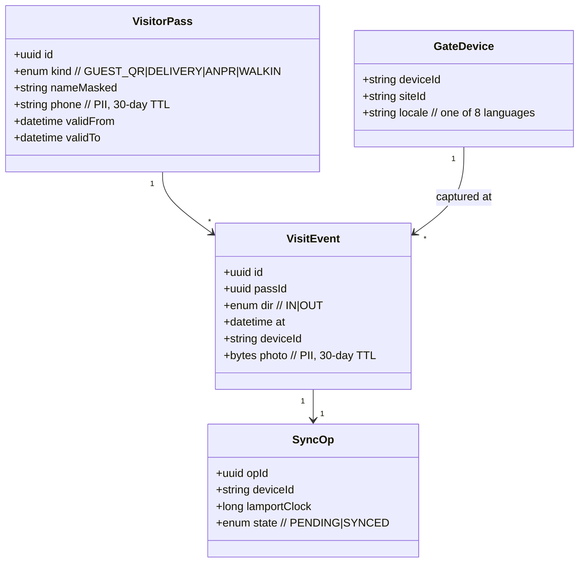
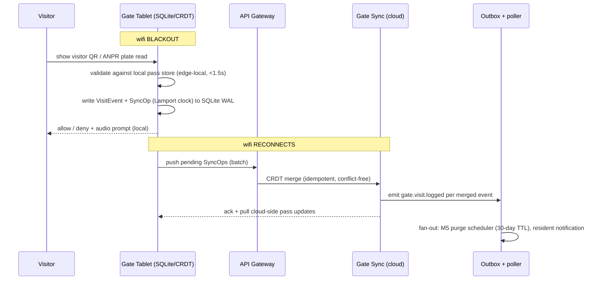
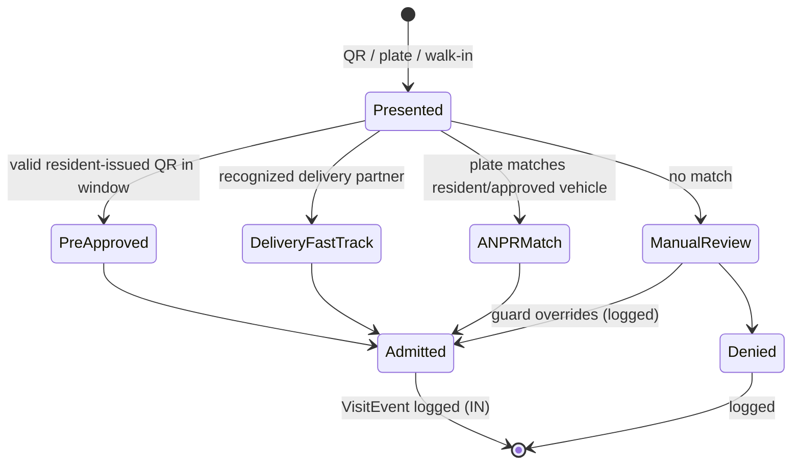

# M4 — Offline Gate Infrastructure

**Document:** SOC-DOC-M4 · **BRD FRs:** FR-4.1 … FR-4.3

> Anchors: [Architecture](../01-architecture.md) · [Glossary](../glossary.md) ·
> [Data model](../03-data-model.md) · [API spec](../04-api-specification.md) ·
> Deep dive: [dd-02 Offline Gate CRDT Sync](../deep-dives/dd-02-offline-gate-crdt.md).

## 1. Purpose & scope

M4 runs the security gate. The guard tablet is **authoritative offline**: it keeps operating through
wifi blackouts on a local **SQLite** store and reconciles to the cloud via **CRDTs** on reconnect, so
no visitor event is ever lost (BRD: zero loss over a 6-hour blackout). It presents a **multilingual
audio UI** in 8 Indian languages, and operates **smart access rails** — pre-approved visitor QR,
delivery-partner fast-track, and ANPR vehicle scanning. Every visit it logs feeds M5's 30-day purge.

**Hot-path rule.** Gate check-in decisions are made **edge-local** (never a cloud round-trip on the
critical path), targeting < 1.5 s (BRD NFR). The cloud is for sync, notification, and reporting only.

**Out of scope:** the purge itself (owned by M5), billing/access-fee logic (M1), and physical gate
hardware control beyond reading ANPR/QR inputs.

## 2. Functional requirements (traceability)

| FR-id | Requirement | Notes |
|---|---|---|
| FR-4.1 | Local SQLite Edge Sync | operate during gate wifi blackouts; CRDT merge on reconnect — see [dd-02](../deep-dives/dd-02-offline-gate-crdt.md) |
| FR-4.2 | Multilingual Audio UI | guard tablet in **8 Indian languages**, voice prompts |
| FR-4.3 | Smart Access Rails | pre-approved visitor QR, delivery-partner fast-track, ANPR vehicle scanning |

## 3. Domain model

Edge-local entities (SQLite) mirror a cloud projection. Each mutation is a CRDT operation tagged with
a device/site id and a logical clock for deterministic merge. See
[dd-02](../deep-dives/dd-02-offline-gate-crdt.md) and [`../03-data-model.md`](../03-data-model.md).

## 4. Key workflows

### 4.1 Offline check-in + reconnect sync (FR-4.1 / FR-4.3)

Conflict resolution (two gates, same pass, overlapping edits) is handled by the CRDT merge —
derivation and the chosen CRDT type are in [dd-02](../deep-dives/dd-02-offline-gate-crdt.md).

### 4.2 Smart access rails — decision states (FR-4.3)

## 5. APIs

Full conventions in [`../04-api-specification.md`](../04-api-specification.md). Gate endpoints are
sync/reporting only — check-in decisions are local.

| Method | Path | Purpose | Roles |
|---|---|---|---|
| POST | `/api/v1/gate/sync` | Push pending CRDT SyncOps (batch) | Gate device |
| GET | `/api/v1/gate/sync/since/{clock}` | Pull cloud-side pass/config deltas | Gate device |
| POST | `/api/v1/visitor-passes` | Resident pre-approves a visitor (issues QR) | Resident, Tenant |
| GET | `/api/v1/gate/visits` | Visit log (reporting) | Secretary, Committee |
| PUT | `/api/v1/gate/devices/{id}/locale` | Set tablet language (1 of 8) | Secretary |

## 6. Events

From the [topic catalogue](../01-architecture.md#5-event-driven-topology):

**Produces:** `gate.visit.logged` (→ M5 purge scheduler + Notification), `audit.action.recorded`
(overrides, config changes).
**Consumes:** resident pass issuance (to push to device pull-sync); no hot-path consumption.

## 7. Acceptance criteria

- **FR-4.1 / zero loss** — *Given* a 6-hour wifi blackout with N check-ins, *When* connectivity
  returns, *Then* all N `VisitEvent`s merge to the cloud with no loss and no duplicates, and the merge
  is order-independent (deterministic CRDT outcome).
- **Hot path** — *Given* a visitor QR, *When* scanned offline, *Then* an allow/deny decision is
  rendered locally in < 1.5 s without any network call.
- **FR-4.2 / 8 languages** — *Given* a tablet set to any of the 8 supported Indian languages, *When*
  check-in runs, *Then* all prompts (visual + audio) render in that language.
- **FR-4.3** — *Given* a pre-approved QR within its validity window, *Then* fast-track admit; *Given*
  an expired/invalid QR, *Then* route to manual review (never silent admit).
- **PII TTL** — *Given* a logged visit, *Then* its photo + phone carry a 30-day TTL so M5 can purge
  (see [M5](module-5-privacy-shield.md)).

## 8. Edge cases & failure modes

- **Clock skew across devices:** Lamport/logical clocks, not wall-clock, drive CRDT ordering.
- **Duplicate QR scan / double-tap:** idempotent SyncOp ids; one VisitEvent.
- **ANPR misread:** low-confidence plate falls to manual review, never auto-deny a resident.
- **Device lost/wiped mid-blackout:** unsynced WAL is the risk window; mitigations (periodic local
  snapshot, device enrolment) in [dd-02](../deep-dives/dd-02-offline-gate-crdt.md).
- **Tenant/society boundary at shared gates:** each device is bound to one `siteId`/tenant.
- **Battery/offline for days:** sync batches are bounded and resumable; backpressure on reconnect.

## 9. Dependencies

- **Internal:** M5 (consumes `gate.visit.logged`, owns purge + masking of the gate directory),
  Notification (resident "visitor at gate" push), Audit (overrides), IAM (device enrolment).
- **External:** ANPR camera / gate hardware, FCM/APNs for resident push, on-device TTS/ASR for the
  audio UI.

## 10. Open questions

- CRDT type selection and merge guarantees — finalized in [dd-02](../deep-dives/dd-02-offline-gate-crdt.md)?
- Which 8 languages ship in v1, and is audio on-device or cached cloud TTS?
- Delivery-partner identity source (platform QR vs OTP vs face) and its PII implications under M5.
- Offline duration SLO beyond the 6-hour BRD floor — cap on unsynced backlog per device.
