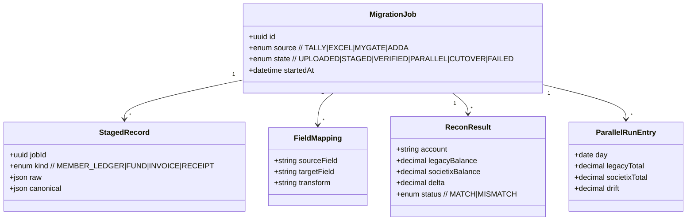
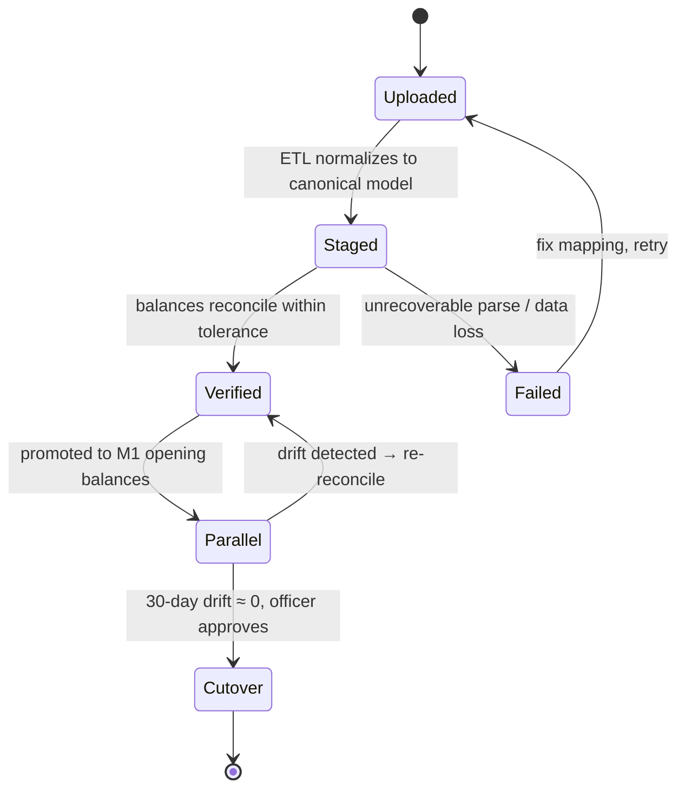

# M6 — Smart-Switch Migration

**Document:** SOC-DOC-M6 · **BRD FRs:** FR-6.1 … FR-6.3

> Anchors: [Architecture](../01-architecture.md) · [Glossary](../glossary.md) ·
> [Data model](../03-data-model.md) · [API spec](../04-api-specification.md) ·
> Related: [M1 Treasury/ERP](module-1-treasury-erp.md) · [dd-01 Ledger](../deep-dives/dd-01-double-entry-ledger.md).

## 1. Purpose & scope

M6 removes the single biggest switching barrier: getting a society's years of history off Tally,
Excel, MyGate, or ADDA and into Societix **cleanly and provably**. It runs an **automated ingestion
ETL** over those exports, **verifies balances** against the society's historical member ledgers and
sinking funds (BRD: validated books in **< 4 hours**), and supports a **zero-downtime parallel run**
that compares legacy vs Societix books over a 30-day pilot before cutover.

**Trust rule.** M6 never silently "fixes" numbers. It reconciles, flags discrepancies, and requires
human sign-off before the migrated ledger becomes M1's opening balances. The parallel run is the proof
that cutover is safe.

**Out of scope:** ongoing operations (handed to M1/M2/M4 after cutover) and any data transformation
that would alter the society's historical financial position without explicit approval.

## 2. Functional requirements (traceability)

| FR-id | Requirement | Notes |
|---|---|---|
| FR-6.1 | Automated Ingestion ETL | parse Tally XML, Excel, MyGate, ADDA exports → canonical staging model |
| FR-6.2 | Balance Verification | match historical member ledgers + sinking funds; **validated books in < 4 hours** |
| FR-6.3 | Zero Downtime Parallel Run | compare legacy vs Societix books during a **30-day** pilot before cutover |

## 3. Domain model

M6 stages data in an isolated **MigrationJob** workspace before promoting it into M1. Nothing touches
the live ledger until verification passes and an officer approves. See
[`../03-data-model.md`](../03-data-model.md) and [dd-01](../deep-dives/dd-01-double-entry-ledger.md) for
the ledger target.



## 4. Key workflows

### 4.1 ETL ingest → balance verification → parallel-run reconciliation

```mermaid
sequenceDiagram
    participant ADM as Platform Admin
    participant M6 as Smart-Switch (M6)
    participant STG as Staging store
    participant M1 as Treasury/ERP (M1)
    participant SEC as Society Treasurer
    ADM->>M6: upload Tally/Excel/MyGate/ADDA export
    M6->>M6: detect format, apply FieldMappings, normalize
    M6->>STG: write StagedRecords (canonical model)
    M6->>M6: verify — recompute member ledgers + sinking funds
    M6->>SEC: ReconResult report (MATCH / MISMATCH deltas)
    alt all MATCH (within tolerance)
        SEC->>M6: approve opening balances
        M6->>M1: promote as opening balances (double-entry)
        Note over M6,M1: 30-day PARALLEL RUN begins
        loop daily
            M6->>M6: compare legacy vs Societix totals → ParallelRunEntry(drift)
        end
        SEC->>M6: approve CUTOVER (drift ≈ 0 sustained)
    else MISMATCH
        M6->>SEC: flag discrepancies; adjust mappings; re-verify
    end
```

### 4.2 Migration job state machine



## 5. APIs

Full conventions in [`../04-api-specification.md`](../04-api-specification.md). M6 is largely a
platform-admin + treasurer tool.

| Method | Path | Purpose | Roles |
|---|---|---|---|
| POST | `/api/v1/migrations` | Create a migration job (upload export) | Platform admin |
| GET | `/api/v1/migrations/{id}` | Job status + state | Platform admin, Treasurer |
| PUT | `/api/v1/migrations/{id}/mappings` | Adjust field mappings | Platform admin |
| GET | `/api/v1/migrations/{id}/recon` | Balance-verification (ReconResult) report | Treasurer, Auditor |
| POST | `/api/v1/migrations/{id}/promote` | Approve → promote to M1 opening balances | Treasurer |
| GET | `/api/v1/migrations/{id}/parallel-run` | Daily legacy-vs-Societix drift | Treasurer, Auditor |
| POST | `/api/v1/migrations/{id}/cutover` | Approve final cutover | Treasurer |

## 6. Events

M6 runs mostly as a batch/staging pipeline and writes to M1 via its normal posting path.

**Produces:** `audit.action.recorded` (uploads, mapping edits, promote/cutover approvals); on promote,
M1 emits its usual `billing.invoice.raised` / ledger events for the opening entries.
**Consumes:** M1 ledger state during the parallel run (to compute drift).

## 7. Acceptance criteria

- **FR-6.2 / < 4 hours** — *Given* a standard society export (Tally/Excel/MyGate/ADDA), *When* M6 runs
  ingest + verification, *Then* a validated ReconResult is produced in under 4 hours, with every
  member-ledger and sinking-fund balance matched or explicitly flagged.
- **FR-6.1** — *Given* each supported source format, *When* ingested, *Then* records normalize to the
  canonical model with no silent data loss; unmappable fields are surfaced, not dropped.
- **FR-6.3 / 30-day parallel** — *Given* a promoted job, *When* the 30-day parallel run executes,
  *Then* daily drift between legacy and Societix totals is reported; cutover is blocked until drift is
  within tolerance for the required sustained period.
- **No silent mutation** — *Given* a MISMATCH, *When* verification completes, *Then* M6 never
  auto-adjusts the society's figures; a human must approve any correction.
- **Opening balances balance** — *Given* promotion to M1, *Then* the opening double-entry set is
  balanced (debits = credits) per [dd-01](../deep-dives/dd-01-double-entry-ledger.md).

## 8. Edge cases & failure modes

- **Malformed / partial export:** fail the job to `Failed` with a precise parse report; never promote
  partial data. (Treat uploads as untrusted data — isolated staging, no interpreter execution.)
- **Rounding differences across systems:** configurable tolerance; residual rounded to a documented
  rounding account, flagged in recon.
- **Duplicate members / renumbered flats:** dedup + mapping review step before verification.
- **Currency/precision mismatch:** normalize to paisa integers in the canonical model.
- **Parallel-run drift that won't converge:** blocks cutover; escalate for manual investigation.
- **Re-run / resume:** staging is idempotent per job; re-upload creates a new versioned job.

## 9. Dependencies

- **Internal:** M1 (promotion target + parallel-run comparison), M2 (member/unit master used by
  governance), Audit (every migration action), IAM (platform-admin + treasurer roles), M5 (any
  resident PII in exports falls under consent/purge from ingest onward).
- **External:** source systems' export formats (Tally XML, Excel, MyGate, ADDA); object storage for
  uploaded files.

## 10. Open questions

- Reconciliation tolerance defaults and who sets them per society.
- MyGate/ADDA export fidelity — do all required fields (sinking fund history) reliably export?
- Parallel-run cutover criteria: exact "sustained drift ≈ 0" definition (consecutive clean days?).
- Rollback: if cutover reveals an error post-go-live, what is the reversal path in M1?
