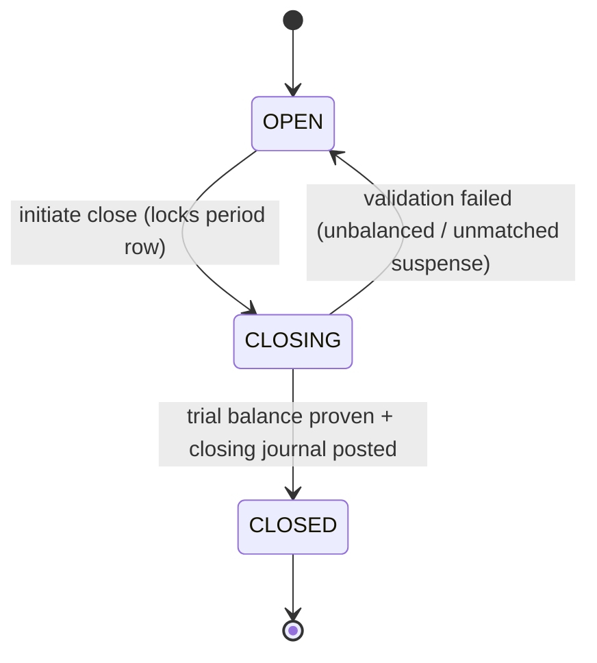

# Deep Dive — The Double-Entry Accounting Engine

**Document:** SOC-DOC-DD-01 · **Status:** Engineering deep dive · **Supports:** M1 Treasury/ERP, BRD FR-1.4

> Prerequisite reading: [Architecture anchor](../01-architecture.md) (event topology, outbox, RLS),
> [Data model](../03-data-model.md), [Glossary](../glossary.md), and the module spec
> [M1 — Treasury/ERP](../modules/module-1-treasury-erp.md).

This document specifies the heart of M1: a **double-entry, append-only, idempotent** general ledger
that is the single source of financial truth for a society. Every rupee that is invoiced, collected,
paid out, accrued, or transferred between statutory funds lands here as a balanced journal. The
ledger is the corpus M2 reads for capex/fund-hike votes and the primary corpus M3 indexes
(see the [modules index](../modules/README.md)).

Design non-negotiables:

1. **Every transaction balances** — `Σ debits == Σ credits`, enforced in the same DB transaction.
2. **Append-only** — posted entries are never mutated or deleted. Corrections are *reversing
   journals*. This is what makes the ledger a legal, auditable record (BRD "immutable audit").
3. **Idempotent posting** — the same business event (e.g. a `payment.settled`) posts exactly once,
   even under at-least-once Kafka redelivery.
4. **No float** — Societix never holds money; the ledger models the *society's* books, not a wallet.
   Cash movements are recorded only when the Payment Aggregator (PA) confirms settlement to the
   society bank account ([ADR-0003](../adr/0003-payment-aggregator-no-float.md)).

---

## 1. Chart of Accounts (CoA)

Every account has one of five fundamental **types**. Type fixes the *normal balance* side and how the
account rolls up into statements.

| Type | Normal balance | Increases on | Statement |
|---|---|---|---|
| `ASSET` | Debit | Debit | Balance Sheet |
| `LIABILITY` | Credit | Credit | Balance Sheet |
| `EQUITY` / **Funds** | Credit | Credit | Balance Sheet |
| `INCOME` | Credit | Credit | P&L |
| `EXPENSE` | Debit | Debit | P&L |

The **statutory funds** that a cooperative society must maintain are modelled as `EQUITY`-type
fund accounts (corpus/reserves owned by the members collectively), each with a dedicated cash/bank
backing it where the bylaws require ring-fencing:

| Fund account | Type | Purpose (statutory basis) |
|---|---|---|
| **Sinking Fund** | EQUITY | Long-term capital renewal; mandated % of construction cost. |
| **Repair & Maintenance Fund** | EQUITY | Earmarked for structural repairs. |
| **Reserve Fund** | EQUITY | Contingency buffer; statutory minimum contribution. |
| **Common Maintenance Fund** | EQUITY | Operating corpus for day-to-day maintenance. |

Representative CoA (abbreviated), with a numeric coding convention (`1xxx` asset, `2xxx` liability,
`3xxx` equity/fund, `4xxx` income, `5xxx` expense):

```
1000  Bank — Society Operating A/c           ASSET
1010  Bank — Sinking Fund A/c (ring-fenced)   ASSET
1200  Accounts Receivable — Maintenance       ASSET
1300  GST Input Tax Credit (ITC)              ASSET
2000  Accounts Payable — Vendors              LIABILITY
2100  TDS Payable (to Govt)                   LIABILITY
2200  GST Output Payable                      LIABILITY
2300  Advance from Members                    LIABILITY
3000  Common Maintenance Fund                 EQUITY
3100  Sinking Fund                            EQUITY
3200  Repair & Maintenance Fund               EQUITY
3300  Reserve Fund                            EQUITY
4000  Maintenance Income                      INCOME
4100  Interest Income (on fund deposits)      INCOME
4200  Interest on Arrears (penal)             INCOME
5000  Security / Housekeeping Expense         EXPENSE
5100  Repairs & Maintenance Expense           EXPENSE
5200  Bank / PA Charges                       EXPENSE
```

> **Fund-backing invariant.** When bylaws require the Sinking Fund to be held in a separate bank
> account (e.g. Haryana HRERA handover audits), M1 enforces `balance(1010 Bank–Sinking) >=
> balance(3100 Sinking Fund)` as a reconciliation check at period close — the equity account records
> the *obligation*, the asset account the *cash that backs it*.

---

## 2. Ledger schema

Three tables carry the whole engine. All are tenant-scoped (`tenant_id`, RLS-enforced per
[Architecture §6](../01-architecture.md)) and the entry table is **append-only** (no `UPDATE`/`DELETE`
grant; enforced by trigger + revoked privileges).

```sql
-- The Chart of Accounts.
CREATE TABLE ledger_account (
    id            BIGINT GENERATED ALWAYS AS IDENTITY PRIMARY KEY,
    tenant_id     UUID        NOT NULL,
    code          TEXT        NOT NULL,              -- '3100'
    name          TEXT        NOT NULL,              -- 'Sinking Fund'
    type          TEXT        NOT NULL               -- ASSET|LIABILITY|EQUITY|INCOME|EXPENSE
                  CHECK (type IN ('ASSET','LIABILITY','EQUITY','INCOME','EXPENSE')),
    normal_side   CHAR(1)     NOT NULL CHECK (normal_side IN ('D','C')),
    is_fund       BOOLEAN     NOT NULL DEFAULT FALSE,
    parent_id     BIGINT      REFERENCES ledger_account(id),   -- hierarchy / rollups
    active        BOOLEAN     NOT NULL DEFAULT TRUE,
    UNIQUE (tenant_id, code)
);

-- The transaction (journal) header. One row per balanced business event.
CREATE TABLE ledger_transaction (
    id            UUID        PRIMARY KEY DEFAULT gen_random_uuid(),
    tenant_id     UUID        NOT NULL,
    txn_date      DATE        NOT NULL,              -- accounting date
    description   TEXT        NOT NULL,
    source_type   TEXT        NOT NULL,              -- INVOICE|PAYMENT|PAYOUT|ACCRUAL|TRANSFER|REVERSAL
    source_ref    TEXT        NOT NULL,              -- e.g. invoice id, payment id
    -- Idempotency: the natural key of the originating event. One event -> one txn.
    idempotency_key TEXT      NOT NULL,
    reverses_txn  UUID        REFERENCES ledger_transaction(id), -- set on reversing journals
    period_id     BIGINT      NOT NULL REFERENCES accounting_period(id),
    posted_at     TIMESTAMPTZ NOT NULL DEFAULT now(),
    posted_by     TEXT        NOT NULL,
    UNIQUE (tenant_id, idempotency_key)              -- the idempotency guard
);

-- The individual debit/credit lines. The grain of the ledger.
CREATE TABLE ledger_entry (
    id            BIGINT GENERATED ALWAYS AS IDENTITY PRIMARY KEY,
    tenant_id     UUID        NOT NULL,
    txn_id        UUID        NOT NULL REFERENCES ledger_transaction(id),
    account_id    BIGINT      NOT NULL REFERENCES ledger_account(id),
    -- Exactly one of debit/credit is > 0; amounts are non-negative minor units (paise).
    debit_minor   BIGINT      NOT NULL DEFAULT 0 CHECK (debit_minor  >= 0),
    credit_minor  BIGINT      NOT NULL DEFAULT 0 CHECK (credit_minor >= 0),
    CHECK ( (debit_minor = 0) <> (credit_minor = 0) ),   -- one side only, never both/neither
    memo          TEXT
);

CREATE INDEX ix_entry_account ON ledger_entry (tenant_id, account_id);
CREATE INDEX ix_txn_period    ON ledger_transaction (tenant_id, period_id);
```

> **Money is stored as integer minor units (paise), never floats.** All arithmetic is integer; the
> presentation layer divides by 100. This eliminates binary floating-point rounding drift in a
> balancing system.

### The balance invariant, enforced in-DB

A `DEFERRABLE INITIALLY DEFERRED` constraint trigger fires at `COMMIT` and rejects any transaction
whose lines do not balance. Deferring to commit lets the application insert the header and all lines
within one transaction before the check runs.

```sql
CREATE OR REPLACE FUNCTION assert_txn_balanced() RETURNS trigger AS $$
DECLARE d BIGINT; c BIGINT;
BEGIN
    SELECT COALESCE(SUM(debit_minor),0), COALESCE(SUM(credit_minor),0)
      INTO d, c FROM ledger_entry WHERE txn_id = NEW.id;
    IF d <> c THEN
        RAISE EXCEPTION 'unbalanced txn %: debits % <> credits %', NEW.id, d, c;
    END IF;
    RETURN NEW;
END $$ LANGUAGE plpgsql;

CREATE CONSTRAINT TRIGGER trg_txn_balanced
    AFTER INSERT ON ledger_transaction
    DEFERRABLE INITIALLY DEFERRED
    FOR EACH ROW EXECUTE FUNCTION assert_txn_balanced();
```

**Append-only enforcement.** Application role has `INSERT` only on `ledger_entry` /
`ledger_transaction`; `UPDATE`/`DELETE` are revoked. A `BEFORE UPDATE OR DELETE` trigger raises
unconditionally. The only way to change the books is to post a new (reversing) transaction.

---

## 3. Posting rules

Each business event maps to a fixed set of debit/credit lines ("the posting rule"). Rules are pure
functions `event -> List<Entry>` and are unit-tested to balance. Below, **Dr** = debit, **Cr** =
credit.

### 3.1 Invoice raised (`billing.invoice.raised`)

Accrual of maintenance income and the member's receivable.

| Account | Dr | Cr |
|---|---|---|
| `1200` Accounts Receivable — Maintenance | ₹10,000 | |
| `4000` Maintenance Income | | ₹10,000 |

### 3.2 Payment settled (`payment.settled`)

PA has settled funds to the society bank account. The receivable is cleared; cash recognised. (No
float: we post cash only on confirmed settlement.)

| Account | Dr | Cr |
|---|---|---|
| `1000` Bank — Operating | ₹9,980 | |
| `5200` Bank / PA Charges | ₹20 | |
| `1200` Accounts Receivable — Maintenance | | ₹10,000 |

### 3.3 Vendor payout with TDS withheld + GST ITC

Society pays a ₹1,00,000 (+18% GST) security vendor, withholding 2% TDS on the base.

| Account | Dr | Cr |
|---|---|---|
| `5000` Security / Housekeeping Expense | ₹1,00,000 | |
| `1300` GST Input Tax Credit | ₹18,000 | |
| `2100` TDS Payable | | ₹2,000 |
| `1000` Bank — Operating | | ₹1,16,000 |

Net cash out = base + GST − TDS = 100000 + 18000 − 2000 = **₹1,16,000**. ITC is an asset (recoverable
against GST output); TDS is a liability owed to the government. (Maker-checker gate governs *who* may
post this — see M1 spec.)

### 3.4 Interest accrual (penal interest on arrears / interest income on deposits)

Monthly accrual of penal interest on a defaulter's arrears (Maharashtra MCS §154B caps the rate):

| Account | Dr | Cr |
|---|---|---|
| `1200` Accounts Receivable — Maintenance | ₹210 | |
| `4200` Interest on Arrears (penal) | | ₹210 |

### 3.5 Fund transfer (appropriation to a statutory fund)

Transferring a surplus into the Sinking Fund (an equity appropriation with its ring-fenced cash):

| Account | Dr | Cr |
|---|---|---|
| `1000` Bank — Operating | | ₹50,000 |
| `1010` Bank — Sinking Fund A/c | ₹50,000 | |
| `3000` Common Maintenance Fund (appropriation) | ₹50,000 | |
| `3100` Sinking Fund | | ₹50,000 |

This is two balanced legs in one journal: move the cash (`1000 → 1010`) and re-label the equity
(`3000 → 3100`). Debits (50k+50k) == credits (50k+50k).

---

## 4. Idempotent posting via the Kafka outbox

Postings are driven by domain events, but posting must happen **exactly once** per event even though
Kafka is at-least-once. Two mechanisms combine:

- **Transactional outbox** ([Architecture §5](../01-architecture.md)): the producing module writes its
  state change and an outbox row in one DB transaction; a relay publishes to Kafka. This guarantees
  the *event* is not lost.
- **Idempotency key on `ledger_transaction`**: the consumer derives a deterministic key from the
  event (e.g. `payment:{paymentId}`) and relies on `UNIQUE (tenant_id, idempotency_key)`. A redelivered
  event collides on insert and is swallowed — the posting is a no-op the second time.

```mermaid
sequenceDiagram
    autonumber
    participant PA as Payment Aggregator
    participant MATCH as M1 Webhook Matcher
    participant OBOX as Outbox (DB)
    participant K as Kafka (payment.settled)
    participant LED as Ledger Poster
    participant DB as PostgreSQL (ledger_*)

    PA->>MATCH: webhook: funds settled (paymentId, amount)
    MATCH->>OBOX: BEGIN; persist match + outbox row; COMMIT
    OBOX-->>K: relay publishes payment.settled
    K->>LED: deliver (at-least-once)
    LED->>DB: BEGIN
    LED->>DB: INSERT ledger_transaction (idempotency_key='payment:PID')
    alt key already exists (redelivery)
        DB-->>LED: unique violation -> treat as done, ROLLBACK, ack
    else first time
        LED->>DB: INSERT ledger_entry x N (balanced)
        DB->>DB: deferred balance trigger @COMMIT
        LED->>DB: COMMIT
        LED-->>K: ack offset
    end
```

Pseudo-code for the poster:

```
onEvent(PaymentSettled e):
    key = "payment:" + e.paymentId
    lines = POSTING_RULES[PAYMENT_SETTLED](e)      # pure fn, asserts balanced
    try:
        tx:
            txn = insert ledger_transaction(idempotency_key=key, period=openPeriod(e.date), ...)
            for line in lines: insert ledger_entry(txn.id, line)
            # commit -> deferred trigger verifies Σdebit == Σcredit
        ack()
    except UniqueViolation(idempotency_key):        # redelivery
        ack()                                       # already posted; safe no-op
```

---

## 5. Concurrency — per-account serialization

Two concurrent postings touching the same account (e.g. two payments against one unit's receivable)
must not interleave into an inconsistent *running* balance where one is maintained. The entry table
itself is append-only so inserts never conflict, but any maintained **balance snapshot** or
period-close aggregate needs serialization.

Strategy:

- **Hot path (posting):** entries are pure inserts — no row locks on prior entries, so postings are
  highly concurrent. Balances are *derived by aggregation* (see §6), not stored, avoiding write
  contention entirely.
- **Where a cached balance exists** (performance snapshot per account), take a Postgres **advisory
  lock keyed by `(tenant_id, account_id)`** so updates to one account serialize while different
  accounts proceed in parallel:

```sql
SELECT pg_advisory_xact_lock(hashtextextended(:tenant_id::text, 0), :account_id);
```

- **Period close** takes a lock on the `accounting_period` row (`SELECT ... FOR UPDATE`) so no new
  postings slip into a period mid-close.

---

## 6. Deriving the statements

Because entries are append-only and balances are derived, every statement is a deterministic
aggregation over `ledger_entry` filtered by period and (for the Balance Sheet) cumulative to date.

### 6.1 Trial Balance

Per account, sum debits and credits; the grand totals must be equal (the global proof the books
balance).

```sql
-- Trial balance for a tenant over an open/closed period.
SELECT a.code,
       a.name,
       a.type,
       SUM(e.debit_minor)  AS total_debit,
       SUM(e.credit_minor) AS total_credit,
       -- signed balance on the account's normal side
       CASE a.normal_side
           WHEN 'D' THEN SUM(e.debit_minor) - SUM(e.credit_minor)
           ELSE          SUM(e.credit_minor) - SUM(e.debit_minor)
       END AS balance_minor
FROM   ledger_entry e
JOIN   ledger_transaction t ON t.id = e.txn_id
JOIN   ledger_account a     ON a.id = e.account_id
WHERE  e.tenant_id = :tid
  AND  t.period_id = :period
GROUP  BY a.code, a.name, a.type, a.normal_side
ORDER  BY a.code;

-- The invariant check: these two must be equal.
-- SELECT SUM(debit_minor) = SUM(credit_minor) FROM ledger_entry WHERE tenant_id=:tid ...;
```

### 6.2 Profit & Loss

Net `INCOME` less `EXPENSE` over the period → surplus/deficit.

```
P&L surplus = Σ balance(INCOME accounts)  −  Σ balance(EXPENSE accounts)   [over period]
```

### 6.3 Balance Sheet

Cumulative (not period-scoped) balances, grouped by type. The closing surplus from P&L rolls into
retained equity so the sheet balances:

```
Σ ASSET  ==  Σ LIABILITY  +  Σ EQUITY (incl. funds + retained surplus)
```

This equality is the structural guarantee of double-entry: because every transaction balances, the
accounting equation holds at all times.

---

## 7. Period close

An `accounting_period` has states `OPEN → CLOSING → CLOSED`. Posting into a `CLOSED` period is
rejected at the application layer (and defensively by a trigger checking the referenced period's
status). Close procedure:



1. Lock the period row (`FOR UPDATE`).
2. Prove the trial balance nets to zero and no suspense/unmatched payments remain.
3. Post a **closing journal** moving net `INCOME`/`EXPENSE` to retained equity (so the next period's
   P&L starts from zero while the Balance Sheet carries forward).
4. Flip status to `CLOSED`. Reversals against a closed period are posted into the *next open* period
   (never re-opening history).

---

## 8. Corrections — reversing entries only

Posted entries are immutable. To correct an error you post a **reversing journal**: a new transaction
whose lines are the mirror image (debits↔credits) of the original, linked via
`ledger_transaction.reverses_txn`. Then, if needed, post the correct entry. This preserves the full
history — an auditor sees the mistake, the reversal, and the fix, which is exactly what the BRD's
immutable-audit requirement demands.

```
reverse(txnId):
    orig = load ledger_transaction(txnId)
    rev  = new ledger_transaction(source_type=REVERSAL, reverses_txn=txnId,
                                  idempotency_key="reversal:"+txnId,
                                  period=currentOpenPeriod())   # never the original (maybe closed)
    for line in orig.entries:
        # swap sides
        insert ledger_entry(rev.id, line.account, debit=line.credit, credit=line.debit)
    # commit -> still balances, by construction
```

Because the reversal reuses a deterministic `idempotency_key`, a double-click "reverse" is itself
idempotent.

---

## 9. Where this connects

- Events in/out are catalogued in [Architecture §5](../01-architecture.md) (`billing.invoice.raised`,
  `payment.settled`).
- Fund definitions and tax terms (TDS, GST ITC, Sinking Fund) are in the [Glossary](../glossary.md).
- Table-level tenancy, keys, and the audit table live in the [Data model](../03-data-model.md).
- Business workflows (billing formulas, defaulter cadence, maker-checker payouts) are in
  [M1 — Treasury/ERP](../modules/module-1-treasury-erp.md).
- The scheme-level decision is recorded in
  [ADR-0004 (Kafka event-driven cadence + outbox)](../adr/0004-kafka-event-driven-cadence.md).
