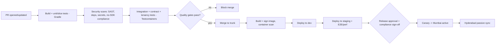

# CI/CD & DevOps

**Document:** `SOC-DOC-DEL-05` · **Status:** Draft for engineering

The delivery pipeline, environments, infrastructure-as-code, secrets, database migration strategy,
release/rollback, and observability for Societix. Realises the deployment topology in
[`../01-architecture.md`](../01-architecture.md) §9 (Mumbai active / Hyderabad passive) and the
testing lanes in [`testing-strategy.md`](testing-strategy.md). Quality gates are enforced per
[`definition-of-done.md`](definition-of-done.md).

---

## 1. Pipeline (GitHub Actions)

| Stage | Trigger | Actions |
|---|---|---|
| Build + test | every PR | Gradle build, unit/slice/Modulith tests, patch coverage gate |
| Security scans | every PR | **SAST** (CodeQL), **dependency** scan (Dependabot/OWASP), **secret** scan (gitleaks), **no-third-party-SDK** compliance check |
| Integration | PR (required) | Testcontainers integration, contract verify, tenancy isolation |
| Image | merge to trunk | Build OCI image, generate SBOM, **sign** (cosign), **container scan** (Trivy/Grype) |
| Deploy dev→staging | merge | Helm deploy; E2E (Playwright/Detox) + performance on staging |
| Deploy prod | manual approval + compliance sign-off | Canary → promote; Hyderabad passive sync |

---

## 2. Environments

| Env | Purpose | Topology |
|---|---|---|
| **dev** | integration & feature validation | single region, ephemeral namespaces per feature where useful |
| **staging** | production-like; E2E/perf/pre-release | mirrors prod topology at reduced scale |
| **prod** | live | **Mumbai active / Hyderabad passive** (streaming PG replication, Kafka mirror) on sovereign Indian cloud |

Data residency: all environments stay within Indian regions (DPDP/sovereignty requirement).

---

## 3. Infrastructure as Code

- **Terraform** provisions cloud infra: VPC, K8s clusters (Mumbai + Hyderabad), managed PostgreSQL 16
  (with replication), Redis 7, Kafka, object storage, DNS/ingress. State in a locked remote backend.
- **Helm + K8s manifests** deploy the modular monolith, gateway/BFF, and workers; HPA for stateless
  app pods; `PodDisruptionBudget` and anti-affinity for availability.
- Environments are diff-only promotions of the same modules (dev/staging/prod as Terraform
  workspaces / Helm value overlays) — no snowflakes.

---

## 4. Config & secrets management

- **Non-secret config** via Helm values + K8s `ConfigMap`, per environment.
- **Secrets** in HashiCorp **Vault** (or K8s Secrets sealed via SOPS where Vault isn't warranted);
  injected at runtime, never in images or git.
- **Per-tenant data-encryption keys** (envelope encryption) managed via a KMS/Vault transit engine —
  tenant PII and bank identifiers are encrypted with per-tenant DEKs (see
  [`../01-architecture.md`](../01-architecture.md) §6).
- Secret scanning (gitleaks) blocks any credential from entering the repo.

---

## 5. Database migrations (zero-downtime)

- **Flyway** migrations run as a pre-deploy pipeline step, versioned with the app.
- **Expand-contract** pattern for zero-downtime, DB-compatible rollbacks:
  1. **Expand** — additive change (new nullable column/table), deployed first; old + new code both work.
  2. **Migrate** — backfill + dual-write while both app versions run.
  3. **Contract** — remove the old shape only after the old app version is fully retired.
- No destructive migration ships in the same release as the code that stops using the old shape — this
  keeps **every release rollback-safe at the DB layer**.
- RLS policies are versioned Flyway migrations and covered by the tenancy isolation suite.

---

## 6. Release & rollback

- **Canary** (preferred) on the Mumbai active region: route a small traffic slice to the new version,
  watch SLOs/error budget, then promote; **blue/green** for high-risk cutovers.
- **Feature flags** decouple deploy from release — merged code can ship dark and enable per-tenant.
- **Rollback** = redeploy previous signed image; safe because migrations are expand-contract
  (previous app version remains DB-compatible). No forward-only destructive migration is allowed in a
  single step.
- Hyderabad passive is kept warm via PG streaming replication + Kafka mirror for regional failover.

---

## 7. Observability & SLOs

- **OpenTelemetry** traces/metrics/logs → **Prometheus** + **Grafana**; traces correlate
  gateway→module→DB (see [`epics-and-stories.md`](epics-and-stories.md) F3).
- **SLOs tied to the 99.95% availability target**, plus NFR-specific SLIs:

| SLI | SLO | Alert |
|---|---|---|
| Availability | 99.95% | Error-budget burn-rate (fast + slow) |
| Gate check-in latency | p95 < 1.5 s | p95 breach sustained 5 min |
| AI query latency | p95 < 2.5 s | p95 breach sustained 5 min |
| Payment match lag | < 60 s | unmatched queue growth |
| Purge SLA | PII deleted ≤ 30 days + grace | overdue purge job |

- **Alerting** routes to on-call (PagerDuty/Opsgenie). **On-call** rotation owned by SRE; runbooks live
  with each alert; incident response RACI in [`estimation-and-team.md`](estimation-and-team.md).
- Dashboards: golden signals per module, per-tenant rate-limit health, Kafka consumer lag, PG
  replication lag (Mumbai→Hyderabad).
