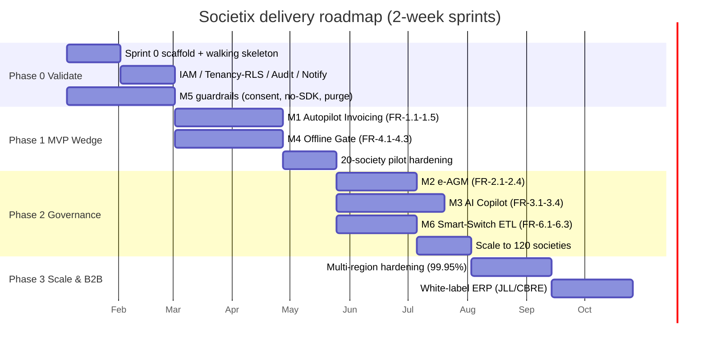
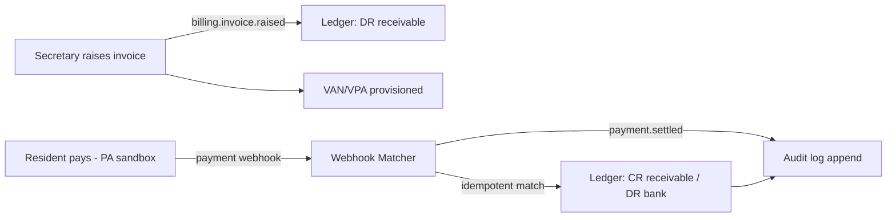

# Phased Development Plan

**Document:** `SOC-DOC-DEL-01` · **Status:** Draft for engineering · **Source BRD:** `SOC-BRD-2026-V1` §14

This plan maps the four BRD delivery phases to engineering milestones, 2-week sprints, and
exit criteria. It assumes the architecture in [`../01-architecture.md`](../01-architecture.md),
the module specs in [`../modules/`](../modules/README.md), and the engineering conventions in
[`../standards/`](../standards/). Companion delivery docs:
[epics & stories](epics-and-stories.md) · [estimation & team](estimation-and-team.md) ·
[testing strategy](testing-strategy.md) · [CI/CD & DevOps](cicd-devops.md) ·
[Definition of Done](definition-of-done.md).

---

## 1. Planning assumptions

| Assumption | Value |
|---|---|
| Sprint length | 2 weeks |
| Phase 1 scale | 20 pilot societies, East Bengaluru |
| Phase 2 scale | 120 Bengaluru societies (~24k units, Yr1 target) |
| Phase 3 scale | Pune + Hyderabad; white-label B2B (JLL, CBRE) |
| Delivery style | Trunk-based, feature-flagged, continuous delivery to staging |
| Build order | Foundations → M1+M4 → M2+M3+M6; **M5 from day 1** |

**Non-negotiable invariants** (from the module dependency map):

- **M1 ledger before M2 and M6.** M2 capex/fund-hike voting references ledger fund balances;
  M6 reconciliation reconstructs the M1 ledger. Neither ships before M1's ledger is stable.
- **Foundations first.** IAM/RBAC, Notification fan-out, Audit log, RLS tenancy, and the
  Kafka/outbox backbone precede all feature modules.
- **M5 privacy guardrails from the first commit.** No module that writes resident/visitor PII
  ships before M5's consent + purge controls cover that data path (BRD build-order invariant).

---

## 2. Phase → engineering milestone map

| BRD Phase | Eng milestone | Modules in scope | Headline outcome |
|---|---|---|---|
| **Phase 0 — Validate** | M0: Foundations + Walking Skeleton | Foundations, M5 (guardrails) | Repo, CI/CD, scaffold, one vertical slice green |
| **Phase 1 — MVP Wedge** | M1A: Autopilot Invoicing / M1B: Offline Gate | **M1**, **M4**, M5 | 20 pilot societies live on invoicing + gate |
| **Phase 2 — Governance** | M2A: e-AGM / M2B: Copilot / M2C: Smart-Switch | **M2**, **M3**, **M6**, M5 | e-AGM + Copilot live; 120 societies migrated |
| **Phase 3 — Scale & B2B** | M3A: Multi-region scale / M3B: White-label | all, hardening | Pune + Hyderabad; white-label ERP for FM firms |

---

## 3. Timeline (≈4 quarters)

---

## 4. Phase 0 / Sprint 0 — Foundations & Walking Skeleton

**Goal:** a deployable skeleton proving the hardest cross-cutting concerns (tenancy, eventing,
payments, ledger) end-to-end before any feature breadth.

### 4.1 Sprint 0 deliverables

| Area | Deliverable |
|---|---|
| Repo & build | Gradle 8 Kotlin DSL multi-module project; Spring Modulith module boundaries (`:treasury`, `:governance`, `:copilot`, `:gate`, `:privacy`, `:smartswitch`, `:iam`, `:notification`, `:audit`); `ArchUnit`/Modulith verification in CI |
| CI/CD skeleton | GitHub Actions: build + unit test on PR, Testcontainers integration lane, SAST/secret/dependency scan, image build to registry, deploy-to-dev — see [`cicd-devops.md`](cicd-devops.md) |
| Auth | OIDC login (Auth Code + PKCE), JWT validation at gateway, role claims (`SECRETARY`, `TREASURER`, `OWNER`, `GUARD`, …) per [`../02-system-design.md`](../02-system-design.md) §1 |
| Tenancy / RLS | `tenant_id` on every table; `OncePerRequestFilter` sets `SET LOCAL app.tenant_id`; Flyway baseline with RLS policies; a tenancy isolation test that fails a cross-tenant read |
| Eventing | Kafka cluster; transactional **outbox** pattern; one topic (`billing.invoice.raised`) wired producer→consumer |
| M5 guardrails | No-third-party-SDK lint gate; consent model stub; purge scheduler skeleton (`privacy.purge.due`) |
| Walking skeleton | **One vertical slice**: raise invoice → pay via PA sandbox (Razorpay/Cashfree) → webhook matched → double-entry ledger posting, all tenant-scoped and audited |

### 4.2 Walking skeleton flow

**Sprint 0 exit criteria**

- [ ] `./gradlew build` green; Modulith boundary tests pass in CI
- [ ] Cross-tenant read test **fails to return rows** (RLS proven)
- [ ] Walking-skeleton slice green in staging against PA sandbox
- [ ] No third-party tracking SDK present (compliance gate green)
- [ ] One synthetic tenant seeded; observability (OTel traces) visible in Grafana

---

## 5. Phase 1 — MVP Wedge (M1 + M4)

**Goal:** the two revenue/retention anchors — Autopilot Invoicing and the Offline Gate — live
across **20 pilot societies in East Bengaluru**. M1 and M4 are independent enough to run in
parallel streams once foundations exist.

| Milestone | Modules | Key deliverables | FRs |
|---|---|---|---|
| **M1A Autopilot Invoicing** | M1 | Multi-formula billing, VAN/VPA provisioning, zero-touch allocation, defaulter cadence (Day +1/+10/+15/+30), maker-checker payouts, double-entry ledger | FR-1.1–1.5 |
| **M1B Offline Gate** | M4 | Offline-authoritative SQLite edge, CRDT reconcile, multilingual guard UI, QR/visitor pre-approval, ANPR intake | FR-4.1–4.3 |
| Cross-cutting | M5 | Visitor-PII 30-day purge live; consent/masking on directory lookups | FR-5.1–5.3 |

**Dependencies:** foundations complete; M5 purge worker goes live with M4 (gate events carry
30-day-TTL PII). Notification fan-out required for defaulter cadence.

**Exit criteria**

- [ ] 20 societies invoicing with ≥95% payments auto-allocated (no manual journal)
- [ ] Gate check-in < **1.5 s** on pilot hardware; **zero data loss** in a simulated 6-hr blackout
- [ ] Defaulter cadence firing on schedule across in-app → WhatsApp → SMS → IVR
- [ ] Visitor PII purged at 30 days, verified by compliance test
- [ ] Pilot NPS / secretary-time-saved baselined (ties to Phase 0 validation interviews)

---

## 6. Phase 2 — Governance (M2 + M3 + M6)

**Goal:** launch e-AGM quorums, AI Copilot, and Smart-Switch ETL; scale to **120 Bengaluru
societies** (~24k units, Yr1 target).

| Milestone | Modules | Key deliverables | FRs |
|---|---|---|---|
| **M2A e-AGM** | M2 | Statutory notices, live quorum, cryptographic balloting, capex/fund-hike voting against M1 balances, committee handover | FR-2.1–2.4 |
| **M2B AI Copilot** | M3 | Grounded NL analytics over M1 ledger + M2 corpus, auto-MoM, bylaw advisor, tender comparison (pgvector RAG + Redis result cache) | FR-3.1–3.4 |
| **M2C Smart-Switch** | M6 | Tally/MyGate ETL ingest, balance verification, zero-downtime parallel run | FR-6.1–6.3 |

**Dependencies (critical path):**

- M2 capex voting **requires** M1 ledger fund balances (Phase 1).
- M3 **indexes** M1 ledger + M2 notices/MoM into pgvector — needs both corpora present.
- M6 **writes into** M1/M2 schemas — best built once those schemas are stable; M6 reconciliation
  reconstructs the M1 ledger, so M1 must be frozen/versioned first.

**Exit criteria**

- [ ] One full statutory e-AGM completed with verifiable tally and audit pack
- [ ] AI query p95 < **2.5 s**; answers grounded (citations to source ledger/notice rows)
- [ ] ≥100 societies migrated via Smart-Switch with balance verification reconciled to zero variance
- [ ] 120 societies live; per-society RLS isolation holds at scale

---

## 7. Phase 3 — Scale & B2B

**Goal:** expand to **Pune & Hyderabad**; ship **white-label ERP** for facility-management firms
(JLL, CBRE). Yr2 target 650 societies / 130k units.

| Milestone | Focus | Key deliverables |
|---|---|---|
| **M3A Multi-region scale** | Reliability | Mumbai active / Hyderabad passive validated; PG failover + Kafka mirror drills; HPA tuned; 99.95% SLO proven over a quarter |
| **M3B White-label** | B2B | Tenant branding/theming, portfolio (multi-society) admin, FM-firm reporting rollups, contractual SLAs |

**Dependencies:** performance & tenancy isolation hardened in Phase 2; observability/SLOs
(see [`cicd-devops.md`](cicd-devops.md)) in place before B2B SLA commitments.

**Exit criteria**

- [ ] Region failover drill meets RPO/RTO; 99.95% availability sustained
- [ ] First white-label FM-firm portfolio onboarded with isolated branding + rollup reporting
- [ ] Load validated toward Yr2 scale (650 societies) with RLS isolation intact

---

## 8. Milestone summary table

| Milestone | Phase | Modules | Primary exit gate |
|---|---|---|---|
| M0 Foundations | 0 | Foundations + M5 | Walking skeleton green; RLS proven |
| M1A Invoicing | 1 | M1 | ≥95% auto-allocation across 20 societies |
| M1B Gate | 1 | M4 | <1.5s check-in; zero-loss blackout |
| M2A e-AGM | 2 | M2 | One verifiable statutory AGM |
| M2B Copilot | 2 | M3 | Grounded answers p95 <2.5s |
| M2C Smart-Switch | 2 | M6 | Zero-variance balance reconciliation |
| M3A Scale | 3 | all | 99.95% + failover drill passed |
| M3B White-label | 3 | all | First FM-firm portfolio live |

---

## 9. Cross-phase dependency diagram

```mermaid
flowchart TD
    F[Foundations: IAM, Notify, Audit, RLS, Kafka/outbox] --> M1
    F --> M4
    M5[M5 Privacy Shield - day 1, always on] -.consent/purge gates.-> M1 & M4 & M2
    M1 --> M2
    M1 --> M3
    M2 --> M3
    M1 -.schema stable.-> M6
    M2 -.schema stable.-> M6
    M1 & M4 --> SCALE[Multi-region scale + white-label]
    M2 & M3 & M6 --> SCALE
```

