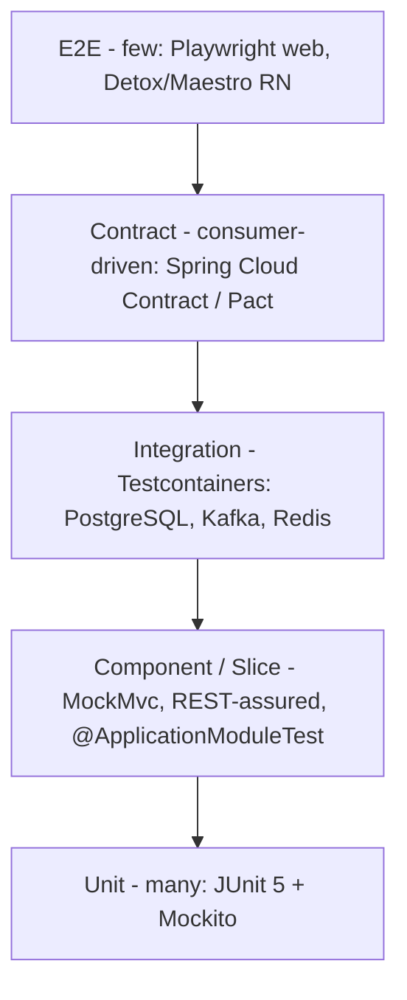

# Testing Strategy

**Document:** `SOC-DOC-DEL-04` · **Status:** Draft for engineering

How we test Societix to the BRD non-functional bar: gate check-in < 1.5 s, zero data loss over a
6-hr gate blackout, 99.95% availability, AI query < 2.5 s, and per-society RLS isolation. Builds on
the architecture in [`../01-architecture.md`](../01-architecture.md) and the acceptance criteria in
[`epics-and-stories.md`](epics-and-stories.md). Coverage gates feed
[`definition-of-done.md`](definition-of-done.md); CI lanes are defined in
[`cicd-devops.md`](cicd-devops.md).

---

## 1. Test pyramid

| Layer | Tooling | What it proves | Where it runs |
|---|---|---|---|
| **Unit** | JUnit 5, Mockito, AssertJ | Pure domain logic (ledger balancing, cadence stages, CRDT merge functions) | PR, every push |
| **Component / slice** | Spring `@WebMvcTest`/MockMvc, REST-assured, `@DataJpaTest` | Controllers, serialization, repository queries, RLS at query level | PR |
| **Modulith boundary** | `@ApplicationModuleTest`, `ApplicationModules.verify()`, ArchUnit | Module encapsulation; no illegal cross-module access | PR |
| **Integration** | Testcontainers (PostgreSQL 16, Kafka, Redis) | Real DB/eventing: outbox→Kafka, webhook→ledger, RLS with real policies | PR integration lane |
| **Contract** | Spring Cloud Contract (preferred) or Pact | Consumer-driven contracts between modules/BFF and the PA webhook shape | PR + nightly |
| **E2E** | Playwright (web console), Detox or Maestro (resident + gate RN) | Headline user journeys across the stack | Nightly + pre-release |

---

## 2. Specialized suites

These exist **because of the NFRs** and get first-class CI lanes.

### 2.1 Multi-tenancy isolation
*Proves RLS prevents cross-tenant reads — the single most important safety test.*
- Seed two tenants (A, B) with overlapping natural keys.
- With session `app.tenant_id = A`, every repository/endpoint returns **only A's rows**; a deliberate
  query for B's IDs returns **zero rows**.
- Fail-closed: with no `app.tenant_id` set, tenant-owned tables return zero rows.
- Run as a Testcontainers integration test with the **real Flyway RLS policies** (not mocked).

### 2.2 Performance / SLA
*Tools: Gatling or k6 against staging-like infra.*
- **Gate check-in < 1.5 s** at **5000 req/s** — measured on the edge-local decision path (SQLite),
  p95 and p99 asserted.
- **AI query < 2.5 s** p95 with warm pgvector embeddings + Redis result cache.
- Soak test toward Yr1 scale (24k units) for memory/connection-pool stability.
- Thresholds are assertions — the job **fails** if p95 regresses past budget.

### 2.3 Offline / CRDT resilience
*Proves zero data loss over a 6-hr gate blackout (FR-4.1).*
- Simulate a 6-hr partition: N check-ins written to local SQLite with no connectivity.
- On reconnect, assert **all N** reconcile via CRDT merge with zero loss and deterministic conflict
  resolution.
- Property-based tests (jqwik) over merge commutativity/idempotency/associativity.

### 2.4 Payment webhook idempotency
*Proves no double-posting and no silent loss (FR-1.3).*
- Replay the same PA webhook (same idempotency key) N times → exactly **one** ledger posting.
- Out-of-order and duplicate deliveries → ledger still balances (debits = credits).
- Unmatched payment → routed to `payment.unmatched`, never dropped.

### 2.5 Compliance (DPDP/RBI)
*First-class gate — a failing compliance test blocks merge/release.*
- **No third-party SDKs:** dependency + build scan asserts zero ad/tracking SDKs present (FR-5.1).
- **30-day purge actually deletes:** advance the clock past TTL → PII hard-deleted from primary and
  replica; a post-purge query finds **zero** residual PII (FR-5.2); the purge action is itself audited.
- **Audit log append-only:** attempt UPDATE/DELETE on the audit table → rejected; hash chain verifies
  tamper-evidence.
- **Consent/masking:** directory lookups honour consent flags; masked fields never leave the API.

---

## 3. Test data & tenant seeding

- **Deterministic fixtures** per tenant via a seeding harness (Flyway test migrations + a
  `TenantSeeder` builder) — realistic societies, units, owners, invoices, visitor logs.
- **Synthetic PII only** — never real resident data in non-prod; generators produce DPDP-safe fakes.
- Each integration test provisions its own tenant(s) and tears down, so suites are order-independent.
- Golden datasets for M6 (sample Tally/MyGate exports) drive ETL reconciliation tests.

---

## 4. Coverage targets

| Scope | Target |
|---|---|
| Domain/core module line coverage | ≥ 85% |
| Overall line coverage (gate) | ≥ 80% |
| Money/vote/purge critical paths | ≥ 95% + mutation testing (PIT) |
| New/changed lines in a PR | ≥ 80% (patch coverage gate) |

Coverage is a floor, not a goal — critical correctness paths (ledger, ballot tally, purge) additionally
carry **mutation testing** to catch assertions that don't actually assert.

---

## 5. Where tests run in CI

| Lane | Trigger | Suites |
|---|---|---|
| Fast | every PR push | unit, slice, Modulith boundary, patch coverage |
| Integration | PR (required to merge) | Testcontainers integration, contract (verify), tenancy isolation |
| Nightly | schedule | full E2E, performance/SLA, soak, mutation |
| Pre-release | release branch | E2E + performance + full compliance suite |

See [`cicd-devops.md`](cicd-devops.md) for the pipeline wiring and quality gates in
[`definition-of-done.md`](definition-of-done.md).
