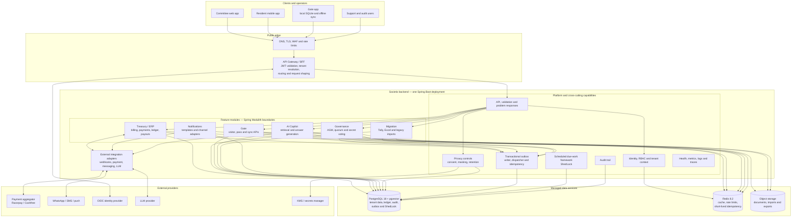
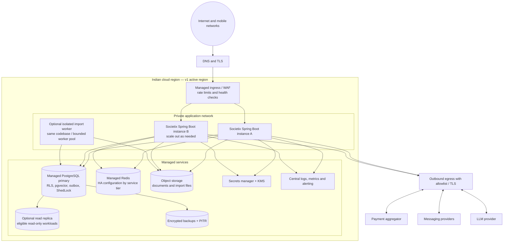

# Societix backend architecture and deployment

**Status:** High-level target design, aligned with the current architecture and ADRs. The repository currently implements the Spring Boot foundation, Society onboarding, outbox dispatch, and shared scheduled-job contracts; many product modules and production cloud resources shown below are planned capabilities, not all implemented services.

## 1. Scope and design goals

Societix is a privacy-first residential community platform. The backend is a **Java 25 / Spring Boot modular monolith**: one deployable application with enforceable internal module boundaries. It starts as a single-region managed deployment and scales by adding stateless application instances and database capacity. Modules are extracted into independent services only when operational or throughput evidence justifies it.

Key constraints:

- PostgreSQL is the source of truth. Tenant-owned rows use `tenant_id` and PostgreSQL Row-Level Security (RLS); requests and background jobs establish tenant context in each transaction.
- Business updates and durable domain events commit together through the PostgreSQL transactional outbox. v1 has no message broker.
- Redis is an accelerator and coordination store, not the source of truth.
- Societix never holds resident payment funds; payment aggregators settle directly to each society.
- Visitor personal data is access-controlled, encrypted where required, and purged according to retention policy.
- Gate operations tolerate offline connectivity; the gate client queues/synchronizes data, while the backend remains the central system of record.

## 2. Logical backend architecture

### Component responsibilities

| Component | Responsibility and boundary |
|---|---|
| Public edge / API Gateway | Terminates public traffic, validates identity tokens, applies quotas, resolves tenant claims, routes requests, and shapes API responses. The gateway is an edge concern; it is not a feature module. |
| Platform | Shared technical capabilities: tenant context and authorization hooks, API error handling, outbox, scheduling, audit, privacy primitives, and operational telemetry. It should not depend on feature modules. |
| Treasury | Bills, payment matching, double-entry ledger, arrears workflow, and maker-checker payouts. Payment processing records state and outbox events in a single database transaction. |
| Governance | Meeting notices, attendance/quorum, voting, resolutions, and handover records. Secret-ballot design is isolated behind the module boundary. |
| Gate | Visitor and pass workflows plus synchronization endpoints. Offline decisions and queued actions live on the gate device until synchronization. |
| Privacy | Consent, data visibility, retention policy, and personal-data deletion. It operates with the owning module's data contracts and audit requirements. |
| AI Copilot | Retrieves authorized society documents/data (including pgvector-backed knowledge) and calls an LLM through an adapter. Sensitive records remain tenant-scoped and are minimized before external calls. |
| Migration | Validates, imports, and reconciles society data from legacy exports. Large source files belong in object storage; import state and business records remain in PostgreSQL. |
| Notifications | In-app and external-channel delivery, driven by events or due-work jobs. Provider calls use retries and idempotency keys. |
| Integration adapters | Encapsulate provider-specific APIs, signatures, retries, timeouts, and mapping. Provider failure must not corrupt financial state. |

### Main interaction patterns

1. **Synchronous request:** client → edge → backend API → module → PostgreSQL. Tenant identity is authenticated, then `app.tenant_id` is set locally within each database transaction; RLS is the database backstop.
2. **Reliable asynchronous reaction:** module changes business rows and inserts an outbox row in the same transaction → a ShedLock-guarded poller dispatches the event → an idempotent handler updates state or calls an adapter. Delivery is at least once.
3. **Time-based work:** the shared daily scheduler obtains a database lock and invokes module-owned due-work jobs. Each module owns its own due-row query, tenant scoping, transaction, and retry/idempotency policy.
4. **Large files:** upload/download through object storage using short-lived scoped access; PostgreSQL stores ownership, metadata, status, and references. Do not store file bytes in Redis or ordinary relational rows.

## 3. Deployment architecture — v1 target

**Deployment notes:** The Spring Boot app is stateless between requests and can run as multiple instances behind ingress. PostgreSQL is authoritative and private; Redis, object storage, secrets, and backups are managed services. The outbox poller and daily jobs may initially run inside each app instance because ShedLock coordinates execution. A separate worker deployment is an operational scale option using the same codebase and shared database lock. Flyway migrations run once as a controlled release step, before compatible application instances are rolled out. Dev, staging, and production should use the same topology with environment-specific size and secrets.

## 4. Scale-up path

Scale from measured bottlenecks, keeping the modular monolith as the default:

| Pressure / signal | First scale step | Later step / guardrail |
|---|---|---|
| API CPU or request latency | Add stateless app instances; tune connection pools and bounded thread pools; cache safe reference reads. | Split only a proven hot module behind stable API/event contracts. |
| PostgreSQL CPU, I/O, or connections | Tune indexes/queries, pool limits, vacuum, and instance size; keep writes on primary. | Add read replicas for explicitly read-only workloads; partition large append-heavy tables by tenant/time; archive per retention policy. RLS and tenant context remain mandatory. |
| Outbox lag / event throughput | Tune batch size and poll delay; improve handler duration and tenant-fairness; monitor oldest pending age. | Run dedicated relay/worker instances; use `FOR UPDATE SKIP LOCKED`/partitioned queue ownership if concurrency is needed; add Kafka only when lag, replay, or service extraction warrants it. Preserve event contracts and idempotency. |
| Long-running imports or exports | Put file bytes in object storage; process in bounded batches with resumable job state. | Scale isolated workers independently from API replicas; enforce per-tenant quotas and backpressure. |
| Cache contention or rate traffic | Size Redis and separate keyspaces/TTLs; ensure database remains source of truth. | Redis cluster/sharding by tenant or workload; avoid caching sensitive data without tenant-aware keys and expiry. |
| Availability / regional failure | Managed DB failover, tested restore, multi-zone app replicas, rolling deploys, and health-based traffic removal. | Passive Hyderabad region with PostgreSQL replication and documented failover/failback; active-active writes require a separate conflict and data-residency design. |
| Module team/deployment independence | Enforce Modulith boundaries and publish stable API/event contracts. | Extract a module only when independent scaling/release or fault isolation benefit exceeds distributed-system cost. Each extracted service must preserve tenant authorization, idempotency, audit, and outbox semantics. |

### Scale and reliability principles

- **Scale stateless compute horizontally first.** Keep sessions and coordination in shared services; graceful shutdown should stop new work and finish or release locks safely.
- **Protect the database.** Bound connection pools across all replicas, index actual query patterns, avoid unbounded batch reads, and keep expensive AI/import work away from latency-sensitive request threads.
- **Use read replicas carefully.** Replication lag means they are unsuitable for read-after-write, payment decisions, authorization, or other strongly consistent reads unless the workflow explicitly tolerates stale data.
- **Keep asynchronous work bounded.** Track queue depth and oldest-event age, cap retries/backoff, isolate poison events, and make handlers idempotent. ShedLock prevents duplicate scheduled runs; it is not a substitute for idempotency or queue-level concurrency control.
- **Tenant fairness is a capacity control.** Apply per-tenant rate limits and quotas, process background work in tenant-fair batches, and prevent one society's import or event burst from starving others.
- **Design migrations for rolling deploys.** Use expand → migrate → contract. Avoid schema changes that make old and new app versions incompatible during a rolling release.
- **Measure before adding infrastructure.** Start with Actuator, structured logs, database/outbox health and SLOs; add OpenTelemetry dashboards/tracing, workers, broker, partitions, or regions in response to measured limits.

## 5. Security and operations baseline

- TLS at public and provider boundaries; private networking for database and cache.
- OIDC/JWT authentication and role checks at the edge/application; tenant-scoped SQL and forced RLS at PostgreSQL.
- Runtime DB identity has least privilege and does not own tables or bypass RLS. Migration identity is separate.
- Secrets and encryption keys come from a secrets manager/KMS; never bake them into images or commit them.
- Redact PII from logs. Include trace/correlation IDs and operational identifiers; retain audit records according to policy.
- PostgreSQL automated backups and point-in-time recovery are exercised with restore drills; object storage has versioning/retention policies appropriate to each data class.
- Monitor availability, latency, error rate, PostgreSQL saturation, Redis health, outbox lag, scheduled-job outcomes, payment-match lag, and privacy-purge lateness.

## 6. Architecture status and references

This is the **target backend HLD**, not a claim that each box is already running in production. Current code is a Spring Boot modular monolith foundation with Platform/Society, outbox processing, and scheduled-job contracts. The API Gateway/BFF, identity integration, product feature modules, external adapters, and managed-cloud topology are documented design capabilities with implementation staged by backlog.

References: [System architecture](../archive/01-architecture.md), [System design](../archive/02-system-design.md), [How it works](../02-how-it-works.md), [ADR-0007: supported baseline](../adr/0007-maven-supported-version-baseline.md), [ADR-0008: PostgreSQL outbox](../adr/0008-postgres-outbox-no-broker.md), and [CI/CD and DevOps](../archive/delivery/cicd-devops.md).
