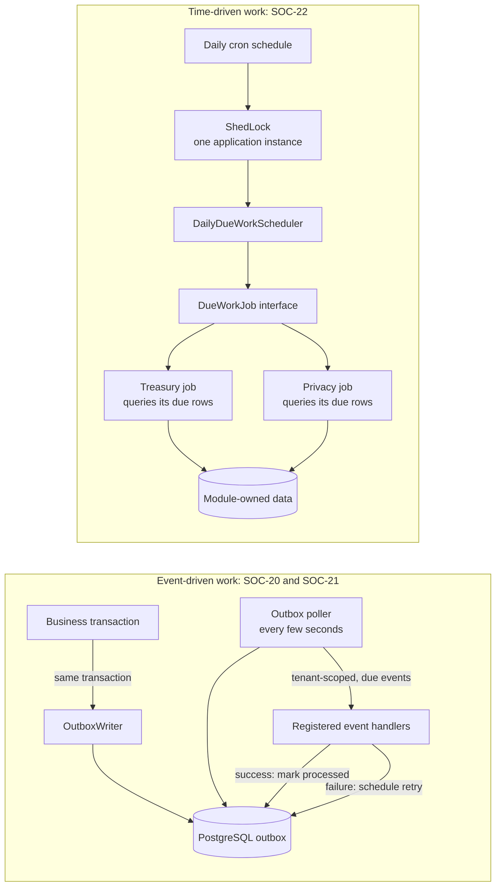

# Outbox and scheduled jobs (SOC-20–SOC-22)

## Purpose

Societix uses PostgreSQL for durable event delivery and time-based automation. SOC-20 records events atomically with business changes; SOC-21 dispatches those events; SOC-22 provides a separate daily scheduling mechanism for work that becomes due after time passes.

## Design

### SOC-20 — Store events in the business transaction

`V4__create_outbox.sql` creates the tenant-scoped `outbox` table, enables PostgreSQL Row-Level Security (RLS), and indexes pending rows. A producer calls `OutboxWriter.append(OutboxEvent)` while its business transaction is active. The business update and event insert therefore commit or roll back together; there is no separate broker write that can be lost between the two.

Each event contains a society ID, event type, JSON payload, generated UUID, and creation time. `OutboxEvent` is the producer input; `OutboxMessage` is the persisted form delivered to handlers.

### SOC-21 — Dispatch events with retries

`OutboxPoller` wakes every few seconds. ShedLock uses the database `shedlock` table so only one application instance drains the queue at a time. The poller discovers societies with due events, then reads event IDs under each society's RLS context. `OutboxEventProcessor` locks each row, finds handlers by event type, records a unique `(society, event, handler)` receipt, invokes handlers, and marks the event processed in a transaction. Failed dispatches remain pending; `OutboxFailureRecorder` increments attempts and delays the next try.

This is at-least-once delivery. Database-backed handler work shares the dispatch transaction and receipt; external calls must also use the event UUID as an idempotency key because PostgreSQL cannot roll back a remote side effect.

### SOC-22 — Run work when its due time arrives

`DailyDueWorkScheduler` runs at the configured cron time (default 02:00 UTC) and holds the `societixDailyDueWork` ShedLock. It calls each registered `DueWorkJob`. The Platform module provides the scheduling contract; each feature module owns its query, tenant scoping, transaction, and processing rules. Treasury and Privacy can implement the same interface without sharing tables or persistence models. Jobs should select rows whose due timestamp is at or before the current time and make processing safe to retry.

SOC-22 is distinct from the outbox poller: the poller checks frequently for newly recorded events, while the daily scheduler runs time-based queries. A due-work job may emit an outbox event when its result needs event-driven follow-up.

## Main code locations

| Concern | Files |
|---|---|
| Outbox schema and dispatch support | `backend/src/main/resources/db/migration/V4__create_outbox.sql`, `V5__configure_outbox_dispatch.sql` |
| Event contract and writer | `platform/outbox/OutboxEvent.java`, `OutboxMessage.java`, `OutboxWriter.java`, `OutboxEventHandler.java` |
| Polling, tenant reads, retries, processing | `platform/outbox/internal/OutboxPoller.java`, `OutboxTenantBatchReader.java`, `OutboxEventProcessor.java`, `OutboxFailureRecorder.java` |
| ShedLock and scheduling | `platform/outbox/internal/OutboxSchedulingConfiguration.java`, `platform/jobs/DueWorkJob.java`, `platform/jobs/internal/DailyDueWorkScheduler.java` |
| Integration coverage | `Outbox*IT.java`, `ScheduledJobsIT.java` |

## Configuration and boundaries

- Outbox polling defaults to every 3 seconds and a batch size of 100 (`societix.outbox.poll-delay-ms`, `societix.outbox.batch-size`).
- Daily due work defaults to 02:00 UTC (`societix.jobs.daily-cron`, `societix.jobs.zone`).
- Tenant-owned data stays protected by RLS. Outbox handling sets the society context inside each database transaction.
- Platform owns the generic scheduling and event infrastructure. Feature modules own event handlers and due-work queries.

## Verification

The integration tests use PostgreSQL Testcontainers. `OutboxWriterIT`, `OutboxPollingIT`, and `OutboxEventProcessorIT` cover event persistence and dispatch; `ScheduledJobsIT` covers due-time selection, reuse by Treasury/Privacy-shaped jobs, and ShedLock exclusion across instances. Run with `cd backend && ./mvnw test`.
