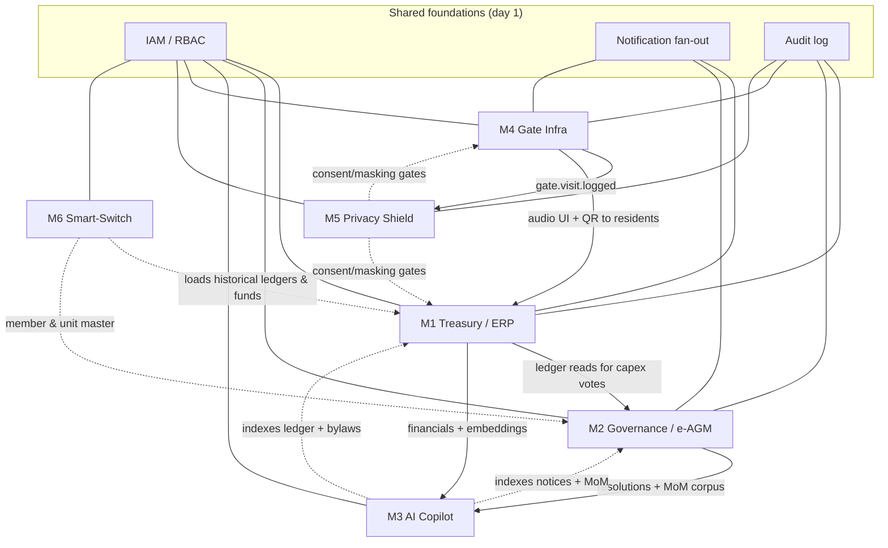

# Modules — Index & Dependency Map

**Document:** `SOC-DOC-MODULES` · **Source BRD:** `SOC-BRD-2026-V1` §8–9 · **Status:** Draft for engineering

This folder holds the per-module engineering specifications. Each module maps **1:1** to a BRD
functional block and carries its own document (`SOC-DOC-M<n>`). Read the
[Architecture anchor](../01-architecture.md) first — it defines the C4 views, the Kafka topic
catalogue, and the RLS multi-tenancy model that every module below assumes. Domain terms are in the
[glossary](../glossary.md).

> **Shared foundations** (not numbered modules): **IAM/RBAC**, **Notification fan-out**
> (in-app → WhatsApp → SMS → IVR), and the append-only **Audit log** are cross-cutting services
> consumed by all six modules. They are specified in [`../02-system-design.md`](../02-system-design.md).

## The six modules

| # | Module | BRD FRs | One-line purpose | Doc |
|---|--------|---------|------------------|-----|
| **M1** | Autopilot Treasury, Billing & Double-Entry ERP | FR-1.1 … FR-1.5 | Zero-touch collections, defaulter cadence, and an auditable double-entry ledger | [module-1-treasury-erp.md](module-1-treasury-erp.md) |
| **M2** | Statutory Governance & e-AGMs | FR-2.1 … FR-2.4 | Statutory notices, live quorum, cryptographic balloting, committee handover | [module-2-governance-agm.md](module-2-governance-agm.md) |
| **M3** | AI Committee Copilot | FR-3.1 … FR-3.4 | Grounded NL analytics, auto-MoM, bylaw advisor, tender comparison | [module-3-ai-copilot.md](module-3-ai-copilot.md) |
| **M4** | Offline Gate Infrastructure | FR-4.1 … FR-4.3 | Offline-authoritative gate: SQLite edge sync, multilingual UI, smart access | [module-4-gate-infra.md](module-4-gate-infra.md) |
| **M5** | DPDP Act Privacy Shield | FR-5.1 … FR-5.3 | Zero-ad guarantee, 30-day PII purge, granular resident consent/masking | [module-5-privacy-shield.md](module-5-privacy-shield.md) |
| **M6** | Smart-Switch Migration | FR-6.1 … FR-6.3 | Automated ETL ingest, balance verification, zero-downtime parallel run | [module-6-smart-switch.md](module-6-smart-switch.md) |

## Dependency graph (build & runtime)

Solid arrows are **runtime** dependencies (A calls/consumes from B); dashed arrows are
**build/bootstrap** dependencies (A needs B's data or schema to exist first).

Key relationships worth internalizing:

- **M1 is the financial spine.** Its double-entry ledger underpins M2's capex/fund-hike voting
  (resolutions reference fund balances) and is the primary corpus M3 queries over. M6's migration
  succeeds only when it can reconstruct M1's ledger and sinking funds.
- **M4 feeds M5.** Every `gate.visit.logged` event carries visitor PII with a 30-day TTL; M5's purge
  scheduler is driven by those events.
- **M3 reads, rarely writes.** It indexes M1 (ledger), M2 (notices/MoM), and bylaws into pgvector; it
  produces drafts (MoM, tender matrices) for humans to approve.
- **M5 is a cross-cutting gate**, not a downstream leaf: its consent/masking decisions constrain what
  M1 (directory) and M4 (gate directory lookups) may expose.

## Recommended build order (→ BRD delivery phases)

See [`../delivery/development-plan.md`](../delivery/development-plan.md) for the sprint breakdown.

| Phase | Modules | Rationale |
|---|---|---|
| **Phase 0 (foundations)** | IAM/RBAC · Notification · Audit · RLS tenancy · Kafka/outbox | Everything depends on tenancy, identity, eventing, and the audit trail. |
| **Phase 1** | **M1** + **M4** | The two revenue/retention anchors: treasury (the "minimise the secretary" value) and the gate (daily-touch security). Independent enough to build in parallel. |
| **Phase 2** | **M2** + **M3** + **M6** | M2 needs M1's ledger (capex votes); M3 needs M1+M2 corpora to index; M6 migrates data *into* M1/M2 and is best built once their schemas are stable. |
| **Cross-cutting (day 1 → always-on)** | **M5** | The zero-ad / purge / consent guarantees must hold from the first line of code — M5 is designed in from Phase 0, not bolted on, and its purge worker goes live with M4 in Phase 1. |

> **Build-order invariant:** never ship a module that writes resident/visitor PII before M5's consent
> and purge controls cover that data path. M5 is a precondition, not a successor.
