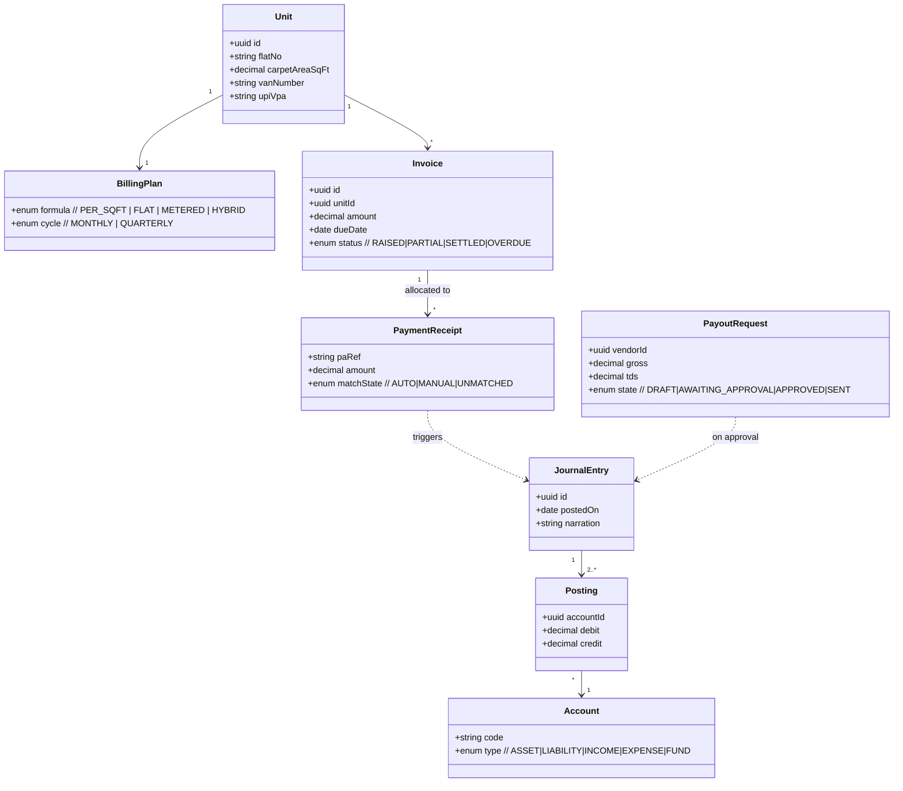
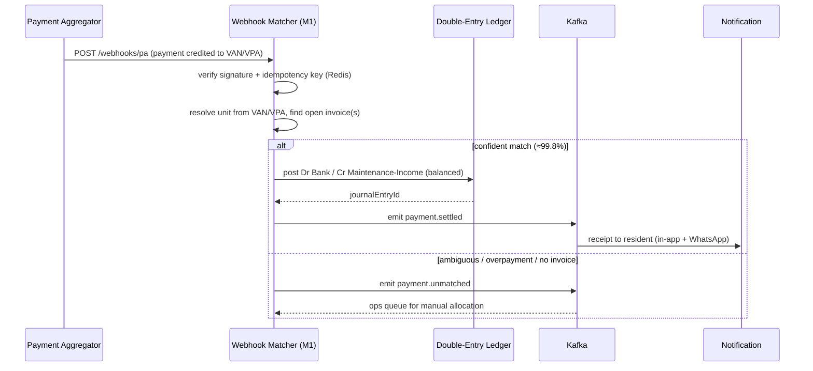
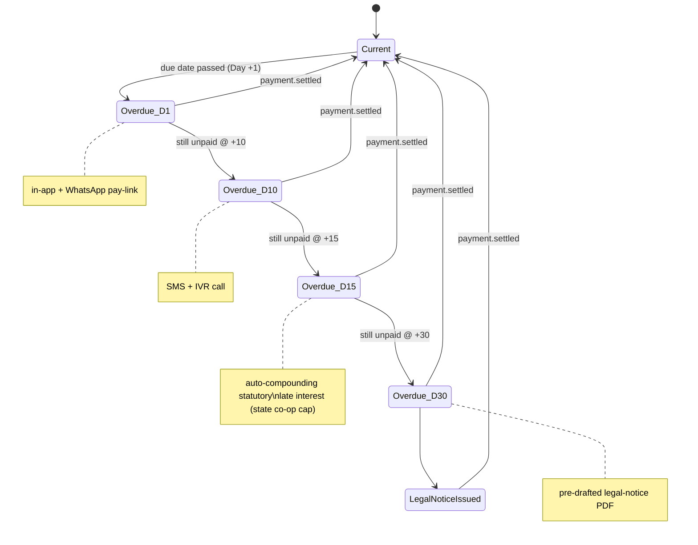

# M1 — Autopilot Treasury, Billing & Double-Entry ERP

**Document:** SOC-DOC-M1 · **BRD FRs:** FR-1.1 … FR-1.5

> Anchors: [Architecture](../01-architecture.md) · [Glossary](../glossary.md) ·
> [Data model](../03-data-model.md) · [API spec](../04-api-specification.md) ·
> Deep dive: [dd-01 Double-Entry Ledger](../deep-dives/dd-01-double-entry-ledger.md).

## 1. Purpose & scope

M1 is the financial spine of Societix. It bills every unit, collects dues **zero-touch** via per-flat
Virtual Account Numbers (VAN) and UPI VPAs, auto-reconciles settlement webhooks to invoices,
escalates defaulters through a statutory cadence, and records every rupee in a real-time
**double-entry ledger** that produces a Trial Balance, P&L, and Balance Sheet on demand. Vendor
payouts run under **maker-checker** dual control with automated TDS and GST ITC tracking.

**Hard constraint — no float.** Money never flows through Societix. The Payment Aggregator (PA)
collects into the society's own VANs/VPA and settles to the society bank account; M1 only *observes*
via webhooks and *instructs* payouts. See [ADR-0003](../adr/0003-payment-aggregator-no-float.md).

**Out of scope:** holding balances, lending, acting as an escrow/wallet, or tax filing (M1 computes
TDS/GST figures and produces reports; filing is the society's responsibility).

## 2. Functional requirements (traceability)

| FR-id | Requirement | Notes |
|---|---|---|
| FR-1.1 | Multi-Formula Billing Engine | per-sq-ft carpet area / flat rate / metered sub-utilities / hybrid; monthly or quarterly cycles |
| FR-1.2 | Static VAN + dynamic UPI VPA per flat; webhook auto-matching | target **99.8% zero-touch** allocation; unmatched → ops queue |
| FR-1.3 | Escalating Defaulter Cadence | Day +1 in-app+WhatsApp pay-link → +10 SMS+IVR → +15 auto-compounding statutory late interest (state co-op caps) → +30 pre-drafted legal-notice PDF |
| FR-1.4 | Real-time Double-Entry Ledger | CoA: Sinking / Repair / Reserve / Common Maintenance funds; auto Trial Balance, P&L, Balance Sheet — see [dd-01](../deep-dives/dd-01-double-entry-ledger.md) |
| FR-1.5 | Maker-Checker Vendor Payments | payout initiation vs approval split; automated TDS calc; GST ITC tracking |

## 3. Domain model

Key aggregates: **Invoice** (billing run output per unit), **LedgerEntry/Posting** (append-only
double-entry lines), **PaymentReceipt** (from PA webhook), **PayoutRequest** (maker-checker), and the
**ChartOfAccounts / Fund** structure. Full schema (including the balanced-posting constraint and RLS
policies) is in [`../03-data-model.md`](../03-data-model.md) and
[dd-01](../deep-dives/dd-01-double-entry-ledger.md).

## 4. Key workflows

### 4.1 Zero-touch payment → ledger allocation (FR-1.2, FR-1.4)

The webhook handler and ledger posting share one DB transaction with the **transactional outbox**, so
`payment.settled` is emitted iff the posting committed (see
[Architecture §5](../01-architecture.md#5-event-driven-topology)).

### 4.2 Defaulter cadence state machine (FR-1.3)

Each transition emits `defaulter.stage.advanced`; a `payment.settled` for the unit resets state to
`Current` and halts further escalation (idempotent — late/duplicate webhooks do not re-charge).

## 5. APIs

Full conventions and schemas in [`../04-api-specification.md`](../04-api-specification.md).

| Method | Path | Purpose | Roles |
|---|---|---|---|
| POST | `/api/v1/billing/runs` | Trigger a billing run for a cycle | Treasurer |
| GET | `/api/v1/units/{id}/invoices` | List a unit's invoices | Treasurer, Owner (own) |
| GET | `/api/v1/units/{id}/van` | Fetch VAN/VPA for a unit | Treasurer, Owner (own) |
| POST | `/api/v1/webhooks/pa` | PA settlement webhook (signed) | PA (service) |
| POST | `/api/v1/payments/{id}/allocate` | Manual allocation of an unmatched receipt | Treasurer |
| GET | `/api/v1/ledger/trial-balance` | Trial Balance as of date | Treasurer, Auditor |
| GET | `/api/v1/ledger/reports/{pnl\|balance-sheet}` | Financial statements | Treasurer, Auditor |
| GET | `/api/v1/defaulters` | Defaulter list with cadence stage | Treasurer |
| POST | `/api/v1/payouts` | Create vendor payout (maker) | Treasurer |
| POST | `/api/v1/payouts/{id}/approve` | Approve payout (checker ≠ maker) | Committee member |

## 6. Events

From the [Architecture topic catalogue](../01-architecture.md#5-event-driven-topology) (keyed by `tenantId`):

**Produces:** `billing.invoice.raised`, `payment.settled`, `payment.unmatched`,
`defaulter.stage.advanced`, `audit.action.recorded`.
**Consumes:** `payment.settled` (Ledger + Cadence), `billing.invoice.raised` (Ledger).

## 7. Acceptance criteria

- **FR-1.2 / 99.8% zero-touch** — *Given* a PA credit to a unit's VAN matching one open invoice,
  *When* the signed webhook is received, *Then* the receipt is allocated, a balanced journal entry is
  posted, and `payment.settled` emitted with **no human action**; measured over a billing cycle,
  ≥ 99.8% of receipts settle zero-touch and the remainder land in the unmatched ops queue.
- **FR-1.1** — *Given* a HYBRID plan (per-sq-ft base + metered water), *When* a monthly run executes,
  *Then* each unit's invoice equals `carpetArea × rate + metered charge` to the paisa.
- **FR-1.3** — *Given* an invoice unpaid at +15 days, *When* the cadence advances, *Then* statutory
  late interest is compounded at or below the state co-op cap and never applied twice for one period.
- **FR-1.4** — *Given* any posted period, *When* the Trial Balance is requested, *Then* total debits
  equal total credits (the balanced-posting invariant holds) and fund balances reconcile.
- **FR-1.5** — *Given* a payout, *When* the maker also attempts approval, *Then* the system rejects it
  (checker must differ from maker) and TDS/GST ITC figures are computed and recorded.

## 8. Edge cases & failure modes

- **Overpayment / part-payment:** allocate to oldest open invoice; residual becomes a credit balance
  (not float — it sits as a liability to the unit on the society's books).
- **Duplicate / replayed webhook:** idempotency key (Redis) + unique `paRef` constraint — no double
  posting, no double receipt.
- **Unknown VAN or ambiguous match:** emit `payment.unmatched`; never guess a posting.
- **State interest cap change mid-cycle:** cadence reads the effective cap at accrual time, versioned.
- **PA outage:** collections pause (no float to fall back on); billing/ledger continue; webhooks
  replay on recovery.
- **Clock/timezone:** cadence day-counting is IST calendar-day based, not 24-hour deltas.

## 9. Dependencies

- **Internal:** IAM/RBAC (maker-checker roles), Notification (reminders/receipts), Audit (every
  posting & payout), M6 (loads opening balances), M2 (reads fund balances for capex votes),
  M3 (indexes the ledger), M5 (consent/masking on the resident directory).
- **External:** Payment Aggregator (Razorpay/Cashfree) for VAN/VPA + payouts; WhatsApp/SMS/IVR.

## 10. Open questions

- Which states' interest-cap tables ship in v1, and how are updates governed (config vs code)?
- Legal-notice PDF: per-state template set — owned by legal or product?
- GST ITC: do we need e-invoice (IRN) integration in v1 or report-only?
- Refund/chargeback path from PA — ledger reversal semantics and resident notification.
