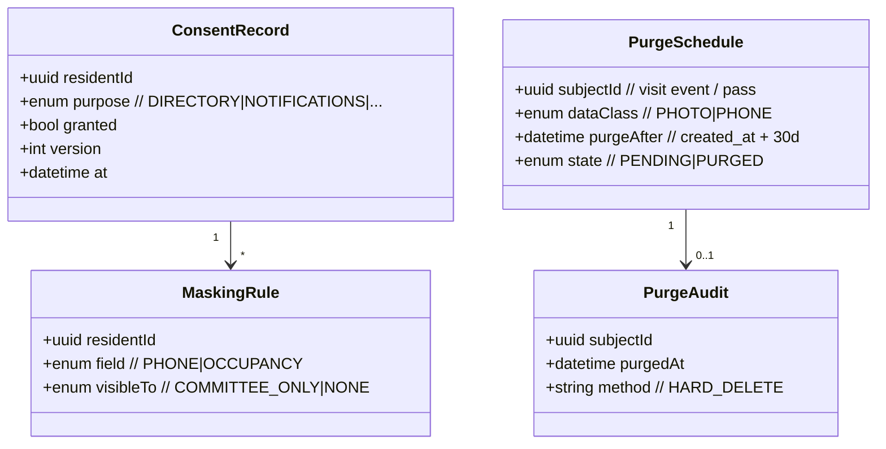
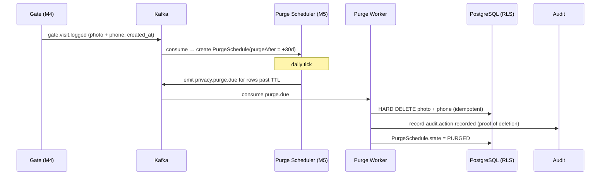

# M5 — DPDP Act Privacy Shield

**Document:** SOC-DOC-M5 · **BRD FRs:** FR-5.1 … FR-5.3

> Anchors: [Architecture](../01-architecture.md) · [Glossary](../glossary.md) ·
> [Data model](../03-data-model.md) · [API spec](../04-api-specification.md) ·
> Compliance: [`../05-security-compliance.md`](../05-security-compliance.md).

## 1. Purpose & scope

M5 operationalizes Societix's core promise: **privacy by construction**, compliant with the
**DPDP Act 2023** (society = Data Fiduciary, Societix = Data Processor). It enforces the **zero-ad /
zero third-party-tracking** guarantee, auto-**purges visitor PII (photos + phone numbers) after 30
days**, and gives residents **granular consent** to mask their directory details (phone, occupancy)
without losing security access.

**Cross-cutting, not downstream.** M5 is not a leaf module — its consent and masking decisions **gate**
what M1 (resident directory) and M4 (gate directory lookups) may expose, and its purge worker consumes
`gate.visit.logged` from M4. It is designed in from Phase 0 (see
[modules/README](README.md#recommended-build-order--brd-delivery-phases)).

**Out of scope:** the society's own lawful-basis decisions (that is the Fiduciary's call); M5 provides
the mechanisms and evidence, not the legal determination.

## 2. Functional requirements (traceability)

| FR-id | Requirement | Notes |
|---|---|---|
| FR-5.1 | Zero-Ad SDK Guarantee | no third-party ad/tracking SDKs anywhere; enforced in build + CI (SBOM/dependency allowlist) |
| FR-5.2 | 30-Day Auto Data Purge | visitor facial photos + phone numbers hard-deleted after 30 days |
| FR-5.3 | Granular Resident Consent | self-manage directory masking of phone/occupancy without losing security access |

## 3. Domain model

Key entities: **ConsentRecord** (per resident, per purpose, versioned), **MaskingRule** (what is
hidden from whom), **PurgeSchedule** (TTL-driven deletion of PII), and **PurgeAudit** (proof of
deletion). Encryption of PII columns uses per-tenant envelope keys (see
[Architecture §6](../01-architecture.md#6-multi-tenancy-model)).



Full schema + key management in [`../03-data-model.md`](../03-data-model.md) and
[`../05-security-compliance.md`](../05-security-compliance.md).

## 4. Key workflows

### 4.1 30-day purge scheduler (FR-5.2)



The purge is a **hard delete** of the PII columns (not a flag); visit *metadata* needed for audit
(timestamps, allow/deny) may be retained in de-identified form per the society's policy.

### 4.2 Consent / directory masking (FR-5.3)

```mermaid
stateDiagram-v2
    [*] --> Default: resident onboarded (safe defaults)
    Default --> Masked: resident hides phone/occupancy
    Masked --> Default: resident unmasks
    Masked --> SecurityException: gate needs contact for active visit
    SecurityException --> Masked: visit ends
    note right of Masked: directory hides field from\nother residents; committee/gate\nretain minimal security access
    note right of SecurityException: masking never blocks a\nlegitimate security need
```

Masking governs **directory visibility**, not the existence of the data — a resident can hide their
phone from neighbours while the gate still reaches them for an active visitor. Every consent change is
versioned and audited.

## 5. APIs

Full conventions in [`../04-api-specification.md`](../04-api-specification.md).

| Method | Path | Purpose | Roles |
|---|---|---|---|
| GET | `/api/v1/privacy/consent` | View my consent/masking state | Resident, Tenant |
| PUT | `/api/v1/privacy/consent` | Update consent / masking rules | Resident, Tenant |
| GET | `/api/v1/privacy/purge/status` | Purge-schedule / compliance report | Secretary, Auditor |
| POST | `/api/v1/privacy/dsr` | DPDP data-subject request (access/erasure) | Resident, Tenant |
| GET | `/api/v1/privacy/sdk-attestation` | Zero-ad/no-tracking SBOM attestation | Auditor, Platform admin |

## 6. Events

From the [topic catalogue](../01-architecture.md#5-event-driven-topology):

**Produces:** `privacy.purge.due` (→ purge worker), `audit.action.recorded` (consent changes + proof
of deletion).
**Consumes:** `gate.visit.logged` (M4) to schedule purges; resident consent updates.

## 7. Acceptance criteria

- **FR-5.2 / 30-day purge** — *Given* a visitor photo and phone captured on day 0, *When* day 30
  passes, *Then* both are hard-deleted, a `PurgeAudit` proof exists, and the purge is idempotent
  (re-running deletes nothing new and errors on nothing).
- **FR-5.1 / zero-ad** — *Given* a production build, *When* CI runs the dependency/SBOM check, *Then*
  the presence of **any** third-party ad or tracking SDK fails the build; the attestation endpoint
  reflects a clean bill.
- **FR-5.3** — *Given* a resident masks their phone, *When* another resident views the directory,
  *Then* the phone is hidden; *When* the gate has an active visit for that resident, *Then* security
  access still functions. Consent state is versioned and auditable.
- **DPDP DSR** — *Given* an erasure request, *When* processed, *Then* the resident's personal data is
  deleted/anonymized within the policy window with an audit trail, subject to statutory retention.

## 8. Edge cases & failure modes

- **Purge during backup/replica lag:** deletion must propagate to standby (Hyderabad) and backups per
  retention policy — "deleted" means deleted everywhere recoverable.
- **Legal hold vs purge:** an active legal hold (e.g. M1 legal-notice case) suspends purge for the
  specific records, logged with justification.
- **Masking vs security tension:** masking never blocks a legitimate active-visit contact path; the
  exception is scoped and time-boxed.
- **Consent race:** last-writer-wins by version; stale client updates rejected.
- **Purge worker crash mid-batch:** idempotent per-row; resumes without double-auditing.
- **Zero-ad regression via transitive dep:** SBOM allowlist checks the full dependency tree, not just
  direct deps.

## 9. Dependencies

- **Internal:** M4 (source of visitor PII + `gate.visit.logged`), M1 (resident directory masking,
  legal-hold signals), M3 (masked fields excluded from retrieval), Audit (proof of deletion), IAM.
- **External:** CI/SBOM tooling (dependency allowlist), per-tenant KMS/envelope keys, backup/replica
  subsystem for propagated deletion.

## 10. Open questions

- Exact de-identified metadata retained post-purge vs fully deleted — policy per society or global?
- DSR SLA window and the interaction with statutory retention (e.g. financial records under M1).
- Legal-hold ownership: who can place/lift a hold, and its audit requirements?
- Consent-version schema: how far back do we retain prior consent states for proof?
